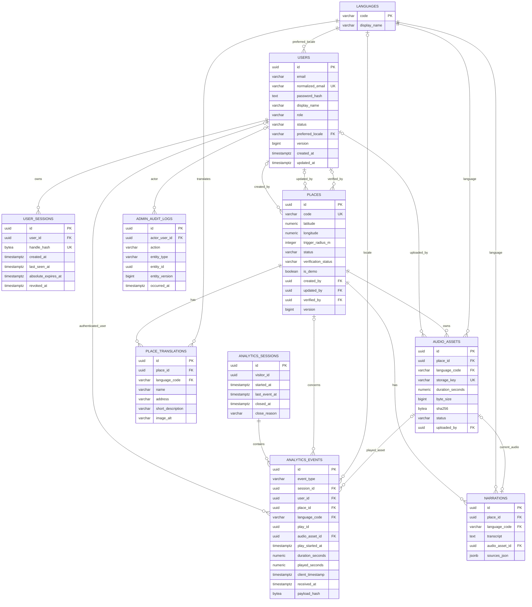

# Saigon Guide — ERD và đặc tả cơ sở dữ liệu

## 1. Trạng thái và phạm vi

| Thuộc tính | Giá trị |
|---|---|
| Phiên bản | 1.1 — thiết kế đối chiếu implementation |
| Cơ sở | PRD 1.0, DEC-01 đến DEC-08 đã được người dùng chấp nhận |
| Database | PostgreSQL 17, EF Core 10/Npgsql tương thích |
| Phạm vi | ERD, từ điển dữ liệu, PK/FK, NULL, unique/check/index, giao dịch và vòng đời dữ liệu |
| Thực thi | EF migrations đã chạy trên PostgreSQL17; integration test DB thật và Docker smoke đã thực hiện; xem báo cáo kiểm thử |

Tài liệu này cụ thể hóa mô hình dữ liệu đã chốt. Admin và Analytics thuộc Must Have. Cùng bảng `users` sẵn sàng chứa role `User`, nhưng đăng ký/hồ sơ/quản lý khách vẫn là Should Have; thiết kế khả năng lưu không đồng nghĩa đã đưa chức năng đó vào Sprint. Không tạo Guest row, lịch sử GPS, bảng visitor riêng, role nhiều-nhiều, bảng KPI tổng hợp hay PostGIS.

Tên vật lý dùng `snake_case`, tên entity C# tương ứng PascalCase. Hợp đồng JSON camelCase sẽ được xác định trong API Specification tiếp theo. Các câu SQL minh họa là đặc tả thiết kế; migration thực tế nằm tại apps/api/Data/Migrations. Tên index do EF sinh có thể khác tên minh họa nhưng giữ cùng ràng buộc/truy vấn.

## 2. Quy ước dữ liệu chung

- PK entity dùng `uuid`, server sinh bằng UUID ngẫu nhiên qua thư viện chuẩn; không cần extension PostgreSQL riêng để có ID. ID không là token xác thực.
- Các mốc thời gian dùng `timestamptz`, server gán; lưu thời điểm tuyệt đối, trình bày/tổng hợp theo Asia/Ho_Chi_Minh. Không dùng giờ client làm thời gian tạo/cập nhật hoặc nhóm KPI.
- Mã ngôn ngữ `varchar(2)`, chỉ `vi/en`. Chuỗi enum lưu `varchar` + CHECK, ánh xạ enum C#; chưa dùng PostgreSQL enum để dễ migration.
- `NN` = NOT NULL; `NULL` = có thể thiếu. Chuỗi bắt buộc phải có CHECK `length(btrim(value)) > 0`; giới hạn varchar tính ký tự, không phải byte. Không tự trim mật khẩu trước hash.
- `created_at` mặc định thời gian server; `updated_at ≥ created_at`. Tất cả audit/event timestamp lấy từ server. Defaults không phải cơ chế cho phép client truyền giá trị.
- Mỗi aggregate Place và User có `version bigint NOT NULL DEFAULT 1 CHECK(version > 0)`. Service update theo `WHERE id = ... AND version = expected`, tăng version đúng một lần trong giao dịch; 0 hàng cập nhật là conflict. Không dùng `xmin` làm version public.
- Default FK là `ON DELETE RESTRICT`, trừ trường hợp ghi khác. Không tự cascade xóa nội dung hoặc Analytics. Không cho ứng dụng dùng quyền superuser/DDL khi chạy thông thường.
- Draft có thể thiếu dữ liệu; publish gate không được suy ra chỉ từ NOT NULL. Mục 7 nêu điều kiện nhiều bảng phải kiểm trong giao dịch.

## 3. ERD tổng thể

Sơ đồ hiển thị cột chính và các quan hệ; danh sách đầy đủ cột nằm ở mục 5. Mỗi child chỉ có tối đa một parent của từng quan hệ. Ký hiệu `o|` ở đầu parent là FK nullable; `o{` ở đầu child là 0..n child. Quan hệ audit target đa hình là ID snapshot, được giải thích ở mục 5.10 và không vẽ thành FK giả.



**Ràng buộc cần đọc cùng sơ đồ:** một audio hiện hành chỉ gắn tối đa một narration; Narration có thể chưa có audio lúc nháp. Composite FK đảm bảo audio cùng Place và Language với narration/event. Sự kiện completed liên hệ start bằng `(session_id, play_id)` theo nghiệp vụ, không có self-FK: khi retention xóa start cũ hơn ngưỡng nhưng completion còn trong hạn, completion đã được xác thực vẫn phải được giữ. Snapshot duration/start time phục vụ mục đích này; xem mục 5.9/8.

## 4. Tóm tắt quan hệ và ràng buộc chính

| Quan hệ | Cardinality | Toàn vẹn |
|---|---|---|
| Place → PlaceTranslation | 1 → 0..n | Unique `(place_id, language_code)`; chỉ vi/en |
| Place → Narration | 1 → 0..n | Unique `(place_id, language_code)` |
| Narration → AudioAsset | 0..1 ↔ 0..1 hiện hành | `audio_asset_id` nullable + unique; composite FK bắt cùng điểm/ngôn ngữ |
| Place → AudioAsset | 1 → 0..n | Nhiều phiên bản file; không sửa bytes/duration của asset đã ready |
| User → UserSession | 1 → 0..n | Một tài khoản có nhiều phiên, đều thu hồi được |
| Visitor pseudonym → AnalyticsSession | 1 → 0..n, không bảng Visitor | Một phiên chưa đóng mỗi visitor bằng partial unique index |
| AnalyticsSession → Event | 1 → 0..n | Session không xóa khi còn event; mỗi event có đúng một session |
| Event → Place/Language/Audio/User | 0..1 ở từng FK | CHECK theo loại sự kiện; server xác minh matching start/completion |
| Admin → Audit | 0..1 → 0..n | Actor nullable sau xóa/anonymize; entity ID là tham chiếu snapshot đa hình |

## 5. Từ điển dữ liệu

### 5.1 `languages` — danh mục VI/EN

| Cột | Kiểu | NULL/default | Vai trò/ràng buộc |
|---|---|---|---|
| code | varchar(2) | NN | PK; CHECK IN ('vi','en') |
| display_name | varchar(50) | NN | Không rỗng; seed tên Tiếng Việt/English |

Không cần cột `is_active` hay CRUD languages vì MVP cố định cả hai. Không xóa code đang được tham chiếu. Seed chỉ hai ngôn ngữ, không chứa dữ liệu du lịch chưa xác minh. Module: locale/content/account/Analytics; FR-16/17/32/48.

### 5.2 `users` — tài khoản Admin và tùy chọn User

| Cột | Kiểu | NULL/default | Vai trò/ràng buộc |
|---|---|---|---|
| id | uuid | NN | PK, server sinh |
| email | varchar(254) | NN | Email hiển thị/đăng nhập, validate phía server |
| normalized_email | varchar(254) | NN | UNIQUE; chuẩn hóa bằng một hàm dùng nhất quán với .NET Identity, không tin body client |
| password_hash | text | NN | Hash định dạng PasswordHasher chuẩn, không phải mật khẩu/token; không trả DTO |
| display_name | varchar(100) | NN | Trim tên, 1–100 ký tự |
| role | varchar(10) | NN | CHECK IN ('Admin','User'); public signup nếu có luôn User |
| status | varchar(10) | NN, 'active' | CHECK IN ('active','locked') |
| preferred_locale | varchar(2) | NN, 'vi' | FK languages(code), RESTRICT |
| locked_at | timestamptz | NULL | Có khi status=locked |
| lock_reason | varchar(500) | NULL | Có và không rỗng khi locked; không nhập bí mật vào lý do |
| version | bigint | NN, 1 | Optimistic concurrency |
| created_at | timestamptz | NN, server now | Thời điểm đăng ký/provision, không bị đổi |
| updated_at | timestamptz | NN, server now | ≥ created_at |

CHECK trạng thái: active thì locked_at/lock_reason NULL; locked thì cả hai có giá trị. Thêm index `(role, created_at DESC, id)` và `(role, status, created_at DESC, id)` phục vụ phân trang/lọc nếu nhận Should Have. Email tìm chính xác qua normalized unique; search contains tên/email ở quy mô đồ án có thể dùng ILIKE tham số hóa, chưa thêm pg_trgm khi chưa đo nhu cầu. Không lưu quyền trong free-form JSON. Không có bảng Roles/UserRoles hoặc tài khoản Guest.

Chọn PasswordHasher của ASP.NET Core Identity làm dịch vụ băm, **không mặc định kéo thêm schema đầy đủ của Identity**; cơ chế phiên riêng ở bảng 5.3. Admin provision bằng công cụ vận hành an toàn. Mọi mutation thay password/status/role phải khóa hoặc cập nhật optimistic version trong cùng transaction với việc thu hồi phiên, ngăn login chạy đồng thời phát hành một phiên active sau khóa.

Xóa tài khoản chỉ qua thao tác hỗ trợ vận hành: thu hồi phiên trước, xóa UserSessions, SET NULL các FK event/audit/content, xóa/anonymize PII. Không xóa Admin cuối cùng đang hoạt động. Tài khoản khách không được thao tác Admin qua API quản lý khách. Module: Auth và Account tùy chọn; FR-22–29/35–41.

### 5.3 `user_sessions` — phiên xác thực

| Cột | Kiểu | NULL/default | Vai trò/ràng buộc |
|---|---|---|---|
| id | uuid | NN | PK; ID nội bộ, không phải bearer handle |
| user_id | uuid | NN | FK users(id), CASCADE chỉ trong quy trình xóa User |
| handle_hash | bytea | NN | UNIQUE; CHECK octet_length=32; SHA-256 của random handle 32 byte đủ entropy |
| created_at | timestamptz | NN, server now | Lúc login thành công |
| last_seen_at | timestamptz | NN, server now | ≥ created_at; server cập nhật sau request hợp lệ |
| absolute_expires_at | timestamptz | NN | = created_at + interval '8 hours' |
| revoked_at | timestamptz | NULL | ≥ created_at nếu có |
| revoke_reason | varchar(32) | NULL | logout/password_changed/account_locked/support; đi cùng revoked_at |

Cookie auth chứa handle ngẫu nhiên dạng base64url, không chứa user ID/role; chỉ truyền qua HttpOnly/Secure/SameSite=Lax. Không lưu handle gốc xuống DB/log. Hash SHA-256 ở đây dành cho token entropy cao, **không dùng thay password hashing**. Tích hợp bằng authentication handler của ASP.NET Core, không tự viết password crypto. CSRF token độc lập, cookie auth không được đưa ra JSON.

Hiệu lực là đồng thời: chưa revoked, `now < absolute_expires_at`, `now < last_seen_at + 30 minutes`, User active. Role đọc từ User trên mỗi request bảo vệ; không tin role cache của client. Đến đúng thời điểm expiry là hết phiên. DB index `user_id` và `absolute_expires_at`; unique handle_hash dùng lookup. Không lưu IP/user-agent để phục vụ phiên trong MVP. Xóa session đã hết idle/absolute hoặc revoked quá 7 ngày; dùng mốc hết hiệu lực đầu tiên. Module: Auth; FR-24/26/28/29, FR-27/40 nếu có User.

### 5.4 `places` — điểm tham quan và xuất bản

| Cột | Kiểu | NULL/default | Vai trò/ràng buộc |
|---|---|---|---|
| id | uuid | NN | PK |
| code | varchar(80) | NN | UNIQUE; slug ổn định chỉ ASCII thường/số/dấu gạch nối, không sửa sau tạo |
| latitude | numeric(9,6) | NULL | Tọa độ điểm, CHECK -90..90 nếu có |
| longitude | numeric(10,6) | NULL | CHECK -180..180 nếu có; hai tọa độ cùng NULL hoặc cùng có |
| trigger_radius_m | integer | NN, 75 | CHECK 25..500 |
| status | varchar(10) | NN, 'draft' | CHECK draft/published/hidden |
| verification_status | varchar(12) | NN, 'unverified' | CHECK unverified/verified |
| is_demo | boolean | NN, false | Cờ dữ liệu mẫu, không cho phát hành production |
| image_url | varchar(2048) | NULL | HTTPS thuộc allowlist phía service; không tự fetch arbitrary URL |
| image_credit | varchar(500) | NULL | Attribution/tác giả hoặc tổ chức |
| image_license | varchar(500) | NULL | Giấy phép hoặc bằng chứng quyền sử dụng |
| sources_json | jsonb | NN, [] | Mảng nguồn cấu trúc cố định theo mục 6 |
| verified_at | timestamptz | NULL | Có khi verified; không muộn hơn server now lúc xác minh |
| verified_by | uuid | NULL | FK users(id), SET NULL khi xóa actor |
| created_by | uuid | NULL | FK users(id), SET NULL; bình thường là Admin tạo |
| updated_by | uuid | NULL | FK users(id), SET NULL |
| version | bigint | NN, 1 | Version chung cho cả aggregate Place và nội dung con |
| created_at | timestamptz | NN, server now | Không đổi |
| updated_at | timestamptz | NN, server now | ≥ created_at |

CHECK: sources_json là array; verified yêu cầu verified_at có giá trị, unverified yêu cầu verified_at/verified_by NULL; verified_by được phép NULL sau xóa actor. Published phải có tọa độ và verification_status=verified ở DB, và phải qua publish gate nhiều bảng ở service. Quy tắc is_demo/production kiểm bằng môi trường server, không thể chỉ CHECK trong DB.

Index `(status, code)` cho public list; UNIQUE code. Nghiệp vụ không xóa cứng Place: draft rác nếu cần dọn là thao tác vận hành có kiểm tất cả FK/asset, không endpoint MVP. `hidden` giữ cả bản dịch/audio/Analytics. Không lưu tọa độ khách trong bảng này. Module: Content/Map/Dashboard; FR-01–03/09/30/31/34/45.

### 5.5 `place_translations` — thông tin điểm theo ngôn ngữ

| Cột | Kiểu | NULL/default | Vai trò/ràng buộc |
|---|---|---|---|
| id | uuid | NN | PK |
| place_id | uuid | NN | FK places(id), RESTRICT |
| language_code | varchar(2) | NN | FK languages(code), RESTRICT |
| name | varchar(200) | NN | Không rỗng; cần tên tối thiểu để tạo bản dịch |
| address | varchar(500) | NULL | Nháp có thể thiếu; publish bắt buộc không rỗng |
| short_description | varchar(1000) | NULL | Nháp có thể thiếu; publish bắt buộc không rỗng |
| image_alt | varchar(500) | NULL | Alt theo locale cho ảnh của Place, publish bắt buộc |
| created_at | timestamptz | NN, server now | Không đổi |
| updated_at | timestamptz | NN, server now | ≥ created_at |

UNIQUE `(place_id, language_code)` đồng thời là index lookup. Không thêm cột `version` riêng: mutation bản dịch khóa parent Place, so expected Place.version, tăng version và ghi audit cùng giao dịch. Không đổi place_id/language_code của bản ghi hiện có; chọn bản dịch khác là tài nguyên khác. Không có public response trả tất cả dữ liệu nháp. Module: Content/Locale; FR-03/16/17/21/30/34.

### 5.6 `narrations` — transcript song ngữ

| Cột | Kiểu | NULL/default | Vai trò/ràng buộc |
|---|---|---|---|
| id | uuid | NN | PK |
| place_id | uuid | NN | FK places(id), RESTRICT |
| language_code | varchar(2) | NN | FK languages(code), RESTRICT |
| transcript | text | NULL | CHECK char_length≤20000 nếu có; không HTML tùy ý; publish bắt buộc |
| audio_asset_id | uuid | NULL | UNIQUE; FK composite cùng place/locale như bên dưới |
| sources_json | jsonb | NN, [] | Mảng nguồn lịch sử/bài thuyết minh theo mục 6 |
| created_at | timestamptz | NN, server now | Không đổi |
| updated_at | timestamptz | NN, server now | ≥ created_at |

UNIQUE `(place_id, language_code)`. Composite FK `(audio_asset_id, place_id, language_code)` → audio_assets `(id, place_id, language_code)`, `MATCH SIMPLE`, RESTRICT; audio NULL chỉ được ở draft/hidden. Unique audio_asset_id cho phép nhiều NULL nhưng một asset không đồng thời được gán cho nhiều narration. Snapshot metadata audio của lượt nghe nằm ở Analytics event, không đọc duration hiện tại của narration khi tính completion cũ.

Thay transcript/nguồn/audio trong transaction khóa Place như mục 5.5. Không hard-delete narration published để vượt gate; muốn bỏ một bản dịch phải ẩn Place trước. Module: Content/Audio/Locale; FR-17–21/32–34.

### 5.7 `audio_assets` — metadata tệp MP3 bất biến

| Cột | Kiểu | NULL/default | Vai trò/ràng buộc |
|---|---|---|---|
| id | uuid | NN | PK |
| place_id | uuid | NN | FK places(id), RESTRICT |
| language_code | varchar(2) | NN | FK languages(code), RESTRICT |
| storage_key | varchar(200) | NN | UNIQUE; server sinh, đường dẫn tương đối an toàn; không dùng tên upload làm đường dẫn |
| mime_type | varchar(32) | NN, 'audio/mpeg' | CHECK = audio/mpeg |
| byte_size | bigint | NN | CHECK 1..20.000.000 byte; định nghĩa MB thập phân để giới hạn nhất quán |
| duration_seconds | numeric(9,3) | NN | CHECK >0 và ≤600 |
| sha256 | bytea | NN | CHECK octet_length=32; checksum bytes sau kiểm tra file |
| credit | varchar(500) | NN | Tác giả/nguồn, không rỗng |
| license | varchar(500) | NN | Quyền sử dụng, không rỗng |
| status | varchar(10) | NN, 'ready' | CHECK ready/retired; không có trạng thái upload nửa chừng trong bảng |
| uploaded_by | uuid | NULL | FK users(id), SET NULL |
| created_at | timestamptz | NN, server now | Không đổi |
| retired_at | timestamptz | NULL | NN khi retired, NULL khi ready |

UNIQUE `(id, place_id, language_code)` làm đích composite FK, ngoài PK id. Index `(place_id, language_code, created_at DESC)` và `(status, created_at)` cho quản lý/dọn asset. Không unique checksum: cùng bytes có thể dùng có quyền ở hai điểm, nhưng từng asset vẫn gắn một điểm/locale xác định.

Upload tạm ngoài public web root → kiểm giới hạn/chữ ký MP3/khả năng decode/duration/rights → chuyển file hoàn chỉnh sang storage_key server sinh → ghi metadata ready → gán narration bằng mutation riêng có version. Nếu DB commit thất bại, dọn file mồ côi bằng job; nếu storage lỗi không tạo metadata thành công. File, MIME, bytes, checksum, duration, place và locale không sửa sau ready; thay file là tạo asset mới. Chỉ retire khi không còn narration hiện hành tham chiếu. Không xóa metadata khi event còn tham chiếu.

File đã thay chỉ còn trong event có thể được giữ cho toàn vẹn lịch sử; endpoint public chỉ phục vụ asset đang được narration của Place published tham chiếu. Admin đọc asset cũ qua quyền Admin. Không cho truy cập mọi storage_key trực tiếp như thư mục public. Module: Media/Content/Analytics; FR-12/18/20/33/34/47.

### 5.8 `analytics_sessions` — phiên đo lường độc lập đăng nhập

| Cột | Kiểu | NULL/default | Vai trò/ràng buộc |
|---|---|---|---|
| id | uuid | NN | PK; server cấp, không là credential đăng nhập |
| visitor_id | uuid | NN | Pseudonym ngẫu nhiên sau consent; không FK, không fingerprint/email |
| consent_policy_version | varchar(20) | NN | Phiên bản thông báo privacy đã chấp nhận, server ghi |
| started_at | timestamptz | NN, server now | Lúc tạo phiên sau consent |
| last_event_at | timestamptz | NULL | Lúc event hợp lệ đầu/cuối được tiếp nhận; NULL nếu mới handshake chưa event |
| closed_at | timestamptz | NULL | Mốc đóng logic, không phải thời gian chạy cleanup |
| close_reason | varchar(20) | NULL | idle_timeout/consent_withdrawn/visitor_expired/support; đi cùng closed_at |

CHECK: last_event_at NULL hoặc ≥started_at; closed_at NULL hoặc ≥COALESCE(last_event_at,started_at); đóng thì phải có close_reason, chưa đóng thì close_reason NULL. Idle expiry tính từ `COALESCE(last_event_at, started_at) + 30 minutes`, đúng biên coi hết phiên. Visitor cookie có chữ ký/bảo vệ chống chỉnh ID, TTL tối đa 90 ngày, tạo sau consent; session ID không tự chứng minh được consent hay ownership. Không lưu raw cookie trong DB.

Partial UNIQUE `(visitor_id) WHERE closed_at IS NULL` đảm bảo tối đa một phiên đang mở logic. Chưa chạy cleanup không có nghĩa phiên cũ vẫn còn hiệu lực: mỗi ingestion/handshake kiểm idle và đóng phiên cũ trước khi tạo phiên mới. Index `(visitor_id, started_at DESC)` và `(COALESCE(last_event_at, started_at)) WHERE closed_at IS NULL` phục vụ lookup/dọn.

Không có `user_id` trên session: cùng visitor có thể logout/login hoặc nhiều tài khoản ở các thời điểm khác nhau; chỉ event mới được server gắn user hiện tại, không hồi tố. Bằng chứng consent là chính sách và context phiên, không là chứng cứ pháp lý tuyệt đối về danh tính. Từ chối không tạo hàng. Thu hồi consent đóng phiên hoạt động, xóa cookie/queue, không âm thầm xóa event cũ. Module: Analytics/Privacy; FR-42–49.

### 5.9 `analytics_events` — sự kiện đã tiếp nhận hợp lệ

Chỉ lưu sự kiện **accepted**, không lưu payload lỗi hoặc rejected vào bảng này. Event duplicate không tạo row khác. `id` là UUID eventId từ client đã validate; request không được chọn các cột server-derived.

| Cột | Kiểu | NULL/default | Vai trò/ràng buộc |
|---|---|---|---|
| id | uuid | NN | PK; event ID unique toàn hệ thống |
| schema_version | smallint | NN, 1 | CHECK =1 cho schema hiện hành |
| event_type | varchar(40) | NN | Enum allowlist ở bảng bên dưới |
| session_id | uuid | NN | FK analytics_sessions(id), RESTRICT |
| user_id | uuid | NULL | FK users(id), SET NULL; server từ phiên auth hiện tại; chỉ gắn role User |
| place_id | uuid | NULL | FK places(id), RESTRICT; bắt buộc cho sự kiện địa điểm/âm thanh |
| language_code | varchar(2) | NULL | FK languages(code), RESTRICT; điều kiện theo event_type |
| page_key | varchar(30) | NULL | Chỉ cho page_view; allowlist explore/place_detail/privacy |
| play_id | uuid | NULL | ID lần phát, chỉ start/completed |
| audio_asset_id | uuid | NULL | Composite FK cùng place/locale; server xác định từ narration hoặc start gốc |
| play_started_at | timestamptz | NULL | Bản chụp received_at của start, server xác định |
| duration_seconds | numeric(9,3) | NULL | Bản chụp duration asset tại start, >0 và ≤600 |
| played_seconds | numeric(9,3) | NULL | Chỉ completion: thời gian các đoạn đã phát không trùng do client báo |
| trigger | varchar(10) | NULL | manual/auto, chỉ narration_started |
| client_timestamp | timestamptz | NN | Để chẩn đoán/kiểm freshness, không nhóm KPI |
| received_at | timestamptz | NN, server clock | Thời điểm chấp nhận lần đầu, bất biến khi retry |
| payload_hash | bytea | NN | SHA-256 32 byte của payload chuẩn hóa + schema/context; chống ID bị dùng cho payload khác |

Allowlist: `page_view`, `place_view`, `location_permission_granted`, `location_permission_denied`, `geofence_entered`, `narration_started`, `narration_completed`, `language_selected`.

Ma trận NULL sau đây phải chuyển thành CHECK cụ thể khi tạo migration. “—” nghĩa phải NULL; “có” nghĩa NN theo loại; “tùy” chỉ nhận vi/en nếu có. session_id/id/timestamp/hash luôn bắt buộc.

| Loại | place | locale | page_key | play_id/asset/duration/play_started_at | played_seconds | trigger |
|---|---|---|---|---|---|---|
| page_view | — | tùy | có | — | — | — |
| place_view | có | có | — | — | — | — |
| location_permission_granted/denied | — | tùy | — | — | — | — |
| geofence_entered | có | có | — | — | — | — |
| language_selected | — | có | — | — | — | — |
| narration_started | có | có | — | có | — | có |
| narration_completed | có | có | — | có | có | — |

Điều kiện bổ sung:

1. CHECK start: `play_started_at = received_at`. CHECK completed: `play_started_at ≤ received_at`, `0.9 × duration_seconds ≤ played_seconds ≤ duration_seconds` và `received_at - play_started_at ≥ duration_seconds × 0.9 seconds`. Các giá trị server-derived không lấy thẳng từ body; làm tròn/clamp sai số thời gian rất nhỏ được quy định khi thiết kế API, không chấp nhận played_seconds tùy ý vượt duration.
2. Partial UNIQUE `(session_id, play_id, event_type) WHERE play_id IS NOT NULL` chống đếm hai start/completion cho cùng play. Ngoài duplicate event ID, một ID mới cho cùng semantic key được xử lý duplicate nếu cùng payload ngữ nghĩa, conflict nếu mâu thuẫn; không chỉ để lỗi DB trở thành 500.
3. Composite FK `(audio_asset_id, place_id, language_code)` → audio_assets `(id, place_id, language_code)`, MATCH SIMPLE, RESTRICT. Không dùng FK `user_id` do client gửi; logged-in Admin không được tạo traffic Analytics du lịch.
4. Khi completed đến, service phải tìm start accepted cùng `(session_id, play_id)` và xác nhận place/lang/asset, chép duration/play_started_at từ start. Event `ended` do browser báo chỉ là bằng chứng phát được báo cáo; không chứng minh người nghe thật. Không có self-FK để retention độc lập theo received_at; tính đúng tại ingestion được kiểm bằng transaction và TC.
5. `payload_hash` áp dụng canonical fields của request: UTC timestamp chuẩn hóa, optional null chuẩn hóa thống nhất, schema version và session context; không bao gồm ID auth hiện tại hoặc dữ liệu server thay đổi theo thời gian. Khi retry sau logout, event accepted giữ user_id gốc, không hồi tố đổi identity. Cookie visitor/session vẫn phải khớp context gốc.
6. Không lưu JSON event free-form, full URL/referrer, raw user-agent, IP, tọa độ khách hoặc email. Idempotency fingerprint không phải dữ liệu đầu vào để tính KPI. Event rejected/duplicate chỉ vào counter/log tổng hợp redacted.

Index thiết kế:

```sql
CREATE INDEX ix_events_received_type
    ON analytics_events (received_at, event_type);
CREATE INDEX ix_events_place_type_received
    ON analytics_events (place_id, event_type, received_at)
    WHERE place_id IS NOT NULL;
CREATE INDEX ix_events_session_received
    ON analytics_events (session_id, received_at);
CREATE INDEX ix_events_user_received
    ON analytics_events (user_id, received_at)
    WHERE user_id IS NOT NULL;
CREATE INDEX ix_events_locale_type_received
    ON analytics_events (language_code, event_type, received_at)
    WHERE language_code IS NOT NULL;
CREATE INDEX ix_events_asset
    ON analytics_events (audio_asset_id)
    WHERE audio_asset_id IS NOT NULL;
CREATE UNIQUE INDEX ux_events_session_play_type
    ON analytics_events (session_id, play_id, event_type)
    WHERE play_id IS NOT NULL;
```

PK id và semantic play unique hỗ trợ dedupe/matching. Index không phải cam kết đạt NFR: sau có database thật cần EXPLAIN/đo 100.000 event, loại index dư khi bằng chứng cho thấy chi phí ghi không đáng. Không partition/Redis ở MVP. Module: Analytics/Dashboard; FR-42–50.

### 5.10 `admin_audit_logs` — nhật ký thay đổi quản trị

| Cột | Kiểu | NULL/default | Vai trò/ràng buộc |
|---|---|---|---|
| id | uuid | NN | PK, server sinh |
| actor_user_id | uuid | NULL | FK users(id), SET NULL khi xóa actor; server xác định |
| action | varchar(40) | NN | Allowlist create/update/publish/hide/upload/retire/account_lock/account_unlock/password_change |
| entity_type | varchar(20) | NN | Place/PlaceTranslation/Narration/AudioAsset/User |
| entity_id | uuid | NN | ID snapshot của đối tượng, không FK đa hình |
| entity_version | bigint | NULL | Version Place/User sau mutation nếu thuộc aggregate có version |
| reason | varchar(500) | NULL | Bắt buộc không rỗng khi account_lock; không ghi bí mật/PII không cần thiết |
| change_summary | jsonb | NN, {} | Object allowlist: changedFields, fromStatus, toStatus, languageCode, parentPlaceId; không dump trước/sau |
| occurred_at | timestamptz | NN, server now | Thời điểm commit thay đổi thành công |

CHECK JSON object; version NULL hoặc >0; validate changedFields từ danh mục cột cho phép, không cho giá trị password/hash/token/transcript/email vào summary. `entity_id` không có FK vì một cột trỏ nhiều bảng và nhật ký phải tồn tại sau dọn tài nguyên; service kiểm đối tượng khi ghi. Không cần thêm Entity registry hoặc nhiều bảng audit riêng cho MVP. Index `(occurred_at)`, `(entity_type, entity_id, occurred_at DESC)`, `(actor_user_id, occurred_at DESC)`.

Audit mutation DB cùng giao dịch với dữ liệu nghiệp vụ; nếu audit thất bại, rollback mutation. Audit không phải nơi lưu mọi request hoặc sự kiện đăng nhập thất bại; lỗi auth theo log an ninh redacted/rate counters. Chỉ role DB ứng dụng được INSERT và cleanup DELETE theo tác vụ vận hành, không có API sửa log. Giữ 180 ngày. Module: Content/Auth/AccountAdmin; FR-26/30–34/40.

## 6. Trường nguồn tham khảo có cấu trúc

`places.sources_json` và `narrations.sources_json` là JSON array, tối đa 10 phần tử, không generic JSON tùy ý. Mỗi phần tử:

| Thuộc tính | Kiểu | Quy tắc |
|---|---|---|
| url | string | HTTPS, ≤2048 ký tự, không credential trong URL |
| title | string | 1–200 ký tự, tên tài liệu/nguồn |
| accessedOn | string ISO date | Ngày truy cập thực, không ngày tương lai |
| scope | string | 1–500 ký tự, thông tin nào đã đối chiếu |

Các trường không thuộc schema bị từ chối. DB CHECK tối thiểu `jsonb_typeof(...)='array'` và `jsonb_array_length(...)≤10`; service validate từng item/URL/ngày. Một Place verified/published phải có nguồn địa lý/tổng quan; mỗi Narration published phải có nguồn cho nội dung. Reviewer/ngày xác minh đặt ở Place; sửa tọa độ, nguồn hoặc thông tin lịch sử phải xác minh lại trước khi publish. Không tự kiểm URL bằng fetch server, tránh SSRF; người phụ trách nội dung thực hiện kiểm nguồn. Nguồn và quyền tài nguyên chưa có trong kho, không seed URL hư cấu.

## 7. Ràng buộc DB và ràng buộc nghiệp vụ

Không dùng CHECK cross-table hoặc CHECK phụ thuộc `now()` để mô phỏng nghiệp vụ thay đổi theo thời gian. CHECK cố định kiểm cấu trúc/giá trị; Service kiểm trạng thái/thời điểm/quyền trong transaction. Các bảng nhiều điều kiện NULL phải dùng biểu thức phân nhánh rõ, tránh CHECK trả UNKNOWN làm dữ liệu sai lọt qua.

| Quy tắc | Database chịu trách nhiệm | Business Service chịu trách nhiệm |
|---|---|---|
| Địa điểm hợp lệ | Khoảng tọa độ/radius, enum, tọa độ cùng có/cùng thiếu | Nguồn đã đối chiếu đúng thực địa, môi trường demo/production |
| Đủ VI/EN | Unique cặp place/locale và FK | Cả hai translation/narration hiện diện, không rỗng, ảnh/alt/rights/source đầy đủ |
| Audio đúng nội dung | Composite FK place/locale, MIME/size/duration checks | File decode được, storage tồn tại, quyền, asset ready, đúng narration lúc publish |
| Publish nguyên tử | Transaction, optimistic version, FK | Khóa Place, kiểm toàn aggregate, public API chỉ published |
| Session xác thực | Unique hash/FK/check chronology | Cookie/CSRF, idle/absolute expiry, role/status mỗi request, thu hồi khi đổi password/khóa |
| Session Analytics | Unique một open session mỗi visitor, FK | Consent cookie được bảo vệ, idle expiry, khóa visitor khi chuyển phiên |
| Event không trùng | PK event ID và partial unique play/type | Canonical payload, duplicate/conflict, không sửa event đã chấp nhận |
| Completion hợp lệ | Shape/type/duration/time checks, matching asset FK | Start đã accepted cùng phiên/play; chép snapshot; chỉ nhận từ context hợp lệ |
| Không ghi GPS khách | Không có cột hoặc JSON event tùy ý | Request allowlist từ chối lat/lon/unknown fields, log redaction |
| Audit/PII | Actor FK SET NULL, retention fields | Không dump dữ liệu nhạy cảm, chỉ Admin có quyền thay đổi |

### 7.1 Giao dịch cập nhật nội dung

1. Xác thực session và role Admin; validate DTO trước khi mở transaction nếu không cần DB.
2. Bắt đầu transaction; khóa row Place (`FOR UPDATE` hoặc tương đương), đối chiếu expected version.
3. Mọi mutation child translation/narration/asset assignment đều tuân cùng khóa parent. Không cập nhật child bằng đường đi bỏ qua aggregate.
4. Kiểm trạng thái hiện hành và điều kiện sau sửa. Nếu published bị mất điều kiện, trả validation và rollback; muốn sửa thiếu dữ liệu phải chuyển hidden trước.
5. Cập nhật row, tăng Place.version đúng một lần, cập nhật actor/timestamps, INSERT audit.
6. Commit. Public request đọc dữ liệu cùng snapshot để không trộn parent published trước sửa với nội dung sau sửa. API chi tiết dùng một truy vấn hoặc transaction read-only REPEATABLE READ khi cần nhiều truy vấn; chưa cache public response qua mutation.

DB row-level checks không tự bảo vệ nhiều bảng nếu người vận hành dùng SQL trực tiếp. Vận hành phải thực hiện theo procedure/service kiểm gate; không quảng bá rằng composite FK tự chứng minh đủ VI/EN.

### 7.2 Giao dịch login, khóa và đổi mật khẩu

Mutation account và phát hành session phải serialize theo row User. Login có thể kiểm password trước rồi trong transaction đối chiếu lại version/hash/trạng thái để không phát hành phiên từ kết quả stale. Khóa/đổi password khóa row User, mutation + version + revoke sessions + audit cùng commit. Request đã được authorize trước commit có thể đang hoàn thành; request được authorize sau commit phải bị từ chối. Không hứa hủy tức thời mọi HTTP request đang chạy.

### 7.3 Giao dịch Analytics và retry

1. Kiểm consent/context, schema/freshness/rate/size. Không bắt đầu thu Analytics bằng việc gửi event trước consent.
2. Khóa theo visitor bằng advisory transaction lock có khóa ổn định server-derived; sau đó tìm/đóng phiên idle và tạo phiên nếu handshake cần. Partial unique bảo vệ lớp cuối khi nhiều tab đồng thời. Collision advisory chỉ giảm song song, không làm trộn visitor vì vẫn query UUID thật.
3. Event retry lookup theo ID dưới visitor/session context. Same payload accepted trước đó trả duplicate, không chạy lại validation phụ thuộc Place hiện tại hay tăng last_event_at. Conflict không thay event gốc. Duplicate của event đã accepted được nhận diện trước expiry check của **phiên cũ**, nhưng vẫn yêu cầu visitor context đã bảo vệ phù hợp; không dùng ID như quyền đọc tùy ý.
4. Event mới phải thuộc phiên còn hiệu lực. Khi session cũ idle, handshake trả session mới; queue event cũ bị loại, không tự gắn sang phiên mới. Nếu batch có nhiều item, xử lý có thứ tự và trả kết quả từng item. Không chỉ dựa vào thứ tự batch để nhận completed: client đợi ack start trước khi gửi completed theo PRD.
5. Start khóa session, xác định narration/audio hiện hành và snapshot duration/start time; completed đọc start cùng session/play, kiểm matching và ngưỡng. Chỉ INSERT event hợp lệ; lấy received_at từ server clock lần đầu. Payload/body không được chọn duration chuẩn hoặc user ID.
6. Unique collision khi request đồng thời: đọc row đã thắng và so canonical payload/semantic fields để trả duplicate/conflict, không trả 500. Có thể dùng savepoint hoặc INSERT ON CONFLICT rồi đối chiếu trong transaction; không dùng catch rồi tiếp tục một PostgreSQL transaction đã aborted.
7. Chỉ event accepted mới cập nhật session.last_event_at. Retry/rejected không kéo dài idle. Khi ngưỡng nhận hợp lệ được thỏa, commit cả event và cập nhật phiên; query KPI không thấy nửa giao dịch.

Không yêu cầu chạy cả batch như một transaction all-or-nothing: một item sai không làm mất item đúng khác. Atomic unit là từng event và cập nhật session tương ứng; API Specification sẽ quy định response từng item. Không lưu payload lỗi thành raw-event DB chỉ để debug.

## 8. Retention, xóa dữ liệu và tệp

### 8.1 Analytics 90 ngày lịch Việt Nam

Mốc cutoff là đầu ngày VN của ngày hiện tại trừ 89 ngày, chuyển về UTC. Đặc tả biểu thức PostgreSQL (chưa chạy):

```sql
SELECT (
    date_trunc('day', now() AT TIME ZONE 'Asia/Ho_Chi_Minh')
    - interval '89 days'
) AT TIME ZONE 'Asia/Ho_Chi_Minh' AS cutoff_utc;
```

Job hằng ngày và khi cần sau phục hồi:

1. Xóa event `received_at < cutoff_utc`, theo batch có giới hạn để tránh transaction quá lớn. Không xóa event còn trong hạn chỉ vì start/session bắt đầu trước cutoff.
2. Đóng session idle theo mốc `COALESCE(last_event_at,started_at)+30 minutes`; không sửa thời gian event.
3. Xóa session đã đóng, không còn event và thời điểm hoạt động cuối/khởi tạo < cutoff. Session lâu nhưng có event còn hạn được giữ tới khi không còn tham chiếu; đây là metadata phục vụ event trong hạn, không kéo dài retention event.
4. Completion còn hạn giữ snapshot start time/duration ngay cả khi start đã bị xóa. Query completion count dựa row completion accepted; cohort completion rate chỉ chọn các start **trong range còn lưu**, rồi ghép session/play với completion trước end.
5. Dashboard chỉ nhận range nằm trong 90 ngày còn giữ; trước cutoff là không khả dụng, không sinh chuỗi 0 giả cho ngày đã xóa. Không có aggregate lưu vĩnh viễn để né retention.

Mốc lý thuyết 90 ngày không chứng minh job đã chạy. Readiness vận hành cần metric lần cleanup thành công cuối và số row bị xóa; nếu job lỗi, log/cảnh báo và xử lý, không báo đã tuân retention chỉ vì có cấu hình.

### 8.2 Auth, audit và nội dung

- UserSessions: giữ tối đa 7 ngày sau mốc hết hiệu lực đầu tiên (idle, absolute hoặc revoke), rồi xóa; xác thực không phụ thuộc job cleanup đã chạy hay chưa.
- Audit: xóa row quá 180 ngày, không raw PII. FK actor SET NULL hỗ trợ xóa tài khoản mà không phá lịch sử mutation còn hạn.
- Nội dung: Place hidden được giữ; không hard-delete Place có nội dung/event. Languages không xóa.
- Audio metadata/file: chỉ dọn asset retired hoặc ready mồ côi >24 giờ nếu không narration hiện hành và không event tham chiếu. Khóa row Place/asset và kiểm lại tham chiếu trong transaction để tránh race với gán asset. Quy trình đánh dấu retired trước dọn; FK ngăn tham chiếu mới bị lọt, service từ chối gán retired. Xóa file sau commit bằng tác vụ retry có kiểm soát, storage-key không được tái dùng. Nếu DB rollback không xóa file đang dùng.
- Backup chứa PII và event là dữ liệu nhạy cảm: truy cập hạn chế, giữ backup tối đa 7 ngày cho demo, không public. Sau restore phải chạy lại retention và áp dụng các yêu cầu xóa tài khoản/consent đã ghi trong hồ sơ vận hành trước khi phục vụ người dùng. Backup không được dùng để hồi sinh tài khoản đã xóa mà không kiểm tra.
- Thu hồi Analytics xóa ID/cookie hiện hành và dừng đo, không đồng nghĩa xóa event quá khứ. Yêu cầu xóa dữ liệu theo visitor ID nếu còn xác định được là thao tác hỗ trợ, phải xóa event của visitor và sessions hết tham chiếu, ghi hồ sơ vận hành tối thiểu; không lưu GPS để truy tìm người dùng.

## 9. Khả năng truy vấn Dashboard

Không tạo bảng Dashboard riêng. Mỗi query dùng range `[start_utc, end_utc)` được server chuyển từ ngày inclusive giờ VN. Các query dưới đây là hình thức tổng hợp, không phải số liệu đã chạy trên database thật.

| Chỉ số PRD | Nguồn/cách truy vấn | Chi tiết cần giữ đúng |
|---|---|---|
| MET-01 | COUNT event_type=page_view | Count event, không count route render |
| MET-02 | COUNT DISTINCT events.session_id | Phiên có event trong range, kể cả started_at trước range |
| MET-03 | Join events → analytics_sessions, COUNT DISTINCT visitor_id | Distinct toàn range, không cộng distinct ngày |
| MET-04 — S | Users role User created_at trước end; count riêng registrations trong range | Tài khoản locked vẫn tính; không tính Admin; snapshot lịch sử sau xóa PII có giới hạn, cần chú thích |
| MET-05 — S | COUNT DISTINCT events.user_id trong range, non-NULL | Server gắn User lúc nhận; guest trước login không gán lại |
| MET-06 / MET-06S | Count place_view / distinct session nhóm place | Left join từ Places để có hàng 0 cho sáu điểm kể cả hidden |
| MET-07 | Count geofence_entered nhóm place | Không suy ra khách tới thật từ số này |
| MET-08 / MET-09 | Count start/completed theo received_at | Completion accepted có thể còn sau start bị retention xóa |
| MET-10 | Distinct session có view và start cùng place sau view trong range / distinct session có view | Dùng EXISTS/matching thay join tạo nhân bản count; mẫu số 0=N/A |
| MET-11 | Start trong range; EXISTS completed cùng session/play có received_at trước end | Cohort theo start, khác completed count theo thời điểm completion |
| MET-12 | Group language_selected và start theo language_code riêng | Default locale không tự thêm selection |
| MET-13 | Sort views DESC, place.id ASC | Tất cả bằng 0 thì chưa có top có ý nghĩa |

Nếu một endpoint cần nhiều query/widget, dùng transaction read-only REPEATABLE READ để một response cùng database snapshot. API không công khai raw visitor/session/user IDs. Không dùng `COUNT(*)` sau LEFT JOIN để biến điểm không event thành 1; dùng COUNT(event.id). Khi chart chia ngày/tuần/tháng phải áp range trước bucket; không lấy cả tuần ngoài range. Vận hành và test tách DB với traffic demo, không thêm cột `is_test` rồi trộn dữ liệu giả vào nguồn thật.

## 10. Thứ tự migration và seed dự kiến

Migration chỉ được viết/chạy sau API Specification, cấu trúc thư mục và Product Backlog theo trình tự đã chốt. Khi triển khai:

1. Languages và Users.
2. UserSessions và Places.
3. PlaceTranslations và AudioAssets.
4. Narrations có composite FK tới AudioAssets.
5. AnalyticsSessions và AnalyticsEvents.
6. AdminAuditLogs, indexes/checks còn lại, bảng migration do EF quản lý (hạ tầng, không entity sản phẩm).
7. Seed VI/EN idempotent; provision Admin an toàn bằng lệnh vận hành, không seed password.
8. Chỉ nạp 6 địa điểm đã kiểm chứng; dữ liệu fixture nằm môi trường test/demo có nhãn riêng, không bịa tọa độ/nguồn hoặc “số liệu truy cập thật”.

Không cần bảng Countries, Tours, Reviews, Favorites, PasswordResetTokens, Sessions chung, GeolocationHistory, VisitorProfiles, DailyMetrics hoặc UsersRoles trong MVP này. Migration history của EF là chi tiết framework, không tính là bảng sản phẩm thứ 11.

## 11. Truy vết ERD và kế hoạch kiểm chứng

### 11.1 Entity → yêu cầu

| Entity | FR | BR chính | TC dự kiến |
|---|---|---|---|
| languages | 16/17/21/32/48 | BR-LANG-01/02 | TC-16/17/21/32/48 |
| users | 22–29/35–41 khi phạm vi phù hợp | BR-AUTH-01, BR-USER-01 | TC-X07/X16/X19 |
| user_sessions | 24/26/27/28/29/40 | BR-AUTH-01, BR-USER-01 | TC-X07/X19 |
| places | 01–03/09/30/31/34/45 | BR-GPS-01, BR-CONTENT-01 | TC-02/03/31, TC-X08/X11 |
| place_translations | 03/16/17/21/30/34 | BR-LANG-02, BR-CONTENT-01 | TC-03/17/21/34 |
| narrations | 17–21/32–34 | BR-AUDIO-01, BR-LANG-02, BR-CONTENT-01 | TC-X06/X08 |
| audio_assets | 12/18/20/33/34/47 | BR-AUDIO-01, BR-CONTENT-01 | TC-X09/X20 |
| analytics_sessions | 42–49 | BR-ANALYTICS-02, BR-PRIVACY-01 | TC-X14/X15/X20 |
| analytics_events | 42–50 | BR-ANALYTICS-01/03/04, BR-DASHBOARD-01/02 | TC-X10/X11/X12/X13/X20 |
| admin_audit_logs | 26/30–34/40 | BR-AUTH-01, BR-USER-01, BR-CONTENT-01 | TC-X07/X08/X19 |

### 11.2 Kiểm tra schema khi bắt đầu code

| Kiểm tra | Dữ liệu/hành động | Kết quả cần chứng minh |
|---|---|---|
| DB-01 | Tạo VI/EN trùng cho cùng Place trong hai request | Unique constraint chặn, không 500 không kiểm soát |
| DB-02 | Gán audio EN vào narration VI hoặc audio điểm khác | Composite FK từ chối |
| DB-03 | lat=91, radius=0, file 20.000.001 bytes, duration=601 | CHECK từ chối; dữ liệu hợp lệ đúng biên được nhận |
| DB-04 | Hai Admin sửa cùng Place.version, kể cả child khác nhau | Một thắng, một conflict, audit đúng một thay đổi |
| DB-05 | Publish thiếu một bản dịch/audio/nguồn/verified, bypass UI bằng API | Service rollback; public không lộ dữ liệu chưa đủ |
| DB-06 | Hai tab/requests tạo open AnalyticsSession cùng visitor | Chỉ một session open; cả hai nhận context tương ứng đúng |
| DB-07 | Concurrent event ID/play semantic duplicate với payload giống/khác | Đúng một row, phân biệt duplicate/conflict |
| DB-08 | Completion không start, khác locale/place, duration giả, elapsed thiếu | Bị từ chối; valid snapshot completion được nhận |
| DB-09 | Start trước cutoff, completion sau cutoff; cleanup | Start bị xóa đúng hạn, completion còn hợp lệ và aggregate count không mất |
| DB-10 | Session.started_at trước cutoff nhưng event trong hạn | Không cascade xóa event; distinct session/visitor vẫn tính được |
| DB-11 | Khóa User hoặc đổi mật khẩu đồng thời login | Không phát hành phiên còn hiệu lực sau mutation đã commit |
| DB-12 | Xóa User hỗ trợ; inspect audit/event/content và DTO | PII được xử lý, FK nullable không phá aggregate; không còn session |
| DB-13 | Dọn asset trong lúc Admin gán narration hoặc event tham chiếu | Không xóa asset đang dùng, FK/service ngăn race |
| DB-14 | Fixture PRD 16.4 và timezone boundary | Tất cả count/distinct/cohort/zero rows đúng như PRD |

Các DB-nn bổ sung chi tiết cho TC của PRD, không thay thế test nghiệp vụ hoặc tự được xem là pass. Các ca đã chạy trên PostgreSQL, concurrency/idempotency và benchmark được ghi trong báo cáo kiểm thử; không mặc định mọi DB-nn được tự động hóa chỉ vì có trong kế hoạch.

## 12. Kết quả thiết kế và bước kế tiếp

- Đã xác định 10 entity sản phẩm, cột/kiểu/NULL/default, PK/FK/unique/check/index và quan hệ.
- Đã tách phiên đăng nhập và Analytics, bản dịch duy nhất, asset bất biến, snapshot playback và quy tắc retention không mất completion còn hạn.
- Đã phân biệt quy tắc DB bảo vệ được với quy tắc cần Service transaction; không lưu GPS hoặc secret gốc.
- Đã có database/migration/code ứng dụng và nội dung nguồn online. Chưa có hosting/domain public, chưa kiểm thử GPS thực địa; deadline/capacity nhóm vẫn là giả định.

**Đã có:** API Specification, cấu trúc thư mục, Product Backlog và code. Xem README.md và báo cáo kiểm thử để chạy, xác thực và triển khai; public release còn cần hosting/domain và kiểm tra thiết bị thật.
