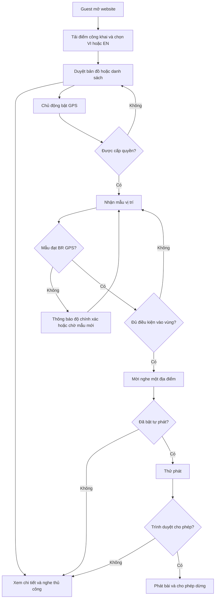
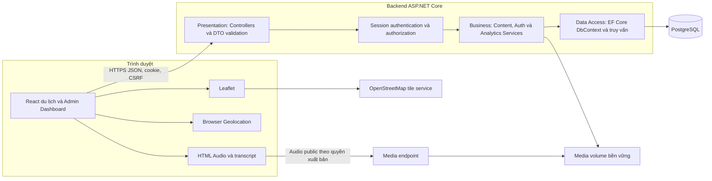

> Tài liệu baseline/lượt trước được giữ để truy vết. Hiện trạng bàn giao mới nhất: [PRD](PRD.md), [TEST_REPORT](TEST_REPORT.md) và [PROJECT_STATUS](PROJECT_STATUS.md). Những câu “chưa push” trong nội dung dưới đây mô tả thời điểm lượt trước.

# PRD — Saigon Guide

## 1. Thông tin tài liệu và phiên bản

| Thuộc tính | Giá trị |
|---|---|
| Sản phẩm | Saigon Guide — Bản đồ GPS và thuyết minh du lịch đa ngôn ngữ |
| Phiên bản | 1.1 — baseline 1.0 đã chốt, cập nhật trạng thái triển khai |
| Ngày soạn | 22/10/2026 |
| Nguồn yêu cầu | Master Prompt do người dùng cung cấp trong cuộc trò chuyện |
| Quy mô | Nhóm 3 sinh viên; giả định 6 tuần, 3 Sprint × 2 tuần |
| Khu vực | TP. Hồ Chí Minh |
| Ngôn ngữ | Tiếng Việt (`vi`) và tiếng Anh (`en`) |
| Trạng thái | Đã triển khai và kiểm thử cục bộ; Docker đã chạy; chưa có hosting/domain public |
| Chủ sở hữu quyết định | Nhóm dự án/người dùng; AI soạn và kiểm tra tính nhất quán |

Tài liệu này là nguồn yêu cầu chung. Thứ tự bàn giao theo yêu cầu trực tiếp của người dùng: **duyệt PRD → ERD → API Specification → cấu trúc thư mục → Product Backlog → code theo Sprint**. Các mục 18–19 và phần kế hoạch trong PRD xác định đầu vào, ràng buộc và điều kiện hoàn thành cho tài liệu chi tiết sau duyệt; không thay thế các tài liệu đó. ERD và đặc tả database schema đã được soạn trong [ERD và Database Schema](ERD-va-Database-Schema.md). Đã tạo API Specification, cấu trúc ứng dụng, Product Backlog, EF migrations và code các Sprint. OpenAPI máy đọc được chưa tạo riêng; tài liệu API Markdown là contract hiện hành. Kết quả thực thi nằm trong [báo cáo kiểm thử](Ket-qua-kiem-thu.md). Mọi thông số hiệu năng và định vị dưới đây là mục tiêu/giả định cần kiểm chứng, không phải kết quả đã đo.

## 2. Tóm tắt điều hành

Saigon Guide giúp khách tự tham quan sáu địa điểm qua bản đồ, nội dung song ngữ và âm thanh. Khách không phải tạo tài khoản. Khi khách chủ động bật GPS, trình duyệt tính khoảng cách và đề nghị nghe khi đến gần; tự phát chỉ thử sau khi khách bật chế độ này và trình duyệt cho phép.

MVP bắt buộc gồm website mobile-first, sáu địa điểm, GPS có chống lặp, âm thanh chuẩn bị sẵn và văn bản dự phòng, đăng nhập Admin, quản trị nội dung, Dashboard và ghi sự kiện có kiểm soát, kiểm thử, CI và triển khai demo thủ công có hướng dẫn. Đăng ký khách và quản lý tài khoản khách là Should Have, không nằm trên đường găng nghiệm thu MVP.

Kiến trúc đã chốt: React/TypeScript + ASP.NET Core Web API ba lớp + PostgreSQL, một backend đơn khối. Phân tích xử lý tại backend, không dùng dịch vụ theo dõi bên thứ ba. Tọa độ của khách chỉ xử lý trên trình duyệt. Chỉ thu thập Analytics sau lựa chọn đồng ý riêng, không gắn điều kiện này với quyền dùng sản phẩm.

## 3. Tổng quan sản phẩm

### 3.1 Giá trị và phạm vi sử dụng

- Một nơi để tìm địa điểm, đọc nội dung đã kiểm chứng và nghe thuyết minh VI/EN.
- Hỗ trợ chuyến đi trong lúc website đang mở; không cam kết theo dõi nền hoặc hoạt động đầy đủ ngoại tuyến.
- GPS dùng để xác định vị trí và khoảng cách đường chim bay; chỉ đường mở dịch vụ ngoài, không tự xây thuật toán định tuyến.
- Dashboard phản ánh sự kiện được tiếp nhận từ những người đồng ý đo lường, không đại diện tất cả du khách.

### 3.2 Sáu địa điểm và tiêu chuẩn dữ liệu

| Địa điểm | Tên tiếng Anh làm việc, cần biên tập | Trạng thái ban đầu |
|---|---|---|
| Dinh Độc Lập | Independence Palace | Chưa xác minh tọa độ, nội dung, quyền tài nguyên |
| Nhà thờ Đức Bà Sài Gòn | Saigon Notre-Dame Cathedral | Như trên |
| Bưu điện Trung tâm Sài Gòn | Saigon Central Post Office | Như trên |
| Chợ Bến Thành | Ben Thanh Market | Như trên |
| Bảo tàng Chứng tích Chiến tranh | War Remnants Museum | Như trên |
| Phố đi bộ Nguyễn Huệ | Nguyen Hue Walking Street | Như trên |

Chưa gán tọa độ, giờ mở cửa, sự kiện lịch sử hoặc URL nguồn như dữ liệu thật. Người C thu thập nguồn chính thức của từng điểm, ghi URL, ngày truy cập, phạm vi thông tin được xác minh, tác giả và quyền ảnh/âm thanh; người A hoặc B review chéo. Dữ liệu giả lập chỉ có trong môi trường test hoặc chế độ demo có nhãn **Dữ liệu mẫu**, không trộn với production hoặc thống kê sử dụng thật.

Mỗi điểm cần mã ổn định, tên/mô tả/địa chỉ song ngữ, tọa độ đã xác minh, bán kính, hình ảnh kèm văn bản thay thế và quyền sử dụng, bài thuyết minh VI/EN, thời lượng âm thanh thực, nguồn kiểm chứng, trạng thái xuất bản, thời điểm sửa và người sửa.

## 4. Vấn đề, mục tiêu và chỉ số thành công

| Mã | Mục tiêu nghiệm thu | Bằng chứng cần thu |
|---|---|---|
| G-01 | Guest xem đủ 6 điểm và đọc VI/EN mà không đăng nhập | E2E từ phiên sạch; kiểm kê dữ liệu |
| G-02 | GPS hợp lệ tạo một đề nghị nghe mỗi lần vào vùng theo BR | Unit state machine + mô phỏng browser + báo cáo thực địa riêng |
| G-03 | Phát thủ công và văn bản luôn có đường sử dụng khi GPS bị từ chối | E2E deny GPS, chặn autoplay, lỗi audio |
| G-04 | Admin quản trị được nội dung, API từ chối người không đủ quyền | Integration test 401/403; demo draft → published → hidden |
| G-05 | KPI tái lập chính xác từ fixture, không đếm trùng retry | Test ingestion, aggregate, ranh giới ngày và expected totals |
| G-06 | Một checkout mới có thể build/test và có hướng dẫn chạy | CI xanh trên commit bàn giao; người khác làm theo README |

Không đặt mục tiêu số người dùng thật khi chưa có traffic. Hoàn thành 100% Must Have và không có lỗi bảo mật chặn phát hành là tiêu chí giao bài; tỷ lệ người bật GPS, opt-in Analytics và nghe chỉ là số liệu quan sát sau demo, không là cam kết kinh doanh.

## 5. Actor và persona

| Actor/persona | Nhu cầu | Quyền và giới hạn |
|---|---|---|
| Guest Việt Nam | Mở nhanh trên điện thoại, đọc/nghe khi đi bộ | Mọi chức năng du lịch công khai; tự chọn GPS/Analytics |
| Guest quốc tế | Nội dung EN, sử dụng được khi GPS lỗi | Như Guest; không suy đoán quốc tịch từ ngôn ngữ |
| Registered User — tùy chọn | Lưu hồ sơ tối thiểu, quản lý mật khẩu | Quyền Guest + hồ sơ của mình; không được vào Admin |
| Admin nội dung | Biên tập, kiểm chứng và công khai nội dung | Quản trị nội dung và Dashboard; quản lý khách nếu bật phân hệ tài khoản |
| Nhóm phát triển | Tái lập môi trường, kiểm thử, trình diễn | Không có quyền production ngầm định; secrets qua cấu hình an toàn |

MVP chỉ có vai trò `Admin` và, khi mở rộng, `User`. Guest không phải bản ghi tài khoản. Không có Super Admin hoặc chức năng nâng quyền qua giao diện.

## 6. MVP và MoSCoW

| Mức | Chức năng |
|---|---|
| Must Have | Mobile-first; bản đồ/list và 6 điểm; chi tiết VI/EN; GPS chủ động; khoảng cách; geofence chống nhiễu/lặp; bật/tắt đề nghị và tự phát; player thủ công; văn bản; fallback khi từ chối GPS, tile/audio lỗi; đăng nhập/logout/đổi mật khẩu Admin; kiểm tra quyền backend; CRUD nội dung bằng tạo/sửa/ẩn/công khai; Dashboard KPI, xu hướng, xếp hạng, ngôn ngữ, lọc thời gian; consent, ingestion và chống trùng; CI build/test; demo HTTPS; tài liệu |
| Should Have | Đăng ký/đăng nhập khách, hồ sơ, đổi mật khẩu khách; quản lý/khóa tài khoản khách; tìm kiếm/lọc điểm; link chỉ đường ngoài; bộ E2E tự động mở rộng; CD tự động |
| Could Have | Khôi phục mật khẩu email; yêu thích; xuất báo cáo; cache có kiểm soát; TTS trình duyệt như tùy chọn phụ |
| Won't Have trong MVP | Native app, đặt vé/thanh toán, AI sinh lịch sử, nhận diện ảnh, route engine, hành trình GPS cá nhân, heatmap, CRM, microservices, theo dõi nền và offline đầy đủ, mạng xã hội/OAuth |

Should Have chỉ được nhận sau khi Must Have liên quan chạy được và còn dung lượng; nếu không, giữ trạng thái chưa triển khai. Không trì hoãn authentication Admin vì tài khoản khách bị lùi. CRUD không bao gồm xóa cứng điểm đã có thống kê; ẩn thay xóa. Ngôn ngữ cố định VI/EN trong MVP, không xây trang quản trị thêm ngôn ngữ.

## 7. Hành trình và sơ đồ nghiệp vụ

### 7.1 Luồng du lịch

Mở web → tải điểm công khai → chọn VI/EN → chọn đồng ý/từ chối Analytics độc lập → duyệt map/list → chọn điểm → đọc hoặc phát. Chỉ sau thao tác bật GPS mới xin quyền; nếu bị từ chối, vẫn dùng map/list/player. Nếu được cấp quyền, hiển thị độ chính xác/khoảng cách, kiểm tra mẫu hợp lệ và vùng. Khi đủ điều kiện, đưa một đề nghị nghe. Nếu đã bật tự phát, thử `play()`; nếu bị chặn thì hiện nút Nghe. Rời màn hình du lịch hoặc tắt GPS thì hủy `watchPosition`; quay lại phải bật tiếp. Tab bị ẩn dừng theo dõi và reset chuỗi mẫu; bài đang phát chỉ tiếp tục theo khả năng trình duyệt, không hứa chạy nền.

### 7.2 Luồng quản trị

Đăng nhập → backend xác minh phiên/quyền → tạo nháp → nhập nội dung và tài nguyên VI/EN → kiểm chứng → yêu cầu công khai → kiểm tra trong giao dịch → lưu → điểm xuất hiện công khai. Sửa điểm published chỉ được lưu nếu vẫn đạt điều kiện công khai, hoặc Admin chủ động chuyển hidden/draft trước khi sửa thiếu trường. Hai người sửa cùng phiên bản: trả conflict, không ghi đè im lặng.

### 7.3 Luồng Dashboard và tài khoản

Admin mở Dashboard → API kiểm tra quyền → xác thực khoảng thời gian → tổng hợp sự kiện đã chấp nhận → trả KPI, chuỗi thời gian và xếp hạng với cùng bộ lọc. Lỗi tải khác với không có dữ liệu; không thay lỗi bằng 0. Phân hệ tài khoản khách, nếu nhận vào phạm vi, có đăng ký → đăng nhập → hồ sơ/đổi mật khẩu → logout; tài khoản khóa bị từ chối login và mọi phiên hiện có bị thu hồi.

## 8. Đặc tả chức năng

Quy ước: M = Must Have; S = Should Have; C = Could Have. Mỗi `FR-nn` gắn một `US-nn`, một `TC-nn` và dòng RTM cùng số. Các tiền điều kiện dùng chung: **P** = dịch vụ dữ liệu hoạt động, chỉ truy cập nội dung published; **G** = P + màn hình du lịch đang mở, người dùng chủ động bật GPS; **A** = phiên Admin hợp lệ, backend kiểm tra quyền mỗi request; **U** = tùy chọn tài khoản khách đã được triển khai; **D** = A + khoảng thời gian hợp lệ. Ngoại lệ chung: API lỗi phải có trạng thái lỗi/thử lại, không giả dữ liệu thành công; thay đổi không hợp lệ không được lưu; API trả lỗi không tiết lộ nội bộ. Phần dưới bổ sung điều kiện và ngoại lệ riêng cho từng chức năng.

### FR-01 — Hiển thị bản đồ

- **Ưu tiên / Actor, tiền điều kiện:** M / Guest / P.
- **Mục đích / Module:** Hiển thị bản đồ; Map.
- **Đầu vào → đầu ra:** Danh sách điểm → bản đồ tương tác.
- **Luồng chính:** Tải nền bản đồ, giữ attribution và cho zoom/pan.
- **Thay thế / ngoại lệ:** Tile lỗi hoặc mất mạng: hiện cảnh báo và danh sách thay thế.
- **Quy tắc:** BR-PRIVACY-01.
- **Nghiệm thu:** Given tile bị chặn, When mở trang, Then vẫn chọn được điểm từ list và không có màn hình trắng.
- **Truy vết:** US-01, TC-01; chi tiết ca kiểm thử tại mục 21.

### FR-02 — Marker địa điểm

- **Ưu tiên / Actor, tiền điều kiện:** M / Guest / P.
- **Mục đích / Module:** Marker địa điểm; Map.
- **Đầu vào → đầu ra:** Điểm published có tọa độ → marker và tên.
- **Luồng chính:** Tạo một marker mỗi điểm hợp lệ; chọn marker mở điểm tương ứng.
- **Thay thế / ngoại lệ:** Điểm hidden không tạo marker; tọa độ lỗi bị chặn từ quản trị.
- **Quy tắc:** BR-CONTENT-01.
- **Nghiệm thu:** Given 6 điểm published và 1 hidden, When tải bản đồ, Then có đúng 6 marker và hidden không có trong payload.
- **Truy vết:** US-02, TC-02; chi tiết ca kiểm thử tại mục 21.

### FR-03 — Chi tiết địa điểm

- **Ưu tiên / Actor, tiền điều kiện:** M / Guest / P.
- **Mục đích / Module:** Chi tiết địa điểm; Place.
- **Đầu vào → đầu ra:** Place ID, locale → mô tả, nguồn, bài đọc và audio.
- **Luồng chính:** Mở trang chi tiết và tải đúng bản dịch.
- **Thay thế / ngoại lệ:** ID không tồn tại hoặc hidden: 404; không lộ dữ liệu nháp.
- **Quy tắc:** BR-CONTENT-01, BR-LANG-02.
- **Nghiệm thu:** Given điểm published VI/EN, When mở VI rồi EN, Then tên và nội dung khớp locale; hidden trả 404.
- **Truy vết:** US-03, TC-03; chi tiết ca kiểm thử tại mục 21.

### FR-04 — Tìm kiếm/lọc

- **Ưu tiên / Actor, tiền điều kiện:** S / Guest / P.
- **Mục đích / Module:** Tìm kiếm/lọc; Place.
- **Đầu vào → đầu ra:** Từ khóa, danh mục nếu được bổ sung → list/marker đồng bộ.
- **Luồng chính:** Tìm tên không phân biệt hoa thường và dấu tiếng Việt.
- **Thay thế / ngoại lệ:** Không có kết quả: hiện rỗng và nút xóa lọc; không tạo danh mục khi chưa có dữ liệu.
- **Quy tắc:** BR-CONTENT-01.
- **Nghiệm thu:** Given từ khóa không khớp, When tìm, Then list rỗng và xóa lọc khôi phục 6 điểm.
- **Truy vết:** US-04, TC-04; chi tiết ca kiểm thử tại mục 21.

### FR-05 — Xin quyền GPS

- **Ưu tiên / Actor, tiền điều kiện:** M / Guest / P, có thao tác bật GPS.
- **Mục đích / Module:** Xin quyền GPS; GPS.
- **Đầu vào → đầu ra:** Lựa chọn người dùng → trạng thái quyền và vị trí hiện tại.
- **Luồng chính:** Chỉ gọi Geolocation sau thao tác chủ động; vẽ vị trí và vòng accuracy.
- **Thay thế / ngoại lệ:** Denied/timeout/unsupported/insecure context: giải thích và giữ chế độ thủ công.
- **Quy tắc:** BR-PRIVACY-01.
- **Nghiệm thu:** Given chưa bấm bật GPS, When tải trang, Then không xin quyền; deny vẫn đọc/nghe được.
- **Truy vết:** US-05, TC-05; chi tiết ca kiểm thử tại mục 21.

### FR-06 — Tính khoảng cách

- **Ưu tiên / Actor, tiền điều kiện:** M / Guest / G, có mẫu hợp lệ.
- **Mục đích / Module:** Tính khoảng cách; GPS.
- **Đầu vào → đầu ra:** Tọa độ trong bộ nhớ → mét đường chim bay.
- **Luồng chính:** Tính Haversine và cập nhật nhãn khoảng cách; không gửi tọa độ lên API.
- **Thay thế / ngoại lệ:** Mẫu cũ hoặc không có vị trí: hiện chưa xác định, không hiển thị khoảng cách cũ như hiện tại.
- **Quy tắc:** BR-GPS-02.
- **Nghiệm thu:** Given cùng tọa độ, When tính, Then bằng 0; fixture địa lý độc lập có sai số không quá 1 m với công thức chuẩn.
- **Truy vết:** US-06, TC-06; chi tiết ca kiểm thử tại mục 21.

### FR-07 — Mở chỉ đường ngoài

- **Ưu tiên / Actor, tiền điều kiện:** S / Guest / P.
- **Mục đích / Module:** Mở chỉ đường ngoài; Place.
- **Đầu vào → đầu ra:** Tọa độ điểm → URL HTTPS chỉ đường.
- **Luồng chính:** Người dùng bấm mở dịch vụ bản đồ ngoài, không tự mở khi geofence.
- **Thay thế / ngoại lệ:** Popup bị chặn: cho link bấm lại; không gửi vị trí khách trong URL.
- **Quy tắc:** BR-PRIVACY-01.
- **Nghiệm thu:** Given chưa bật GPS, When bấm chỉ đường, Then URL chỉ chứa đích và tên dịch vụ ngoài được thông báo.
- **Truy vết:** US-07, TC-07; chi tiết ca kiểm thử tại mục 21.

### FR-08 — Theo dõi vị trí

- **Ưu tiên / Actor, tiền điều kiện:** M / Guest / G, quyền granted.
- **Mục đích / Module:** Theo dõi vị trí; GPS.
- **Đầu vào → đầu ra:** watchPosition → chuỗi mẫu trong bộ nhớ.
- **Luồng chính:** Duy trì một watcher; dọn watcher khi tắt/rời trang/tab ẩn.
- **Thay thế / ngoại lệ:** Lỗi tạm thời: báo trạng thái và bỏ chuỗi mẫu; khi tab hiện không tự suy ra đã vào vùng.
- **Quy tắc:** BR-GPS-02, BR-PRIVACY-01.
- **Nghiệm thu:** Given GPS đang bật, When tắt hoặc rời trang, Then clearWatch được gọi và không xử lý mẫu tiếp.
- **Truy vết:** US-08, TC-08; chi tiết ca kiểm thử tại mục 21.

### FR-09 — Xác nhận vào vùng

- **Ưu tiên / Actor, tiền điều kiện:** M / Guest / G.
- **Mục đích / Module:** Xác nhận vào vùng; GPS.
- **Đầu vào → đầu ra:** Mẫu hợp lệ và cấu hình điểm → đề nghị nghe.
- **Luồng chính:** Áp điều kiện khoảng cách, accuracy, hai mẫu và thời gian theo BR.
- **Thay thế / ngoại lệ:** Một mẫu đơn lẻ bên trong không được kích hoạt.
- **Quy tắc:** BR-GPS-01, BR-GPS-03.
- **Nghiệm thu:** Given R=75 m, hai mẫu đạt d+accuracy≤75 cách nhau 3 s, When mẫu thứ hai đến, Then có một geofence entry.
- **Truy vết:** US-09, TC-09; chi tiết ca kiểm thử tại mục 21.

### FR-10 — GPS kém chính xác

- **Ưu tiên / Actor, tiền điều kiện:** M / Guest / G.
- **Mục đích / Module:** GPS kém chính xác; GPS.
- **Đầu vào → đầu ra:** Accuracy, timestamp → cảnh báo hoặc mẫu đủ chuẩn.
- **Luồng chính:** Loại mẫu accuracy vượt ngưỡng hoặc quá cũ khỏi state machine.
- **Thay thế / ngoại lệ:** Vẫn cho dùng thủ công; không đánh dấu rời vùng từ mẫu không hợp lệ.
- **Quy tắc:** BR-GPS-02.
- **Nghiệm thu:** Given accuracy=41 m hoặc mẫu cũ 16 s, When nhận mẫu, Then không kích hoạt và hiển thị cảnh báo phù hợp.
- **Truy vết:** US-10, TC-10; chi tiết ca kiểm thử tại mục 21.

### FR-11 — Chống kích hoạt lặp

- **Ưu tiên / Actor, tiền điều kiện:** M / Guest / G, đã vào vùng.
- **Mục đích / Module:** Chống kích hoạt lặp; GPS.
- **Đầu vào → đầu ra:** Trạng thái theo điểm → một đề nghị mỗi lần vào.
- **Luồng chính:** Giữ latch cho tới khi xác nhận rời vùng và hết cooldown.
- **Thay thế / ngoại lệ:** Rerender, đổi locale, lỗi play hoặc tắt/bật GPS không được xóa latch.
- **Quy tắc:** BR-GPS-04.
- **Nghiệm thu:** Given 20 mẫu vẫn trong vùng, When xử lý, Then chỉ có một đề nghị và một event entry.
- **Truy vết:** US-11, TC-11; chi tiết ca kiểm thử tại mục 21.

### FR-12 — Phát thủ công/tự động

- **Ưu tiên / Actor, tiền điều kiện:** M / Guest / P; tự động cần G và opt-in riêng.
- **Mục đích / Module:** Phát thủ công/tự động; Audio.
- **Đầu vào → đầu ra:** Điểm, locale, lựa chọn auto → audio hoặc nút nghe.
- **Luồng chính:** Play thủ công luôn khả dụng; auto chỉ thử khi có entry và bật auto.
- **Thay thế / ngoại lệ:** play() bị từ chối: hiện CTA, không ghi narration_started.
- **Quy tắc:** BR-AUDIO-01, BR-GPS-04.
- **Nghiệm thu:** Given autoplay bị chặn, When vào vùng, Then hiện nút Nghe và không tăng lượt bắt đầu cho tới playing.
- **Truy vết:** US-12, TC-12; chi tiết ca kiểm thử tại mục 21.

### FR-13 — Tắt tự động

- **Ưu tiên / Actor, tiền điều kiện:** M / Guest / P.
- **Mục đích / Module:** Tắt tự động; GPS, Audio.
- **Đầu vào → đầu ra:** Toggle auto → trạng thái off.
- **Luồng chính:** Tắt ngay mọi lần thử tự phát tiếp theo; nút dừng audio độc lập.
- **Thay thế / ngoại lệ:** Tắt auto không ngầm dừng bài đang nghe; UI nêu rõ và có nút Dừng cạnh đó.
- **Quy tắc:** BR-AUDIO-01.
- **Nghiệm thu:** Given auto off, When có entry mới, Then chỉ mời nghe, không gọi play tự động.
- **Truy vết:** US-13, TC-13; chi tiết ca kiểm thử tại mục 21.

### FR-14 — Nhiều điểm gần nhau

- **Ưu tiên / Actor, tiền điều kiện:** M / Guest / G.
- **Mục đích / Module:** Nhiều điểm gần nhau; GPS.
- **Đầu vào → đầu ra:** Các ứng viên đạt điều kiện → một đề nghị.
- **Luồng chính:** Chọn điểm gần nhất; hòa khoảng cách chọn ID thứ tự tăng; không thay bài đang phát.
- **Thay thế / ngoại lệ:** Các điểm còn lại không ghi entry tự động; cần mẫu hợp lệ mới sau khi player/prompt rảnh.
- **Quy tắc:** BR-GPS-05.
- **Nghiệm thu:** Given hai ứng viên cùng lúc, When kiểm tra, Then chỉ một đề nghị, không có hai audio đồng thời.
- **Truy vết:** US-14, TC-14; chi tiết ca kiểm thử tại mục 21.

### FR-15 — Kích hoạt lại

- **Ưu tiên / Actor, tiền điều kiện:** M / Guest / G, điểm đã latch.
- **Mục đích / Module:** Kích hoạt lại; GPS.
- **Đầu vào → đầu ra:** Hai mẫu ngoài vùng, thời gian → trạng thái được tái kích hoạt.
- **Luồng chính:** Xác nhận ra vùng theo BR rồi chờ hết cooldown trước lần vào hợp lệ mới.
- **Thay thế / ngoại lệ:** Chưa ra vùng hoặc chỉ một mẫu ngoài: không rearm; nghe lại thủ công không bị cấm.
- **Quy tắc:** BR-GPS-06.
- **Nghiệm thu:** Given đã ra vùng hai mẫu nhưng mới 119 s từ entry, When quay lại, Then chưa mời lại; sau 120 s và đủ mẫu vào mới thì được.
- **Truy vết:** US-15, TC-15; chi tiết ca kiểm thử tại mục 21.

### FR-16 — Chọn ngôn ngữ

- **Ưu tiên / Actor, tiền điều kiện:** M / Guest / P.
- **Mục đích / Module:** Chọn ngôn ngữ; Locale.
- **Đầu vào → đầu ra:** vi/en → locale giao diện và nội dung.
- **Luồng chính:** Mặc định VI, chọn EN và nhớ lựa chọn không nhạy cảm.
- **Thay thế / ngoại lệ:** Locale lạ: trở về VI và hiển thị rõ; không suy ra quốc tịch.
- **Quy tắc:** BR-LANG-01.
- **Nghiệm thu:** Given phiên mới, When mở web, Then VI; chọn EN rồi tải lại vẫn EN.
- **Truy vết:** US-16, TC-16; chi tiết ca kiểm thử tại mục 21.

### FR-17 — Lấy đúng nội dung

- **Ưu tiên / Actor, tiền điều kiện:** M / Guest / P.
- **Mục đích / Module:** Lấy đúng nội dung; Locale, Place.
- **Đầu vào → đầu ra:** Place ID + vi/en → đúng bản dịch.
- **Luồng chính:** Tải nội dung đúng cặp điểm/ngôn ngữ.
- **Thay thế / ngoại lệ:** Bản dịch thiếu: cảnh báo, đề nghị đổi ngôn ngữ; không âm thầm gắn nhãn EN cho VI.
- **Quy tắc:** BR-LANG-02.
- **Nghiệm thu:** Given yêu cầu EN, When API trả bản dịch, Then code=en; thiếu EN hiển thị thiếu nội dung.
- **Truy vết:** US-17, TC-17; chi tiết ca kiểm thử tại mục 21.

### FR-18 — Điều khiển player

- **Ưu tiên / Actor, tiền điều kiện:** M / Guest / P, có audio.
- **Mục đích / Module:** Điều khiển player; Audio.
- **Đầu vào → đầu ra:** Play/pause/resume/replay/stop → trạng thái và thời gian.
- **Luồng chính:** Một player toàn cục; pause/resume giữ play ID; replay từ đầu có play ID mới.
- **Thay thế / ngoại lệ:** Audio lỗi: dừng loading, báo lỗi và cung cấp transcript; không đếm start từ click.
- **Quy tắc:** BR-AUDIO-01.
- **Nghiệm thu:** Given bài đang phát, When pause rồi resume, Then giữ play ID; replay tạo ID mới và chỉ một audio chạy.
- **Truy vết:** US-18, TC-18; chi tiết ca kiểm thử tại mục 21.

### FR-19 — Đọc thuyết minh

- **Ưu tiên / Actor, tiền điều kiện:** M / Guest / P.
- **Mục đích / Module:** Đọc thuyết minh; Audio, Place.
- **Đầu vào → đầu ra:** Locale và transcript → văn bản truy cập được.
- **Luồng chính:** Hiển thị toàn bộ transcript cùng nguồn, không phụ thuộc GPS/audio.
- **Thay thế / ngoại lệ:** Audio hỏng hoặc không có voice TTS: transcript vẫn đọc được.
- **Quy tắc:** BR-LANG-02.
- **Nghiệm thu:** Given audio 404, When xem điểm, Then văn bản vẫn hiển thị và có thông báo lỗi audio.
- **Truy vết:** US-19, TC-19; chi tiết ca kiểm thử tại mục 21.

### FR-20 — Thiếu dịch/âm thanh

- **Ưu tiên / Actor, tiền điều kiện:** M / Guest / P.
- **Mục đích / Module:** Thiếu dịch/âm thanh; Audio, Locale.
- **Đầu vào → đầu ra:** Thiếu tài nguyên → phương án dự phòng có nhãn.
- **Luồng chính:** Audio thiếu dùng transcript; bản dịch thiếu đề nghị bản còn lại.
- **Thay thế / ngoại lệ:** Không tự gọi TTS cloud, không tự đổi ngôn ngữ và giả vờ đã phát đúng.
- **Quy tắc:** BR-LANG-02.
- **Nghiệm thu:** Given EN text có nhưng audio lỗi, When bấm nghe, Then không completion giả và cung cấp EN text.
- **Truy vết:** US-20, TC-20; chi tiết ca kiểm thử tại mục 21.

### FR-21 — Đổi ngôn ngữ đang nghe

- **Ưu tiên / Actor, tiền điều kiện:** M / Guest / P.
- **Mục đích / Module:** Đổi ngôn ngữ đang nghe; Audio, Locale.
- **Đầu vào → đầu ra:** Locale mới → nội dung mới, player stopped.
- **Luồng chính:** Dừng bài cũ, reset về đầu, yêu cầu bấm Nghe cho bài mới.
- **Thay thế / ngoại lệ:** Không tự phát lại vì thao tác đổi locale; lưu một language_selected nếu consent.
- **Quy tắc:** BR-AUDIO-01, BR-LANG-01.
- **Nghiệm thu:** Given đang nghe VI, When đổi EN, Then VI dừng, EN ở đầu và chưa có start EN.
- **Truy vết:** US-21, TC-21; chi tiết ca kiểm thử tại mục 21.

### FR-22 — Đăng ký khách

- **Ưu tiên / Actor, tiền điều kiện:** S / Guest / U.
- **Mục đích / Module:** Đăng ký khách; Account.
- **Đầu vào → đầu ra:** Email, tên, mật khẩu → tài khoản User active.
- **Luồng chính:** Chuẩn hóa email, validate và băm mật khẩu; không cho truyền role.
- **Thay thế / ngoại lệ:** Email trùng: phản hồi chung tránh xác nhận tồn tại; không tạo tài khoản thứ hai.
- **Quy tắc:** BR-USER-01.
- **Nghiệm thu:** Given email đã tồn tại khác hoa thường, When đăng ký, Then không có user trùng và không thể tự chọn Admin.
- **Truy vết:** US-22, TC-22; chi tiết ca kiểm thử tại mục 21.

### FR-23 — Đăng nhập khách

- **Ưu tiên / Actor, tiền điều kiện:** S / Guest / U.
- **Mục đích / Module:** Đăng nhập khách; Account.
- **Đầu vào → đầu ra:** Email, mật khẩu → phiên cookie.
- **Luồng chính:** Xác thực active user, xoay session ID và chuyển về trang trước đó.
- **Thay thế / ngoại lệ:** Sai/locked: thông báo chung, rate limit; không tiết lộ mật khẩu/phiên.
- **Quy tắc:** BR-AUTH-01, BR-USER-01.
- **Nghiệm thu:** Given user locked, When nhập đúng mật khẩu, Then vẫn không tạo phiên.
- **Truy vết:** US-23, TC-23; chi tiết ca kiểm thử tại mục 21.

### FR-24 — Logout và quản lý phiên

- **Ưu tiên / Actor, tiền điều kiện:** M / Admin / A; User khi U.
- **Mục đích / Module:** Logout và quản lý phiên; Auth.
- **Đầu vào → đầu ra:** Cookie phiên → thu hồi phiên.
- **Luồng chính:** Logout POST có CSRF; backend vô hiệu hóa session; hết hạn trả 401.
- **Thay thế / ngoại lệ:** Cookie cũ hoặc replay sau logout không dùng được; lỗi mạng báo chưa xác nhận logout.
- **Quy tắc:** BR-AUTH-01.
- **Nghiệm thu:** Given đã logout thành công, When dùng lại cookie cũ, Then API protected trả 401.
- **Truy vết:** US-24, TC-24; chi tiết ca kiểm thử tại mục 21.

### FR-25 — Hồ sơ khách

- **Ưu tiên / Actor, tiền điều kiện:** S / User / U, phiên hợp lệ.
- **Mục đích / Module:** Hồ sơ khách; Account.
- **Đầu vào → đầu ra:** Tên và locale → hồ sơ của chính mình.
- **Luồng chính:** Chỉ lấy/sửa displayName và preferredLocale; email/role không sửa ở đây.
- **Thay thế / ngoại lệ:** Request chứa ID người khác hoặc role: từ chối; không xuất hash/token.
- **Quy tắc:** BR-USER-01.
- **Nghiệm thu:** Given User A, When yêu cầu sửa User B, Then không thay đổi B và không lộ hồ sơ B.
- **Truy vết:** US-25, TC-25; chi tiết ca kiểm thử tại mục 21.

### FR-26 — Đổi mật khẩu

- **Ưu tiên / Actor, tiền điều kiện:** M / Admin / A; User khi U.
- **Mục đích / Module:** Đổi mật khẩu; Auth.
- **Đầu vào → đầu ra:** Mật khẩu hiện tại và mới → hash mới, thu hồi phiên.
- **Luồng chính:** Kiểm tra mật khẩu hiện tại và policy; đổi rồi buộc đăng nhập lại.
- **Thay thế / ngoại lệ:** Sai mật khẩu cũ: không đổi; khôi phục qua email là Could Have, chưa có endpoint MVP.
- **Quy tắc:** BR-AUTH-01.
- **Nghiệm thu:** Given đổi mật khẩu thành công, When dùng tất cả phiên cũ, Then 401; mật khẩu cũ không login được.
- **Truy vết:** US-26, TC-26; chi tiết ca kiểm thử tại mục 21.

### FR-27 — Trạng thái tài khoản khách

- **Ưu tiên / Actor, tiền điều kiện:** S / User/Admin / U.
- **Mục đích / Module:** Trạng thái tài khoản khách; Account.
- **Đầu vào → đầu ra:** active/locked → quyền đăng nhập tương ứng.
- **Luồng chính:** Áp trạng thái tại mỗi request bảo vệ và login.
- **Thay thế / ngoại lệ:** Mở khóa không khôi phục các session đã thu hồi.
- **Quy tắc:** BR-USER-01.
- **Nghiệm thu:** Given tài khoản bị khóa giữa phiên, When request kế tiếp, Then từ chối ngay.
- **Truy vết:** US-27, TC-27; chi tiết ca kiểm thử tại mục 21.

### FR-28 — Kiểm tra quyền

- **Ưu tiên / Actor, tiền điều kiện:** M / Guest/Admin/User tùy route.
- **Mục đích / Module:** Kiểm tra quyền; Auth.
- **Đầu vào → đầu ra:** Cookie và route → cho phép hoặc 401/403.
- **Luồng chính:** Backend kiểm tra authenticated rồi role; không tin role từ client.
- **Thay thế / ngoại lệ:** Guest 401, User vào Admin 403; không chỉ ẩn nút ở UI.
- **Quy tắc:** BR-AUTH-01.
- **Nghiệm thu:** Given role giả trong JSON/header, When gọi Admin API, Then không được nâng quyền.
- **Truy vết:** US-28, TC-28; chi tiết ca kiểm thử tại mục 21.

### FR-29 — Đăng nhập Admin

- **Ưu tiên / Actor, tiền điều kiện:** M / Admin đã được provision an toàn.
- **Mục đích / Module:** Đăng nhập Admin; Auth.
- **Đầu vào → đầu ra:** Email, mật khẩu → phiên Admin.
- **Luồng chính:** Dùng cùng cơ chế xác thực an toàn, route UI riêng, không có public signup Admin.
- **Thay thế / ngoại lệ:** Sai login/locked: lỗi chung; rate limit; không có tài khoản mật khẩu mặc định trong repo.
- **Quy tắc:** BR-AUTH-01.
- **Nghiệm thu:** Given Admin hợp lệ, When login, Then truy cập quản trị; Guest gọi trực tiếp API vẫn 401.
- **Truy vết:** US-29, TC-29; chi tiết ca kiểm thử tại mục 21.

### FR-30 — Quản trị địa điểm

- **Ưu tiên / Actor, tiền điều kiện:** M / Admin / A.
- **Mục đích / Module:** Quản trị địa điểm; Content.
- **Đầu vào → đầu ra:** Trường địa điểm, version, trạng thái → bản ghi mới.
- **Luồng chính:** Tạo draft, sửa, chuyển published/hidden; kiểm tra conflict.
- **Thay thế / ngoại lệ:** Điểm có sự kiện không xóa cứng; version cũ trả 409; hidden vẫn giữ thống kê.
- **Quy tắc:** BR-CONTENT-01.
- **Nghiệm thu:** Given điểm published, When ẩn, Then biến mất khỏi API công khai nhưng Admin và lịch sử aggregate còn thấy.
- **Truy vết:** US-30, TC-30; chi tiết ca kiểm thử tại mục 21.

### FR-31 — Tọa độ và bán kính

- **Ưu tiên / Actor, tiền điều kiện:** M / Admin / A.
- **Mục đích / Module:** Tọa độ và bán kính; Content.
- **Đầu vào → đầu ra:** Lat/lon/radius → cấu hình GPS.
- **Luồng chính:** Validate lat [-90,90], lon [-180,180], radius [25,500] m; cờ xác minh.
- **Thay thế / ngoại lệ:** Giá trị NaN/ngoài khoảng: không lưu; đổi cấu hình reset chuỗi mẫu chưa xác nhận, giữ latch.
- **Quy tắc:** BR-GPS-01, BR-CONTENT-01.
- **Nghiệm thu:** Given radius=0 hoặc lat=91, When lưu, Then lỗi trường cụ thể và không đổi dữ liệu.
- **Truy vết:** US-31, TC-31; chi tiết ca kiểm thử tại mục 21.

### FR-32 — Bản dịch thuyết minh

- **Ưu tiên / Actor, tiền điều kiện:** M / Admin / A.
- **Mục đích / Module:** Bản dịch thuyết minh; Content.
- **Đầu vào → đầu ra:** Place ID, vi/en, title, text, source → bản dịch duy nhất.
- **Luồng chính:** Tạo/sửa theo cặp điểm/ngôn ngữ và lưu người sửa.
- **Thay thế / ngoại lệ:** Trùng cặp trả conflict; sửa thiếu trường published bị từ chối hoặc phải ẩn trước.
- **Quy tắc:** BR-CONTENT-01, BR-LANG-02.
- **Nghiệm thu:** Given đã có EN, When tạo EN lần nữa, Then không sinh bản ghi trùng.
- **Truy vết:** US-32, TC-32; chi tiết ca kiểm thử tại mục 21.

### FR-33 — Tài nguyên âm thanh

- **Ưu tiên / Actor, tiền điều kiện:** M / Admin / A.
- **Mục đích / Module:** Tài nguyên âm thanh; Content, Media.
- **Đầu vào → đầu ra:** File MP3 và metadata quyền → tài nguyên phục vụ playback.
- **Luồng chính:** Upload giới hạn, kiểm tra loại/kích thước/khả năng decode và duration; gán cho narration.
- **Thay thế / ngoại lệ:** Tệp giả đuôi, >20 MB hoặc decode lỗi bị từ chối; không tải file từ URL tùy ý.
- **Quy tắc:** BR-CONTENT-01, BR-AUDIO-01.
- **Nghiệm thu:** Given file text tên .mp3, When upload, Then bị từ chối; file hợp lệ phát được và có duration thực.
- **Truy vết:** US-33, TC-33; chi tiết ca kiểm thử tại mục 21.

### FR-34 — Kiểm tra công khai

- **Ưu tiên / Actor, tiền điều kiện:** M / Admin / A.
- **Mục đích / Module:** Kiểm tra công khai; Content.
- **Đầu vào → đầu ra:** Yêu cầu publish → published hoặc lỗi đầy đủ.
- **Luồng chính:** Trong giao dịch kiểm đủ nội dung, nguồn, VI/EN, audio và tọa độ đã xác minh.
- **Thay thế / ngoại lệ:** Thiếu một mục: giữ trạng thái cũ và liệt kê trường lỗi; không public một phần.
- **Quy tắc:** BR-CONTENT-01.
- **Nghiệm thu:** Given thiếu EN audio, When publish, Then 422 và điểm vẫn draft; đủ hết thì published.
- **Truy vết:** US-34, TC-34; chi tiết ca kiểm thử tại mục 21.

### FR-35 — Danh sách tài khoản

- **Ưu tiên / Actor, tiền điều kiện:** S / Admin / A + U.
- **Mục đích / Module:** Danh sách tài khoản; AccountAdmin.
- **Đầu vào → đầu ra:** Trang hiện tại → tài khoản khách.
- **Luồng chính:** Lấy danh sách User với trường tối thiểu.
- **Thay thế / ngoại lệ:** Không bao gồm hash/token; không xây quản trị Admin bằng luồng này.
- **Quy tắc:** BR-USER-01.
- **Nghiệm thu:** Given nhiều User, When tải danh sách, Then chỉ thấy trường cho phép và không có hash.
- **Truy vết:** US-35, TC-35; chi tiết ca kiểm thử tại mục 21.

### FR-36 — Tìm tài khoản

- **Ưu tiên / Actor, tiền điều kiện:** S / Admin / A + U.
- **Mục đích / Module:** Tìm tài khoản; AccountAdmin.
- **Đầu vào → đầu ra:** Tên/email tối đa 100 ký tự → kết quả.
- **Luồng chính:** Tìm không phân biệt hoa thường trong User, query tham số hóa.
- **Thay thế / ngoại lệ:** Từ khóa SQL đặc biệt là dữ liệu, không thay truy vấn.
- **Quy tắc:** BR-USER-01.
- **Nghiệm thu:** Given từ khóa chứa dấu nháy, When tìm, Then không lỗi SQL và không trả toàn bộ ngoài điều kiện.
- **Truy vết:** US-36, TC-36; chi tiết ca kiểm thử tại mục 21.

### FR-37 — Lọc tài khoản

- **Ưu tiên / Actor, tiền điều kiện:** S / Admin / A + U.
- **Mục đích / Module:** Lọc tài khoản; AccountAdmin.
- **Đầu vào → đầu ra:** Status, ngày đăng ký → kết quả lọc.
- **Luồng chính:** Kết hợp trạng thái và khoảng ngày theo quy tắc timezone.
- **Thay thế / ngoại lệ:** Khoảng đảo/ngày sai: 422; không tự bỏ bộ lọc.
- **Quy tắc:** BR-USER-01, BR-ANALYTICS-04.
- **Nghiệm thu:** Given lọc locked, When tải, Then mọi dòng đều locked trong khoảng.
- **Truy vết:** US-37, TC-37; chi tiết ca kiểm thử tại mục 21.

### FR-38 — Phân trang tài khoản

- **Ưu tiên / Actor, tiền điều kiện:** S / Admin / A + U.
- **Mục đích / Module:** Phân trang tài khoản; AccountAdmin.
- **Đầu vào → đầu ra:** Page≥1, size 1..100 → items,total.
- **Luồng chính:** Sắp createdAt giảm rồi ID ổn định, áp filter trước pagination.
- **Thay thế / ngoại lệ:** Trang ngoài dữ liệu trả items rỗng; size quá giới hạn trả 422.
- **Quy tắc:** BR-USER-01.
- **Nghiệm thu:** Given 25 User và size=10, When xem 3 trang trên snapshot cố định, Then không trùng và đủ 25.
- **Truy vết:** US-38, TC-38; chi tiết ca kiểm thử tại mục 21.

### FR-39 — Chi tiết tài khoản

- **Ưu tiên / Actor, tiền điều kiện:** S / Admin / A + U.
- **Mục đích / Module:** Chi tiết tài khoản; AccountAdmin.
- **Đầu vào → đầu ra:** User ID → hồ sơ tối thiểu, trạng thái, ngày tạo.
- **Luồng chính:** Đọc displayName, email, locale, status; không lịch sử GPS.
- **Thay thế / ngoại lệ:** ID không tồn tại: 404; User thường không có quyền gọi.
- **Quy tắc:** BR-USER-01, BR-PRIVACY-01.
- **Nghiệm thu:** Given Admin xem User, When nhận response, Then không có credential, token hay tọa độ.
- **Truy vết:** US-39, TC-39; chi tiết ca kiểm thử tại mục 21.

### FR-40 — Khóa/mở khóa khách

- **Ưu tiên / Actor, tiền điều kiện:** S / Admin / A + U.
- **Mục đích / Module:** Khóa/mở khóa khách; AccountAdmin.
- **Đầu vào → đầu ra:** User ID, lý do, version, xác nhận → trạng thái mới.
- **Luồng chính:** Xác nhận UI, kiểm tra backend, audit và thu hồi session khi khóa.
- **Thay thế / ngoại lệ:** Không khóa Admin qua API khách; version cũ 409; mở khóa cần login lại.
- **Quy tắc:** BR-USER-01.
- **Nghiệm thu:** Given User đang login, When Admin khóa, Then request kế tiếp bị từ chối và có audit lý do/người thực hiện.
- **Truy vết:** US-40, TC-40; chi tiết ca kiểm thử tại mục 21.

### FR-41 — Chỉ số tài khoản

- **Ưu tiên / Actor, tiền điều kiện:** S / Admin / D + U.
- **Mục đích / Module:** Chỉ số tài khoản; Dashboard.
- **Đầu vào → đầu ra:** Khoảng thời gian → registered, active User.
- **Luồng chính:** Tính từ Users và các event đã consent liên kết server-side.
- **Thay thế / ngoại lệ:** Chưa có U: không hiện KPI; active đo được không đồng nghĩa mọi user active.
- **Quy tắc:** BR-DASHBOARD-01, BR-PRIVACY-01.
- **Nghiệm thu:** Given một User nhiều event, When tính active, Then chỉ đếm một tài khoản; Admin bị loại.
- **Truy vết:** US-41, TC-41; chi tiết ca kiểm thử tại mục 21.

### FR-42 — Ghi sự kiện

- **Ưu tiên / Actor, tiền điều kiện:** M / Guest consent Analytics, hoặc User khi U.
- **Mục đích / Module:** Ghi sự kiện; Analytics.
- **Đầu vào → đầu ra:** Event allowlist, event ID, phiên → accepted/duplicate/rejected.
- **Luồng chính:** Backend xác thực schema, phiên, đối tượng, size, tốc độ và idempotency rồi ghi.
- **Thay thế / ngoại lệ:** Không consent: không gửi/lưu; trùng không tăng count; client không được gửi KPI tổng hợp.
- **Quy tắc:** BR-ANALYTICS-03, BR-PRIVACY-01.
- **Nghiệm thu:** Given cùng event ID gửi 3 lần, When ingestion, Then chỉ một event hợp lệ; tọa độ trong payload bị từ chối.
- **Truy vết:** US-42, TC-42; chi tiết ca kiểm thử tại mục 21.

### FR-43 — KPI tổng quan

- **Ưu tiên / Actor, tiền điều kiện:** M / Admin / D.
- **Mục đích / Module:** KPI tổng quan; Dashboard.
- **Đầu vào → đầu ra:** Khoảng thời gian → KPI định nghĩa mục 16.
- **Luồng chính:** Backend tính từ tập event hợp lệ và trả metadata khoảng thời gian.
- **Thay thế / ngoại lệ:** Nguồn lỗi không thay bằng số 0; không có dữ liệu dùng số 0 hoặc N/A đúng nghĩa.
- **Quy tắc:** BR-DASHBOARD-01, BR-DASHBOARD-02.
- **Nghiệm thu:** Given fixture có 3 page_view và 2 session, When mở KPI, Then hiển thị 3 và 2 riêng biệt.
- **Truy vết:** US-43, TC-43; chi tiết ca kiểm thử tại mục 21.

### FR-44 — Xu hướng truy cập

- **Ưu tiên / Actor, tiền điều kiện:** M / Admin / D.
- **Mục đích / Module:** Xu hướng truy cập; Dashboard.
- **Đầu vào → đầu ra:** Range, bucket ngày/tuần/tháng → chuỗi page/session.
- **Luồng chính:** Bucket theo giờ Việt Nam, thêm bucket rỗng=0 trong phạm vi.
- **Thay thế / ngoại lệ:** Khoảng ngoài retention báo giới hạn, không khẳng định ngày không lưu là 0.
- **Quy tắc:** BR-ANALYTICS-04, BR-DASHBOARD-01.
- **Nghiệm thu:** Given event ngay trước/sau 00:00 giờ VN, When nhóm ngày, Then nằm đúng hai ngày khác nhau.
- **Truy vết:** US-44, TC-44; chi tiết ca kiểm thử tại mục 21.

### FR-45 — Xếp hạng địa điểm

- **Ưu tiên / Actor, tiền điều kiện:** M / Admin / D.
- **Mục đích / Module:** Xếp hạng địa điểm; Dashboard.
- **Đầu vào → đầu ra:** Range → hàng theo từng điểm và các số đo.
- **Luồng chính:** Sort place_view giảm rồi ID; trả đủ sáu điểm kể cả 0 và điểm đã ẩn.
- **Thay thế / ngoại lệ:** Điểm ẩn có nhãn; nội dung đã đổi không làm mất khóa lịch sử.
- **Quy tắc:** BR-DASHBOARD-01.
- **Nghiệm thu:** Given hai điểm cùng 5 views và một hidden có 3, When xếp hạng, Then tie-break ổn định và hidden vẫn có hàng.
- **Truy vết:** US-45, TC-45; chi tiết ca kiểm thử tại mục 21.

### FR-46 — Thống kê xem điểm

- **Ưu tiên / Actor, tiền điều kiện:** M / Admin / D.
- **Mục đích / Module:** Thống kê xem điểm; Dashboard.
- **Đầu vào → đầu ra:** Event place_view → lượt xem và phiên có xem.
- **Luồng chính:** Đếm event ID khác với distinct session theo điểm.
- **Thay thế / ngoại lệ:** Rerender không tạo view; reload là view mới; retry cùng ID không tăng.
- **Quy tắc:** BR-ANALYTICS-01, BR-ANALYTICS-03.
- **Nghiệm thu:** Given một phiên xem điểm hai lần hợp lệ, When tổng hợp, Then views=2 và sessions=1.
- **Truy vết:** US-46, TC-46; chi tiết ca kiểm thử tại mục 21.

### FR-47 — Thống kê thuyết minh

- **Ưu tiên / Actor, tiền điều kiện:** M / Admin / D.
- **Mục đích / Module:** Thống kê thuyết minh; Dashboard.
- **Đầu vào → đầu ra:** Start/completed có play ID → starts, completions và tỷ lệ.
- **Luồng chính:** Ghép theo session/play ID, chặn completed thiếu start; resume không là start mới.
- **Thay thế / ngoại lệ:** Seek/đóng tab/lỗi audio không tự hoàn tất; completion gửi lặp không tăng.
- **Quy tắc:** BR-AUDIO-01, BR-ANALYTICS-03.
- **Nghiệm thu:** Given 2 play ID, một ended đạt ngưỡng và một đóng tab, When tổng hợp, Then starts=2, completions=1.
- **Truy vết:** US-47, TC-47; chi tiết ca kiểm thử tại mục 21.

### FR-48 — Thống kê ngôn ngữ

- **Ưu tiên / Actor, tiền điều kiện:** M / Admin / D.
- **Mục đích / Module:** Thống kê ngôn ngữ; Dashboard.
- **Đầu vào → đầu ra:** language_selected và narration_started → hai phân bố riêng.
- **Luồng chính:** Nhóm vi/en; chỉ tính lựa chọn chủ động, không tự tạo selection từ mặc định.
- **Thay thế / ngoại lệ:** Không suy diễn quốc tịch; auto start vẫn thuộc ngôn ngữ audio thực.
- **Quy tắc:** BR-LANG-01, BR-DASHBOARD-01.
- **Nghiệm thu:** Given 2 lựa chọn EN, 1 start VI, When xem, Then selection EN=2 và starts VI=1, không gộp.
- **Truy vết:** US-48, TC-48; chi tiết ca kiểm thử tại mục 21.

### FR-49 — Bộ lọc thời gian

- **Ưu tiên / Actor, tiền điều kiện:** M / Admin / D.
- **Mục đích / Module:** Bộ lọc thời gian; Dashboard.
- **Đầu vào → đầu ra:** Ngày bắt đầu/kết thúc, bucket → range thống nhất.
- **Luồng chính:** Mặc định 7 ngày lịch gồm hôm nay; preset tuần này/tháng này; custom≤90 ngày.
- **Thay thế / ngoại lệ:** Ngày kết thúc trước bắt đầu hoặc tương lai: 422; mọi widget nhận cùng range.
- **Quy tắc:** BR-ANALYTICS-04, BR-DASHBOARD-01.
- **Nghiệm thu:** Given range đảo, When gửi request trực tiếp, Then API từ chối; range hợp lệ cập nhật toàn Dashboard.
- **Truy vết:** US-49, TC-49; chi tiết ca kiểm thử tại mục 21.

### FR-50 — Chưa có dữ liệu

- **Ưu tiên / Actor, tiền điều kiện:** M / Admin / D.
- **Mục đích / Module:** Chưa có dữ liệu; Dashboard.
- **Đầu vào → đầu ra:** Tập event rỗng/đang tải/lỗi → trạng thái riêng.
- **Luồng chính:** Counts=0, tỷ lệ không có mẫu số=N/A, bảng 6 điểm bằng 0.
- **Thay thế / ngoại lệ:** Lỗi 500 hiển thị lỗi và thử lại; không biến thành không có lượt truy cập.
- **Quy tắc:** BR-DASHBOARD-02.
- **Nghiệm thu:** Given không event, When tải, Then không số giả; Given API lỗi, Then hiện lỗi thay vì KPI 0.
- **Truy vết:** US-50, TC-50; chi tiết ca kiểm thử tại mục 21.

### FR-51 — Quyền xem thống kê

- **Ưu tiên / Actor, tiền điều kiện:** M / Admin / A.
- **Mục đích / Module:** Quyền xem thống kê; Auth, Dashboard.
- **Đầu vào → đầu ra:** Danh tính từ phiên → aggregate được phép.
- **Luồng chính:** Mọi API Dashboard yêu cầu Admin; không trả raw event, visitor ID/email.
- **Thay thế / ngoại lệ:** Guest 401, User 403; không có endpoint export raw public.
- **Quy tắc:** BR-AUTH-01, BR-PRIVACY-01.
- **Nghiệm thu:** Given Guest và User thường, When gọi Dashboard trực tiếp, Then lần lượt 401 và 403, không có aggregate trả kèm.
- **Truy vết:** US-51, TC-51; chi tiết ca kiểm thử tại mục 21.

## 9. Quy tắc nghiệp vụ

Các giá trị GPS dưới đây là cấu hình thử nghiệm ban đầu, phải hiệu chỉnh bằng kiểm tra thực địa; không là bảo đảm độ chính xác. Thay đổi tham số phải cập nhật test và phiên bản PRD.

| Mã BR | Quy tắc |
|---|---|
| BR-GPS-01 | Điểm có bán kính R, mặc định đề xuất 75 m, cấu hình 25–500 m. Một mẫu nằm trong an toàn khi `distance + accuracy ≤ R`. Chỉ đề nghị khi đủ điều kiện nhiều mẫu theo BR-GPS-03. Tính Haversine với bán kính Trái Đất 6.371.000 m; không dùng khoảng cách này làm đường đi. |
| BR-GPS-02 | Mẫu có lat/lon hữu hạn đúng khoảng, `0 ≤ accuracy ≤ 40 m`, tuổi không quá 15 s và timestamp không quá 5 s trong tương lai. Mẫu không hợp lệ chỉ cập nhật thông báo chất lượng, không dùng để vào/rời vùng. |
| BR-GPS-03 | Cần hai mẫu hợp lệ liên tiếp cùng đạt điều kiện, timestamp tăng, cách nhau 3–10 s. Mẫu ngoài điều kiện hoặc không hợp lệ reset chuỗi ứng viên. Không giả lập mẫu bằng timer. Timestamp trùng không thêm vào chuỗi. |
| BR-GPS-04 | Sau đề nghị, latch theo place ID trong tab bằng sessionStorage, cùng thời điểm entry. Giữ qua reload, rerender, đổi ngôn ngữ, tắt/bật GPS và lỗi autoplay. Lưu trạng thái đã xác nhận rời vùng để không bị khóa vĩnh viễn khi reload. Tab mới là một ngữ cảnh độc lập; không cam kết chống lặp giữa các thiết bị/tab. |
| BR-GPS-05 | Chỉ một đề nghị/player tại một thời điểm. Nếu nhiều điểm cùng đủ điều kiện, chọn distance nhỏ nhất rồi ID tăng. Không ngắt bài đang phát và không xếp hàng tự phát các điểm còn lại. Chỉ đánh dấu entry của điểm được chọn; các ứng viên khác phải đánh giá lại bằng mẫu mới khi rảnh. |
| BR-GPS-06 | Xác nhận ra vùng bằng hai mẫu hợp lệ cách nhau 3–10 s với `distance - accuracy ≥ R + 30 m`. Rearm sau khi đã xác nhận ra và ít nhất 120 s từ entry trước; cần chuỗi vào vùng mới sau rearm. Nếu quay lại quá sớm, chờ tới cooldown rồi bắt đầu chuỗi mới, không dùng mẫu cũ. |
| BR-AUDIO-01 | Một player, tốc độ 1× trong MVP; hỗ trợ play/pause/resume/replay/stop. Không cần tua trong MVP. Start chỉ khi `playing`; resume giữ play ID, replay hoặc đổi bài rồi phát tạo ID mới. Completion cần start đã được backend chấp nhận, sự kiện `ended`, phần thời gian phát không trùng ≥90% duration và thời gian server từ start ≥90% duration. Đây là hoàn tất phát được báo cáo, không chứng minh người thực sự nghe. |
| BR-LANG-01 | Mặc định VI, chỉ VI/EN; nhớ lựa chọn giao diện. `language_selected` chỉ khi người dùng chủ động chọn một giá trị khác hiện tại. Không phát event selection cho mặc định hoặc render. |
| BR-LANG-02 | Không thay ngôn ngữ âm thầm. Thiếu audio: transcript cùng ngôn ngữ; thiếu transcript: thông báo và cho chọn ngôn ngữ còn lại. Đổi locale dừng bài và yêu cầu phát lại. |
| BR-CONTENT-01 | Draft chưa công khai; published xuất hiện công khai; hidden không xuất hiện công khai nhưng giữ lịch sử. Publish yêu cầu đủ VI/EN, tên/địa chỉ/mô tả/transcript, lat/lon đã xác minh, bán kính hợp lệ, ảnh/alt/quyền sử dụng, nguồn kiểm chứng và MP3 phát được cho mỗi ngôn ngữ. Lưu thiếu điều kiện trên published bị từ chối. Chuyển trạng thái và audit trong cùng giao dịch; optimistic concurrency ngăn ghi đè. Demo chưa kiểm chứng chỉ ở môi trường demo có banner, không vượt qua cổng publish production. |
| BR-AUTH-01 | Backend quyết định quyền từ session còn hiệu lực; không tin role/user ID client. Admin được provision bằng thao tác vận hành an toàn, không public signup. Session và token không xuất trong JSON/log. Logout, đổi mật khẩu và khóa thu hồi phiên. |
| BR-USER-01 | Nếu làm tài khoản khách: email chuẩn hóa unique, tên 1–100 ký tự, mật khẩu 12–128 ký tự, cho phép Unicode/khoảng trắng, không tự trim mật khẩu. Role đăng ký luôn User; active/locked. Khóa có lý do và audit; API khách không quản lý Admin. Không xác nhận email trong MVP, phải ghi giới hạn này; chưa làm quy trình email nên không quảng bá reset password. |
| BR-ANALYTICS-01 | Page view tính khi route công khai hoàn tất navigation, gồm reload; rerender không tính. Place view thêm khi chi tiết published tải thành công và đang hiển thị. Mở lại sau khi rời là view mới; đổi locale tại cùng điểm không là view mới. Sau lần đồng ý Analytics đầu tiên, ghi một page_view cho route hiện tại đã tải xong và một place_view nếu đang xem chi tiết; không hồi tố các trang trước consent. Admin route, healthcheck và preview nội bộ không tạo Analytics công khai. |
| BR-ANALYTICS-02 | Analytics session khác auth session. Sau consent, server cấp session gắn visitor ngẫu nhiên; hết phiên sau 30 phút không có event hợp lệ được tiếp nhận. Event hợp lệ tiếp theo mở phiên mới. Nhiều tab dùng chung visitor cookie và phiên hoạt động; backend khóa giao dịch khi tìm/tạo session. Cookie bị xóa, thiết bị khác hoặc race khởi tạo có thể làm sai ước tính visitor; không dùng fingerprint. |
| BR-ANALYTICS-03 | Event ID UUID unique toàn hệ thống; cùng ID và payload trong cùng context trả duplicate, không ghi thêm; ID trùng nhưng payload/context khác trả conflict. Start/completed unique theo `(session, playId, type)`. Kiểm tra place/locale/play, chỉ nhận trường allowlist, giới hạn batch/tốc độ. Completed không có start hợp lệ thì từ chối; client không gửi số KPI. |
| BR-ANALYTICS-04 | Lưu UTC. KPI dùng **receivedAt do server gán**, không dùng đồng hồ client để nhóm ngày. Ngày/tuần/tháng theo Asia/Ho_Chi_Minh; tuần từ thứ Hai 00:00. Ngày UI inclusive được đổi thành `[start, ngày sau end)`; bucket biên chỉ tính phần giao với range. |
| BR-PRIVACY-01 | GPS chỉ trong bộ nhớ client, không gửi/lưu lat/lon của khách. Consent Analytics mặc định off, độc lập GPS; từ chối vẫn dùng đủ du lịch. Chỉ sau đồng ý mới tạo visitor cookie và event. Thu hồi: dừng event, xóa queue/cookie/ID liên quan bằng endpoint và client cleanup, không xóa lịch sử đã thu một cách im lặng; có quy trình yêu cầu xóa theo ID nếu còn xác định được. Không liên kết User với lịch sử guest trước đăng nhập. |
| BR-DASHBOARD-01 | Mọi widget cùng range và tập event hợp lệ; distinct phải tính lại toàn range, không cộng distinct từng ngày. Không có dữ liệu tài khoản thì bỏ KPI tài khoản. Aggregate SQL trực tiếp cho quy mô MVP, chưa cần bảng tổng hợp/Redis. |
| BR-DASHBOARD-02 | Count không có event = 0; mẫu số 0 = N/A; chưa thu thập/chưa triển khai = không khả dụng. Lỗi API = trạng thái lỗi, không thay số 0. Không có ngày ngoài retention được thể hiện như dữ liệu 0 chắc chắn. |

## 10. User Stories và tiêu chí nghiệm thu

Mỗi FR ở mục 8 có một US cùng số. Mẫu chuẩn được áp dụng tường minh: **“Là [Actor của FR], tôi muốn [tên chức năng FR] để [đạt mục đích và đầu ra nêu trong FR].”** Tiền điều kiện, ưu tiên, AC Given–When–Then và TC được kế thừa chính xác từ FR cùng số, không tạo bản yêu cầu thứ hai khác nghĩa. Ví dụ `US-09` là Guest muốn nhận một đề nghị nghe khi đủ điều kiện đến gần để bắt đầu tham quan thuận tiện; tiền điều kiện G, ưu tiên M, nghiệm thu FR-09 và TC-09. Danh mục US đầy đủ được sinh tại mục 29 để có mô tả cụ thể từng story.

Mọi thay đổi hành vi phải sửa FR gốc, BR liên quan và TC/RTM cùng lúc. User Story chưa được nhận vào Sprint không được mô tả là đã hoàn thành. Ước lượng Story Points sẽ thực hiện ở Product Backlog sau khi duyệt thiết kế, tránh gắn ước lượng giả với phạm vi chưa chốt.

## 11. Yêu cầu phi chức năng (NFR)

| ID | Yêu cầu/mục tiêu đề xuất | Ưu tiên | Cách kiểm chứng |
|---|---|---|---|
| NFR-01 | API đọc thông thường P95 ≤500 ms; aggregate Dashboard P95 ≤1 s | M | Môi trường ghi cấu hình CPU/RAM, cùng vùng DB, 6 điểm, 100.000 event/90 ngày, 20 client đồng thời, 5 phút sau warmup; không tính tải tile/audio ngoài |
| NFR-02 | Trang du lịch dùng được trong ≤3 s trên thiết bị mô phỏng tầm trung, Fast 4G, cache lạnh; list không chờ map | M | Đo 5 lần, lưu median và trace; tách SLA tài nguyên ngoài |
| NFR-03 | Backend authorization, mật khẩu hash bằng thư viện Identity; rate limit login 5 lần thất bại/15 phút theo IP và tài khoản, lỗi chung; HTTPS, CSRF cho request thay đổi state có cookie | M | Integration 401/403/CSRF, test rate limit, kiểm tra cookie; cấu hình IP proxy tin cậy để không tin X-Forwarded-For tùy ý |
| NFR-04 | Không lưu secret trong Git, không log cookie/password/GPS; lỗi có mã và request ID | M | Secret scan, review log và lỗi 500/422; không có stack trace ở production |
| NFR-05 | Mobile 360–1440 px, không tràn ngang trang; map không khóa cuộn toàn trang | M | Chụp và thao tác ở 360/390/768/1440 px; bảng Admin cuộn riêng |
| NFR-06 | Điều hướng bàn phím, focus rõ, label/alt, trạng thái qua chữ, nút ≥44 px, tương phản chữ thường ≥4.5:1 | M | Kiểm tra tự động và thao tác tay player/form/GPS; list thay map cho accessibility |
| NFR-07 | Chrome/Edge/Firefox desktop và Chrome Android/Safari iOS bản ổn định gần thời điểm bàn giao | M | Ghi phiên bản thực test; Safari iOS/Android thật cho quyền GPS và autoplay; giả lập không thay thế kiểm tra thực địa |
| NFR-08 | Lỗi tile/GPS/audio/Analytics không làm sập đọc nội dung; queue Analytics hữu hạn | M | Inject lỗi từng dịch vụ; fallback hoạt động và không retry vô hạn |
| NFR-09 | Không có lịch sử GPS; raw Analytics giữ 90 ngày lịch VN gồm hôm nay, visitor cookie tối đa 90 ngày; auth hết hạn có thu hồi | M | Kiểm payload, DB schema, cookie, test cleanup chạy hằng ngày; Dashboard báo khoảng được giữ |
| NFR-10 | Controller → Service → Data Access; DTO không trả Entity trực tiếp; unit/integration tách biệt | M | Review dependency và build; test không phụ thuộc dữ liệu demo thật |
| NFR-11 | Một event không đếm hai lần ngay cả request đồng thời; publish không lưu một phần | M | Test transaction và unique constraint trên PostgreSQL thật |
| NFR-12 | Readiness kiểm DB, liveness kiểm tiến trình; log có request ID/mã lỗi, không PII | M | Ngắt DB: readiness fail; request lỗi đối chiếu được log bằng ID |
| NFR-13 | Có backup DB và media, diễn tập restore trước demo; không hứa HA hoặc zero downtime | M | Khôi phục sang database riêng, xác minh điểm/audio và document thời gian thực |
| NFR-14 | Hỗ trợ tăng số điểm/event bằng index/phân trang; chưa cần distributed cache | S | Đo lại query plan khi vượt fixture; không thay stack nếu chưa có bằng chứng bottleneck |

## 12. Tài khoản và phân quyền

### 12.1 Quyết định phạm vi

**Admin bắt buộc; tài khoản khách Should Have.** Không lưu lịch sử nghe/yêu thích trong MVP cơ sở. Registered User vẫn được đặc tả để có thể bổ sung nhất quán, nhưng không dựng endpoint/UI giả nếu chưa nhận công việc.

| Tài nguyên/hành động | Guest | User (nếu có) | Admin |
|---|---|---|---|
| Điểm published, nội dung VI/EN | Có | Có | Có |
| GPS/player cục bộ | Có, tự chọn | Có, tự chọn | Có trong phần du lịch |
| Analytics event | Chỉ khi consent | Chỉ khi consent | Không ghi hoạt động quản trị |
| Hồ sơ bản thân | Không | Có | Chỉ thông tin bản thân cần cho đổi mật khẩu |
| CRUD nội dung, media | Không | Không | Có |
| Dashboard aggregate | Không | Không | Có |
| Tìm/khóa tài khoản khách | Không | Không | Có nếu triển khai U |
| Xem hash/token/mật khẩu hoặc nâng quyền | Không | Không | Không qua API sản phẩm |

### 12.2 Phiên và mật khẩu

- Dùng cookie phiên opaque cùng origin, `HttpOnly`, `Secure` khi HTTPS, `SameSite=Lax`, `Path=/`; không đặt token trong localStorage. Xử lý password bằng ASP.NET Core Identity/PasswordHasher và thư viện crypto được hỗ trợ; không tự viết thuật toán hash.
- Bản ghi phiên phía server cho phép thu hồi ngay. Giới hạn idle 30 phút và tối đa 8 giờ từ login, không có remember-me MVP; xoay ID khi login. Mỗi protected request kiểm phiên, expiry, role và trạng thái User.
- Mọi thay đổi state xác thực bằng cookie có antiforgery token và kiểm Origin; login cũng phòng login-CSRF. CORS production cùng origin; dev chỉ origin chính xác, không wildcard credentials.
- Đổi mật khẩu cần mật khẩu hiện tại, mật khẩu mới 12–128 ký tự, thu hồi mọi phiên rồi login lại. Không yêu cầu các quy tắc chữ hoa/ký tự đặc biệt tùy tiện. Không trả mật khẩu/hash/token ở bất kỳ DTO nào.
- Tạo Admin đầu tiên bằng lệnh vận hành một lần với nhập bí mật an toàn, không seed password mặc định hay ghi trong repo. Khôi phục quyền Admin là thao tác vận hành có kiểm soát, ghi nhật ký, thu hồi phiên; không là reset email giả.
- Sai login/locked trả thông điệp chung; `401` không đăng nhập/hết phiên; `403` đã đăng nhập nhưng không có quyền; `409` conflict phiên bản/duy nhất; `422` dữ liệu sai; `429` quá tốc độ. Khi phiên hết, UI giữ dữ liệu form chưa lưu trong bộ nhớ và yêu cầu login lại, không tự thực hiện thay đổi.

## 13. GPS và thuyết minh

### 13.1 State machine

GPS có `off`, `requesting`, `tracking`, `degraded`, `denied`, `unsupported`. Trạng thái theo từng điểm: `outside`, `candidate-in`, `latched`, `candidate-out`, `cooldown`, rồi `outside` sau rearm. Chỉ mẫu đạt BR đi vào state machine. Khi đổi cấu hình điểm hoặc tab ẩn, reset chuỗi mẫu đang xét, không xóa latch. Hủy watcher khi rời màn hình. Không ghi tọa độ xuống localStorage/sessionStorage; chỉ lưu latch và thời điểm entry.

R=75 m và accuracy=40 m có thể bỏ lỡ entry khi GPS kém; đây là lựa chọn thận trọng ban đầu. Nút nghe thủ công luôn là đường dự phòng. Bản mô phỏng GPS phục vụ test phải gắn nhãn, không chạy như tracking thật trong production.

### 13.2 Lựa chọn âm thanh

| Tiêu chí | MP3 chuẩn bị sẵn — phương án chính | TTS trình duyệt — Could Have |
|---|---|---|
| Chất lượng | Review được giọng, phát âm và nội dung trước demo | Giọng VI/EN tùy OS/trình duyệt, không đồng nhất |
| Độ trễ | Tải file; có thể progressive playback | Khởi tạo giọng có thể chậm/không có voice |
| Chi phí | Công biên soạn/thu âm hoặc tạo file có quyền; storage/bandwidth | Thường không tính phí API nhưng phụ thuộc engine; không cam kết miễn phí mọi dịch vụ |
| Offline | Chỉ file đã tải/cache; MVP không bảo đảm offline | Tùy giọng cài sẵn và engine; không bảo đảm |
| Độ phức tạp | Player chuẩn, metadata thời lượng rõ | Fallback giọng và tracking completion khó đồng nhất |

**Dự phòng bắt buộc là transcript**, ổn định hơn phụ thuộc TTS. Nếu không có MP3 hợp lệ, không cho publish production. TTS nếu thêm sau phải có nhãn, không trộn completion của TTS với MP3 khi chưa bổ sung đặc tả đo lường. MP3 đề xuất 1–3 phút mỗi điểm/ngôn ngữ, tối đa 20 MB/file và duration >0 đến 10 phút; đây là giới hạn nội dung, không là số đo tệp đã có.

Player luôn có Phát/Tạm dừng/Tiếp tục/Nghe lại/Dừng và hiển thị trạng thái bằng chữ. Auto mặc định off; GPS và auto là hai lựa chọn độc lập. Chọn điểm khác khi đang nghe hỏi xác nhận chuyển bài hoặc giữ bài cũ; không có hai luồng âm thanh. Lỗi mạng không tự báo hoàn tất, và không thử play lặp vô hạn.

## 14. Quản trị nội dung

Luồng draft → published → hidden, có thể sửa hidden rồi publish lại. Không tạo hệ thống duyệt nhiều cấp trong MVP; một Admin được quyền biên tập và công khai, nhưng phải có nguồn và người review dữ liệu trong hồ sơ dự án. Kiểm tra publish áp dụng cả khi gọi API trực tiếp.

Dữ liệu kiểm chứng gồm URL nguồn, ngày truy cập, người kiểm chứng, ghi chú; `unverified/verified` và cờ riêng `isDemo`. Nguồn có thể nhiều URL trong trường cấu trúc giới hạn, không nhất thiết tạo bảng riêng khi chưa có truy vấn nghiệp vụ. Audio lưu metadata trong DB, file lưu volume bền vững ngoài web root rồi phục vụ theo ID; chỉ audio của điểm công khai được đọc ẩn danh. Upload file do Admin có CSRF, giới hạn dung lượng, kiểm MIME/chữ ký và khả năng decode; không nhận URL server phải tải về để tránh SSRF. Tệp mồ côi được dọn theo tác vụ an toàn, không xóa file đang được narration tham chiếu.

Ảnh dùng tài nguyên nhóm có quyền, gắn attribution và alt; URL ngoài chỉ HTTPS từ cấu hình allowlist đã duyệt. Backend không tự fetch arbitrary URL để kiểm tra. Không cho HTML tùy ý trong transcript: văn bản thuần, render an toàn. Giới hạn đề xuất: tên 200, địa chỉ 500, mô tả 1.000, transcript 20.000 ký tự mỗi bản dịch. Audit tạo/sửa/đổi trạng thái/khóa khách có actor, entity ID, action, thời điểm, version; không ghi nguyên nội dung nhạy cảm.

## 15. Admin Dashboard và Analytics

Gồm bộ lọc chung, thẻ KPI, xu hướng page views và sessions, bảng/biểu đồ sáu địa điểm, thống kê ngôn ngữ. Không cần bản đồ nhiệt. Mỗi widget có nhãn metric, thời gian cập nhật, khoảng thời gian và chú thích “Dữ liệu từ các trình duyệt đồng ý Analytics; không phải số người thực”. Dashboard lấy aggregate server, không tự tổng hợp raw event ở frontend.

Mặc định 7 ngày lịch gồm hôm nay; preset hôm nay/tuần này/tháng này và custom tối đa 90 ngày trong thời gian còn lưu. Tuần bắt đầu thứ Hai. UI chọn bucket ngày/tuần/tháng, cùng range cho mọi widget. Không dùng tổng các distinct theo bucket để tạo distinct toàn range. Địa điểm hidden vẫn có dòng kèm nhãn, tránh mất thống kê; zero view vẫn có dòng 0. Nếu phát triển thêm điểm, bảng không bị hardcode sáu hàng, nhưng dữ liệu nghiệm thu khởi đầu là sáu điểm.

Dashboard không cho xem event cá nhân hoặc tọa độ. Admin có thể xem số sự kiện bị từ chối/duplicate theo log tổng hợp vận hành, tách khỏi KPI người dùng; log không lưu toàn payload.

## 16. Định nghĩa KPI và cơ chế ghi sự kiện

### 16.1 Hợp đồng sự kiện ở mức yêu cầu

Envelope được phép: `eventId` UUID, `type` enum, `clientTimestamp` UTC phục vụ chẩn đoán giới hạn, `sessionId` do server cấp, `placeId?`, `languageCode?`, `pageKey?` enum, `playId?`, `durationSeconds?`, `playedSeconds?`, `trigger?` (`manual/auto`). Backend gán ID lưu trữ, `receivedAt`, visitor/session và user liên kết từ context đã xác thực. Không nhận user ID/role từ body. Không có latitude, longitude, email, IP, full URL, referrer hoặc free-form properties trong schema lưu trữ Analytics. Request metadata IP chỉ được dùng tạm cho rate limit, không lưu trong event.

| Type | Lúc phát và trường đặc thù |
|---|---|
| page_view | Route công khai tải xong, pageKey thuộc allowlist; không đếm từng rerender |
| place_view | Chi tiết published hiển thị thành công; bắt buộc placeId và languageCode |
| location_permission_granted / denied | Sau kết quả yêu cầu quyền do người dùng chủ động; không suy ra từ lỗi timeout |
| geofence_entered | Điểm được chọn sau đủ BR; placeId, languageCode; không tọa độ hoặc độ chính xác khách |
| narration_started | Sự kiện playing đầu tiên của một play ID; placeId, languageCode, playId, trigger; duration lấy từ asset chuẩn phía server |
| narration_completed | ended và đạt BR-AUDIO-01; cùng playId/place/locale với start; duration/playedSeconds kiểm tra giới hạn |
| language_selected | Lựa chọn locale khác hiện tại bởi người dùng; languageCode |

### 16.2 Consent, phiên, retry và chất lượng dữ liệu

- Trước consent: không visitor ID, không Analytics cookie hoặc event. Sau đồng ý: server cấp visitor ngẫu nhiên qua cookie riêng và phiên Analytics; có nút thu hồi trong cài đặt. Lưu lựa chọn đồng ý/từ chối riêng tối đa 90 ngày để không hỏi liên tục. Thu hồi xóa cookie phía server và queue phía client; historical aggregate không giả định tự xóa được nếu đã mất định danh.
- Session idle 30 phút dựa trên event hợp lệ được nhận, tách session đăng nhập. Nhiều tab chia visitor cookie; mỗi navigation hợp lệ có event ID mới; retry giữ ID cũ. Logout không xóa visitor hoặc tự rút consent; không hồi tố gắn visitor guest vào tài khoản. Admin dùng phần quản trị không tạo event du lịch.
- Retry Analytics trong bộ nhớ tối đa 100 event, 20 event/batch, body ≤32 KB. Retry lỗi mạng/5xx tối đa 3 lần theo khoảng 1/2/4 s rồi chờ tương tác hoặc kết nối mới, TTL queue 5 phút; không lưu queue GPS hoặc queue lâu dài. 4xx không retry, 429 theo Retry-After trong TTL. Giới hạn ingestion đề xuất 120 event/phút/phiên và 600/phút/IP, điều chỉnh sau test dùng chung mạng; IP chỉ là rate-limit key tạm thời.
- ClientTimestamp không quá 5 phút cũ hoặc 1 phút tương lai; quá giới hạn từ chối. Thời điểm nhóm KPI luôn là receivedAt, vì vậy retry qua ranh giới ngày có thể thuộc ngày nhận. Không sửa ngày client để hợp thức hóa event. Event của session hết hạn bị loại khỏi queue, không chuyển sang session mới; event mới dùng phiên mới sau handshake. Mất mạng/đóng tab có thể mất event, không cam kết đo đầy đủ.
- Duplicate kiểm trước các validation phụ thuộc trạng thái hiện tại nhưng sau kiểm context, để retry một event đã chấp nhận không bị đổi thành lỗi vì điểm vừa bị ẩn. Event mới của điểm vừa bị ẩn bị từ chối; completion vẫn được nhận nếu có start hợp lệ trước khi ẩn và asset metadata lịch sử còn giữ. Giữ duration tại start để sửa audio sau đó không đổi định nghĩa play cũ.
- Start/completion gửi theo thứ tự: chỉ đưa completion vào queue khi start đã được xác nhận accepted/duplicate. Start không được backend chấp nhận thì không có completion được tính. Nếu start bị trễ do offline khiến kiểm elapsed phía server không đạt, bỏ completion khỏi KPI; chấp nhận undercount và ghi rõ giới hạn. Không hạ validation để tạo số đẹp.
- Backend không tin dữ liệu client là bằng chứng khách thật: schema validation, bound session, same-origin/CSRF context khi cần, idempotency, rate limit, allowlist published và play matching chỉ giảm sai/chống lạm dụng cơ bản. Không tuyên bố chống bot hoặc giả mạo hoàn toàn.

### 16.3 Từ điển chỉ số

Ký hiệu `E(R)` là event hợp lệ có receivedAt thuộc range R; mọi count event dùng event ID unique và bỏ event Admin/test. Distinct visitor/session tính trên E(R), chỉ từ traffic consent. Dữ liệu test nằm database/môi trường riêng. Bảng dưới dùng cùng range trừ khi ghi rõ.

| Metric | Định nghĩa/công thức và nguồn | Chống trùng/điều kiện | Giới hạn diễn giải |
|---|---|---|---|
| MET-01 Page views | Count page_view trong E(R) | Event ID unique; navigation/reload, không rerender | Một người tạo nhiều views |
| MET-02 Sessions | Distinct sessionId trong E(R) | Chỉ session có event trong R, kể cả bắt đầu trước R | Không phải số người; không cộng distinct từng ngày |
| MET-03 Visitors ước tính | Distinct visitorId trong E(R) | Visitor ngẫu nhiên, không fingerprint | Xóa cookie/thiết bị/tab khởi tạo có thể tăng; consent làm thiếu |
| MET-04 Registered Users — S | Count Users role User với createdAt < end(R); thêm registrationsInRange = count createdAt trong R | Account ID, cả active/locked; không tính Admin | Là snapshot đến cuối range và số đăng ký mới, không phải hoạt động; không có U thì N/A |
| MET-05 Active logged-in Users — S | Distinct User ID server gắn trên E(R), role User | Không hồi tố guest; không tính Admin | Chỉ người dùng consent có hoạt động đo được |
| MET-06 Place views | Count place_view trong E(R), nhóm place | Event ID; MET-06S = distinct session theo place | Không đồng nghĩa đã tới thực địa |
| MET-07 Geofence entries | Count geofence_entered trong E(R), nhóm place | Event ID + latch client; không có tọa độ | Tín hiệu client báo, không chứng nhận hiện diện |
| MET-08 Narration starts | Count narration_started trong E(R) | Unique session/playId/type | Không đếm click lỗi, pause/resume; replay là lượt mới |
| MET-09 Completions | Count narration_completed trong E(R) có start hợp lệ | Unique session/playId/type; BR-AUDIO-01 | Ended đạt ngưỡng do client báo, không chứng minh nghe thật |
| MET-10 Tỷ lệ bắt đầu nghe | Distinct session có place_view trong R và start cùng place sau view trong R / distinct session có place_view của place trong R ×100% | Matching session/place; 0 mẫu số=N/A | Tối đa 100%; start từ map không mở chi tiết vẫn vào MET-08 nhưng không vào tử số này |
| MET-11 Tỷ lệ hoàn tất | Số play ID có start trong R và completion trước end(R) / số play ID có start trong R ×100% | Cohort theo start, completion phải sau start | Play kết thúc sau end chưa hoàn tất trong báo cáo; MET-09 có thể khác tử số cohort |
| MET-12 Language usage | Count language_selected theo locale; bảng riêng starts theo locale từ MET-08 | Event ID và play unique; default không là selection | Không suy quốc tịch; không trộn hai nguồn |
| MET-13 Top place | Place có MET-06 cao nhất, hòa theo ID tăng | Toàn bộ place kể cả hidden, cùng R | Tất cả bằng 0 thì hiển thị chưa có dữ liệu xếp hạng |

Khoảng lưu dữ liệu: giữ 90 ngày lịch VN gồm hôm nay, cleanup hàng ngày xóa phần cũ hơn đầu ngày sớm nhất; không có aggregate vĩnh viễn trong MVP. Mất dữ liệu do retention là chủ đích, UI giới hạn ngày chọn. Auth session hết hạn dọn trong 7 ngày; audit quản trị giữ 180 ngày không nội dung bí mật. Mốc này là đề xuất vận hành cho đồ án, phải rà soát chính sách trường/hosting trước public thật.

### 16.4 Fixture nghiệm thu thống kê

Fixture ở database test, không phải traffic thật: visitor V1/session S1 có 2 page_view, 2 place_view của P1, 1 start A1 VI và completion A1; V2/S2 có 1 page_view, 1 place_view P1, 1 start A2 EN chưa xong; V1/S3 có 1 page_view và 1 place_view P2. Tất cả event nằm R, start sau view, A1 đạt thời gian hợp lệ. Gửi lại A1 start 3 lần cùng ID chỉ giữ một.

Kết quả mong đợi: page=4, session=3, visitor=2, P1 views=3/session=2, P2 views=1/session=1, starts=2, completions=1, P1 start rate=100%, P2 start rate=0%, completion cohort=50%, P1 đứng đầu. Không có language_selected thì bảng selections=0 dù starts VI=1/EN=1. Các điểm còn lại có dòng 0. Tài khoản chưa triển khai thì không dựng KPI Registered/Active.

## 17. Kiến trúc tổng thể và Backend ba lớp

### 17.1 Stack đã chốt

| Thành phần | Lựa chọn chính | Lý do/đánh đổi |
|---|---|---|
| Frontend | React 19, TypeScript 5, Vite 7, Node.js 24 LTS, npm lockfile | Một SPA, hỗ trợ browser API, phổ biến; không cần SSR cho demo bản đồ |
| Backend | ASP.NET Core 10 trên .NET 10 LTS, REST JSON | Có nền tảng auth/DI/validation/test, hợp kiến trúc ba lớp; nhóm cần học C# nếu chưa quen |
| Database/ORM | PostgreSQL 17, EF Core 10 + Npgsql tương thích EF 10 | Quan hệ, transaction, unique/index cho Analytics; không cần PostGIS cho 6 điểm và GPS client |
| Bản đồ | Leaflet 1.9.x + OpenStreetMap raster cho demo lưu lượng thấp | Nhẹ, không cần API key; phải hiện attribution và tuân thủ tile usage policy, không bulk download/prefetch; public tiles không có SLA |
| Âm thanh | HTMLAudioElement với MP3 đã biên tập; transcript fallback | Chất lượng và completion dễ định nghĩa; cần chuẩn bị 12 file có quyền |
| Biểu đồ | Recharts cho Dashboard | Cùng React, kèm bảng chữ cho accessibility |
| Test frontend | Vitest, React Testing Library; Playwright cho hành trình chính | Unit trạng thái và browser integration; test Safari thật bổ sung |
| Test backend | xUnit, ASP.NET Core WebApplicationFactory, PostgreSQL test riêng | Kiểm đúng transaction/unique và SQL thật, không thay bằng in-memory DB cho aggregate |
| Media tools | Công cụ kiểm MP3/metadata như ffprobe/ffmpeg trong môi trường chạy | Phải kiểm file thực, duration và giới hạn tài nguyên; chọn gói/phiên bản cụ thể lúc dựng môi trường |
| CI/deploy | GitHub Actions; Docker Compose trên một máy Linux cho demo HTTPS | Một nguồn triển khai dễ hướng dẫn; cần ngân sách/máy chủ và quyền truy cập trước deploy thật |

Đây là version family đã chốt; patch versions và lockfile phải pin sau khi kiểm tra runtime/registry ở Sprint 1. Không cài `latest` ngầm định. Nếu giảng viên bắt buộc SQL Server hoặc .NET phiên bản khác, phải đổi quyết định trước ERD/API, không âm thầm đổi trong code. Không cần Redis, Kafka, microservices, TTS cloud hoặc dịch vụ Analytics ngoài.

### 17.2 Phân lớp

Presentation xử lý HTTP, input DTO, error envelope và auth middleware. Business Services thực thi publish gate, chuyển trạng thái, session, event validation và định nghĩa KPI. Data Access dùng EF Core DbContext và các query/repository chuyên biệt khi cần; không tạo generic repository dư thừa chỉ để đủ tên lớp. Entity là mô hình persistence nội bộ; DTO công khai chỉ chứa dữ liệu cho phép. Mapping phải loại credential và trạng thái nháp. Service không phụ thuộc React hoặc HTTP request body.

Frontend xử lý tọa độ, Haversine, geofence, player, UX và gửi event; backend không nhận stream GPS, nhưng vẫn là nơi quyết định authorization, validation nội dung, event hợp lệ và aggregate. Analytics session và authentication session tách riêng. Dashboard chỉ gọi server, không kết nối database từ browser.

### 17.3 Cấu hình và phụ thuộc triển khai

- Development: frontend Vite proxy `/api` và `/media` tới backend, backend kết nối PostgreSQL local; production ASP.NET phục vụ frontend đã build để cùng origin, có reverse proxy TLS. SPA fallback không nuốt route `/api`, `/media` hoặc healthcheck.
- Biến không bí mật: ASPNETCORE_ENVIRONMENT, allowed origin dev, public base URL, media storage path, media size limit, retention days; hostname/tile attribution cấu hình theo nhà cung cấp. Những cấu hình này chưa được tạo trong máy hoặc lưu draft onboarding trong bước soạn PRD.
- Bí mật: database password/connection string và thông tin provision Admin qua môi trường/secret store; không seed password vào Git. Khóa bảo vệ cookie/data protection lưu volume bền vững nếu dùng cookie framework; không chia sẻ DB test với demo.
- Health liveness và readiness; readiness phải thử DB. Log structured có request ID, route, status và thời lượng; redaction headers/cookie/body nhạy cảm, không log raw query chứa email.
- Nguồn mạng cần khi thực hiện sau duyệt: registry npm, NuGet, nguồn .NET chính thức, PostgreSQL/container registry nếu dùng, GitHub và host tile OSM. Không cần khóa Maps hay TTS cho thiết kế cơ sở. Phải xác nhận egress/trust khi cài thực tế, không tắt TLS/signature verification.

## 18. Mô hình dữ liệu — cơ sở của ERD

Đây là **mô hình khái niệm** của PRD. Chi tiết ERD/database schema thiết kế nằm trong [ERD và Database Schema](ERD-va-Database-Schema.md); chưa tạo database hoặc chạy migration. Khóa dùng UUID cho entity sản phẩm; mã ngôn ngữ dùng `vi/en`; thời gian UTC, timestamp có timezone; số tọa độ dùng kiểu số đủ chính xác và check khoảng hợp lệ. PK/FK, cột/kiểu cụ thể, indexes và Mermaid ERD đã được mô tả trong tài liệu thiết kế; migration sẽ viết ở Sprint 1 sau các tài liệu tiền triển khai.

| Thực thể | Mục đích/quan hệ | Ràng buộc bắt buộc cho bước ERD |
|---|---|---|
| Places | Tọa độ địa điểm, radius, trạng thái, version và kiểm chứng | Không chứa tọa độ người dùng; ẩn thay xóa khi đã có sự kiện; tọa độ/radius check; mã ổn định |
| Languages | Hai mã hỗ trợ cố định | Không trang CRUD ngôn ngữ trong MVP |
| PlaceTranslations | Tên, địa chỉ, mô tả và metadata ngôn ngữ của điểm | Unique `(placeId, languageCode)`; belongs-to Place/Language |
| Narrations | Transcript và nguồn theo điểm/ngôn ngữ | Unique `(placeId, languageCode)`; có tối đa một audio hiện hành; không public thiếu dịch |
| AudioAssets | File key an toàn, MIME, bytes, duration, quyền sử dụng | Không URL fetch tùy ý; giữ metadata audio cũ khi đã được play tham chiếu; file ngoài DB |
| Users | Email chuẩn hóa, password hash, tên, role, status, locale | Email unique; role enum Admin/User, chưa cần Roles/UserRoles nhiều-nhiều; không tạo Guest row |
| UserSessions | Phiên xác thực có thu hồi, last activity, absolute expiry | FK User; chỉ lưu biểu diễn phiên được bảo vệ/hash handle theo cơ chế auth chọn khi đặc tả; không plaintext bearer token |
| AnalyticsSessions | Phiên tương tác, visitor ngẫu nhiên, thời điểm đầu/cuối | Khác UserSessions; không cần bảng Visitors riêng nếu chỉ group pseudonymous ID; cleanup 90 ngày |
| AnalyticsEvents | Sự kiện allowlist và server receive time, tham chiếu session/place/lang | Event ID unique, play uniqueness, optional User do server xác định; không GPS/IP/email; properties hữu hạn; start giữ asset duration để tham chiếu lịch sử |
| AdminAuditLogs | Theo dõi sửa nội dung/khóa khách | Actor User, entity ID, action, timestamp, version, lý do cho khóa; không hash/token hoặc bản sao payload nhạy cảm |

Quan hệ: Place có nhiều PlaceTranslations/Narrations; Narration tham chiếu AudioAsset; User có nhiều UserSessions; AnalyticsSession có nhiều AnalyticsEvents; Event có Place/Language/User nullable theo loại. AdminAuditLog tham chiếu người thao tác. Không thêm bảng KPI tổng hợp ở MVP; dùng SQL trên event có index theo thời gian/type/place/session và unique constraint. Không cascade xóa Place làm mất Analytics; chỉ cleanup event/session theo retention. Khi có yêu cầu xóa tài khoản, thu hồi phiên, xóa/anonymize PII và đặt User FK nullable trong event/audit theo chính sách, không phá aggregate. Quy trình xóa tài khoản là thao tác hỗ trợ vận hành, không tự thêm màn hình MVP.

## 19. Phạm vi API Specification sau duyệt

API REST dưới `/api/v1`, JSON UTF-8, UTC ISO 8601. Các nhóm hợp đồng phải được đặc tả lần lượt sau ERD; **chưa khẳng định endpoint, DTO hoặc implementation đã tồn tại**.

| Nhóm hợp đồng | FR liên quan | Quyền | Yêu cầu đặc tả |
|---|---|---|---|
| Danh sách/chi tiết/bài thuyết minh/ngôn ngữ | 01–04,16–21 | Public, chỉ published | Locale, 404 thống nhất cho hidden, cache không lộ draft |
| Phiên Analytics, consent withdrawal, batch event | 42 | Consent, không cần đăng nhập | Event schema, session binding, accepted/duplicate/rejected từng item, rate limits, chống lạm dụng |
| Login/logout/session hiện tại/đổi mật khẩu | 24,26,28,29 | Theo thao tác | Cookie/CSRF, expiry/revocation, rate limit, DTO không credential |
| Tạo/sửa/đổi trạng thái địa điểm, bản dịch, upload audio | 30–34 | Admin | Version concurrency, publish gate, multipart limit và media authorization |
| KPI, chuỗi thời gian, xếp hạng, ngôn ngữ | 43–51 | Admin | Cùng bộ lọc timezone, định nghĩa distinct/cohort, zero/N/A/error |
| Đăng ký/login/hồ sơ khách | 22,23,25,27 | Should Have | Gating phạm vi, email unique, ownership, không tự nâng quyền |
| Tìm/lọc/khóa khách | 35–41 | Admin, Should Have | Pagination ổn định, allowed fields, khóa/thu hồi session và audit |

Không tạo API cho từng phép tính Haversine, nút pause, marker hoặc toggle GPS; những thao tác đó là client-only. Các KPI có thể trả trong một response Dashboard nhất quán thay vì mỗi thẻ một endpoint. `400` JSON sai cú pháp; `401/403/404/409/422/429/500` theo ngữ nghĩa ở mục 12; lỗi theo Problem Details với code, field errors và request ID, không stack trace. API Specification tiếp theo phải có từng method/path, params/body, response mẫu, validation, permission, error examples, pagination, idempotency, CSRF và test liên kết. Không tạo reset-email endpoint nếu chưa chấp thuận phạm vi.

## 20. Thiết kế giao diện ở mức yêu cầu

Mọi màn hình có loading riêng, lỗi có hướng xử lý và nút thử lại, empty state đúng nghiệp vụ. Thông báo dùng vùng aria-live khi thích hợp, không chỉ màu. Mobile hiển thị một cột, không che nút dừng/GPS; desktop có thể map và panel song song.

| Màn hình | Mục tiêu/bố cục/thao tác và dữ liệu | Loading/lỗi/rỗng/mobile/accessibility |
|---|---|---|
| Trang du lịch | Thanh VI/EN, list/map, nút GPS và settings consent; 6 điểm published | Skeleton list độc lập tile; tile lỗi giữ list; không có điểm thì thông báo; có danh sách bàn phím thay map |
| Chi tiết | Ảnh/alt/nguồn, tên/địa chỉ/mô tả, khoảng cách có nhãn, transcript và link ngoài S | ID hidden 404; nội dung thiếu có giải thích; loading không ghi place_view; focus vào heading khi navigation |
| Player | Mini-player cố định không che nội dung, tên điểm/locale/trạng thái/thời gian và nút điều khiển | Loading/lỗi audio phân biệt pause; Dừng luôn thấy; nhãn nút theo trạng thái, bàn phím dùng được |
| GPS và đề nghị | Off/requesting/tracking/degraded/denied; độ chính xác và đề nghị một điểm | Tắt theo dõi ngay; không modal lặp cướp focus; button Nghe/Để sau; không ép người bị deny đổi cài đặt |
| Privacy/settings | Mục đích, retention, bật/tắt Analytics độc lập GPS/auto | Từ chối tương đương về khả năng tiếp cận; thu hồi báo rõ dữ liệu cũ và cách yêu cầu xóa |
| Login Admin | Email, password, thông báo chung, pending chống submit lặp | Show/hide password có label; sai/locked chung; quá tốc độ có thời gian thử lại; không menu signup Admin |
| Dashboard | Range/bucket, KPI, hai đường page/session, bảng ranking và language | Skeleton, error/retry, empty=0/N/A; bảng cuộn riêng, chart có bảng số thay thế |
| Quản lý điểm | Bảng trạng thái, locale completeness, nguồn/version; tạo/sửa/ẩn/publish | Filter cơ bản trạng thái; không có điểm cho tạo mới; confirm hide; không chỉ icon |
| Form điểm/narration | Tọa độ/radius, VI/EN, transcript/nguồn, ảnh/quyền, audio upload và preview | Validation cạnh trường và summary; giữ dữ liệu khi 422/409; chưa save không bị gán published; báo unsaved changes |
| Tài khoản khách — S | Signup/login/profile/đổi mật khẩu | Không hiện link nếu chưa triển khai; email read-only profile; lỗi từng trường không lộ credential |
| Quản lý khách — S | Search, filter, pagination, detail tối thiểu, lock/unlock có lý do | Không có kết quả giữ filter; xác nhận tên đối tượng trước khóa; không quản trị Admin bằng bảng này |

## 21. Chiến lược kiểm thử và Test Cases

Các test dưới đây là **kế hoạch nền của PRD**; phần đã thực thi và kết quả thực tế được liệt kê trong [báo cáo kiểm thử](Ket-qua-kiem-thu.md). Không mặc định mọi TC có mã trong tài liệu đều đã tự động hóa hoặc đã chạy. Các ID giúp truy vết, không là báo cáo pass. Bằng chứng sau code phải gồm command, commit, môi trường, số pass/fail/skip, artifact và hạn chế. Zero-test run không được coi là đạt.

- Unit frontend: Haversine, chuỗi mẫu/latch/cooldown, chọn ứng viên, locale, player state/event semantics. Inject clock và location adapter để tái lập; không trộn giả lập với claim thực địa.
- Unit backend: publish rules, validation, session expiry, metric definitions. Integration với PostgreSQL thật cho transaction, unique constraint, SQL aggregate và FK; database tách theo test run.
- Component/browser: permission denied, GPS unsupported, autoplay rejection, audio network error, route/render events, accessibility và responsive. Playwright tự động hành trình tối thiểu Guest xem/nghe fallback và Admin publish → xuất hiện → hidden; mở rộng suite là Should Have.
- Security: anonymous/User gọi Admin trực tiếp, CSRF, session replay sau logout/lock/password change, role injection, upload giả, input SQL/XSS, rate limit và redaction logs.
- Performance: NFR-01/02 trong điều kiện ghi rõ; restore/health/deploy smoke cho NFR-12/13. Không mở rộng load test lớn trước khi có workflow cốt lõi.
- Thiết bị thật: GPS/âm thanh ở Android Chrome và iOS Safari, ghi phiên bản, môi trường, quyền và điều kiện thực địa; nếu không có thiết bị hoặc chưa ra thực địa phải ghi chưa chạy, không đổi thành passed.

### 21.1 Quy ước ca nghiệm thu từng FR

`TC-nn` tham chiếu `FR-nn` và `US-nn`, ưu tiên kế thừa M/S. Tiền điều kiện và dữ liệu lấy ở FR; **bước 1** chuẩn bị Given của AC; **bước 2** thực hiện When và luồng chính; **bước 3** assert Then cùng dữ liệu trả/lưu và không có side effect ngoài quyền; **bước 4** chạy nhánh lỗi/thay thế của FR và kiểm trạng thái cuối. Các ca nhiều nhánh được tách thành test method cụ thể khi code nhưng giữ TC cha. TC của Should Have chỉ chạy khi phân hệ được nhận vào phạm vi, không ghi là pass nếu chưa làm. RTM mục 29 ghi module và kết quả mong đợi cụ thể của từng ca.

### 21.2 Ca biên và tích hợp bổ sung

| TC | FR/US | Tiền điều kiện, dữ liệu và bước thực hiện | Mong đợi | Loại/ưu tiên |
|---|---|---|---|---|
| TC-X01 | 05,08,10 | Secure context, GPS mock lần lượt deny/timeout/unsupported; mở điểm và phát thủ công | Không crash, không event grant giả; list/text/player còn dùng được | Browser/M |
| TC-X02 | 09–11 | R=75; d=35, accuracy=40 ở t0/t0+3; lặp 20 mẫu | Đúng biên được nhận một entry; một mẫu d=35.01 không đủ | Unit/M |
| TC-X03 | 09,10 | Hai mẫu bên trong cách 2 s/11 s; mẫu timestamp trùng/cũ 16 s; accuracy=41 | Không đủ chuỗi; không dùng mẫu không hợp lệ để ra vùng | Unit/M |
| TC-X04 | 11,15 | Entry t0; ngoài an toàn hai mẫu; vào ở t119, t120 rồi t123 | Không tái kích trước cooldown; mẫu t120/t123 tạo lần thứ hai | Unit/M |
| TC-X05 | 11,14 | Hai điểm cùng điều kiện và đang phát bài thứ ba; sau đó stop và gửi mẫu mới | Không ngắt bài; sau rảnh chỉ một đề nghị đúng tie-break | Unit/browser/M |
| TC-X06 | 12,18,47 | play reject, rồi manual playing; pause/resume; replay; lỗi mạng trước ended | Reject không start, resume không start mới, replay mới, lỗi không complete | Browser/integration/M |
| TC-X07 | 24,26,28 | Login Admin, giữ cookie, logout/đổi password rồi gọi protected API với cookie cũ | 401; role giả không bypass; mutation thiếu CSRF bị từ chối | Security/M |
| TC-X08 | 30,32,34 | Hai Admin đọc cùng version; một sửa thành công; người thứ hai save; publish thiếu EN | 409 không mất bản sửa; 422 không publish; audit chỉ cho thay đổi thành công | Integration/M |
| TC-X09 | 33,34 | MP3 hợp lệ, text đổi tên mp3, file >20 MB; thử upload bằng Guest | Chỉ file hợp lệ được lưu; 401 Guest; không file rác sau reject | Integration/M |
| TC-X10 | 42,46,47 | Hai request cùng event ID đồng thời; start retry; completed không start; unknown field lat | Đúng 1 event, duplicate phân biệt conflict; reject completion/PII payload sai | Integration/M |
| TC-X11 | 42,43–48 | Seed fixture mục 16.4; gọi Dashboard và đối chiếu từng KPI | Chính xác các tổng/unique/cohort đã định, không traffic giả ở demo thật | Integration/M |
| TC-X12 | 44,49 | Event tại 16:59:59Z/17:00:00Z, ngày kế tiếp VN; range inclusive hai ngày, tuần cắt range | Bucket VN và khoảng nửa mở đúng; không đếm ngoài range | Integration/M |
| TC-X13 | 43,49,50 | DB không event; sau đó ngắt DB; request range đảo/quá retention | 0/N/A khi rỗng, lỗi khi DB hỏng, 422 cho range sai | Integration/browser/M |
| TC-X14 | 42 | Trước consent, bật/từ chối/thu hồi; kiểm requests/cookie/queue | Không đo trước consent, dừng sau thu hồi; không GPS trong payload/DB | Privacy/browser/M |
| TC-X15 | 42 | Hai tab cùng visitor; gửi activity dưới/trên 30 phút; queue mất mạng 6 phút | Dùng phiên hoạt động chung, idle tạo phiên mới; event stale bị bỏ và không retry vô hạn | Integration/browser/M |
| TC-X16 | 41,51 | Guest và User gọi mọi route Admin; inspect DTO/log | 401/403 đầy đủ; không hash/token/visitor/raw event/email trong aggregate | Security/M, User case khi U |
| TC-X17 | 01–03,18,43 | Bàn phím, screen-reader smoke, 360/390/768/1440 px; tab qua player/form | Không che nút quan trọng, focus/labels rõ, map có list thay thế | Accessibility/M |
| TC-X18 | 05,09,12 | Điện thoại thật, cấp/deny GPS, đứng gần điểm đã xác minh, thử auto/manual | Ghi quan sát và sai lệch, không tự cam kết auto/GPS tuyệt đối | Thực địa/M, báo riêng nếu chưa chạy |
| TC-X19 | 22,25,27,35–40 | Nếu U: email trùng khác hoa thường, role injection, sửa người khác, khóa phiên hiện hành | Không duplicate/nâng quyền; không sửa hồ sơ khác; khóa thu hồi ngay | Integration/S |
| TC-X20 | 42–50 | Retention cleanup với clock cố định; sửa audio sau start; hidden sau start; completion sát biên R | Không xóa trong hạn; completion dùng duration gốc, hidden không mất lịch sử; cohort đúng | Integration/M |
| TC-OPS01 | NFR-01,02,12,13 | Build/deploy candidate, health DB down, backup/restore riêng, tải 20 clients/5 phút | Readiness đúng; restore nội dung/audio được; đo và báo percentile thật | Vận hành/M |

## 22. Git workflow, CI/CD và triển khai

### 22.1 Git

Dùng repository hiện có; mỗi cloud task đã cách ly nên không tạo Git worktree nếu người dùng không yêu cầu. `main` chỉ nhận Pull Request; nhánh `feature/<issue>-<ten>`, `fix/...`, `chore/...`, `docs/...`. Commit nêu mục đích (`feat:`, `fix:`, `test:`, `docs:`). Mỗi PR gắn issue/FR/TC, ảnh giao diện nếu có, command test và giới hạn; ít nhất một người khác review, CI bắt buộc xanh trước merge. Không commit secret/dump DB/âm thanh không có quyền. Không push main trực tiếp. Khi conflict: người làm PR cập nhật từ main, giải quyết trên nhánh, chạy lại check bị ảnh hưởng rồi xin review; không force-push nhánh dùng chung.

### 22.2 CI bắt buộc và CD tùy chọn

CI chạy PR vào main và push main: checkout → setup Node/.NET phiên bản pin → frozen dependency restore (`npm ci`, .NET locked restore sau khi có lockfile) → lint/typecheck → build frontend/backend → unit/component → integration PostgreSQL service → E2E smoke với app thật → lưu test reports, failed screenshots và artifact. Secret scan và kiểm file cấu hình trước merge. Kết quả lệnh phải truyền exit code thật, không `|| true` để che lỗi. Dữ liệu seed test tách khỏi môi trường demo.

Chưa tạo GitHub Actions YAML vì API/project path và cấu trúc thư mục phải được chốt theo trình tự sau PRD; cấu hình YAML cụ thể là đầu ra của Sprint 1, bắt buộc chạy trên cấu trúc thật. Ví dụ command family đề xuất là `npm ci`, npm scripts lint/typecheck/test/build và `dotnet restore/build/test`; tên script/path không được xem là đã tồn tại.

Demo deploy thủ công có checklist là Must Have. CD tự động là Should Have: sau CI, tạo image gắn commit SHA → backup DB/media → migration tương thích → deploy demo → readiness và smoke API/du lịch/Admin → ghi version → rollback khi fail. Production public ngoài phạm vi giao demo; chỉ triển khai thực khi có quyền, host và secrets. Chưa có bằng chứng hosting/CD nào được cấu hình hoặc chạy.

### 22.3 Hướng dẫn vận hành cần tạo khi triển khai

Prerequisites: runtime pin hoặc Docker/Compose, PostgreSQL 17, media volume, HTTPS và DNS. Chọn VPS Linux làm phương án demo cơ sở; DB không mở cổng public, app/media cùng origin qua TLS reverse proxy. Máy chủ/ngân sách chưa được cấp, vì vậy đây là phụ thuộc chưa xác nhận, không là môi trường đã sẵn sàng.

Trình tự: cấu hình biến và secrets an toàn → restore/build → migration một lần có backup → provision Admin ngoài Git → nạp nội dung đã kiểm chứng → chạy API/frontend → readiness DB → smoke danh sách/chi tiết/audio/login/quyền/Dashboard → ghi phiên bản. Tài liệu phải chỉ cách xem log redacted, restart process, kiểm volume và TLS, restore DB/media. Rollback app về image trước chỉ nếu schema tương thích; migration phá vỡ cần restore backup và ghi phần dữ liệu có thể mất, không giả định EF downgrade luôn an toàn.

## 23. WBS và cách làm Scrum

Đây là WBS cấp sản phẩm; Product Backlog với points, dependencies và Sprint Backlog chi tiết được lập **sau** ERD/API/cấu trúc thư mục được duyệt.

| WBS | Công việc | Chủ trì | Phụ thuộc | Ưu tiên | Đầu ra/điều kiện hoàn thành |
|---|---|---|---|---|---|
| W01 | Khảo sát, chốt yêu cầu | Cả nhóm | Không | M | PRD được duyệt, decision log rõ |
| W02 | Kiến trúc, ERD, API, thư mục | A + review B/C | W01 | M | Tài liệu nhất quán, contract và quyền được duyệt |
| W03 | Wireframe, UX và nội dung mẫu | B/C | W01 | M | Luồng deny GPS/autoplay và VI/EN rõ; nguồn nội dung được lưu |
| W04 | Khởi tạo app, DB, migration, CI | A/C | W02 | M | Build/test chạy trên checkout sạch |
| W05 | API điểm và một vertical slice | A/B | W03,W04 | M | Một điểm từ DB → chi tiết → MP3/transcript |
| W06 | Sáu điểm, map/list, responsive | B/C | W05 | M | Đủ dữ liệu đã kiểm chứng hoặc demo có nhãn |
| W07 | GPS/geofence và player | B + A review | W05 | M | BR và TC biên chạy đúng |
| W08 | Admin auth và quản trị nội dung | A/C | W04,W05 | M | Publish gate, permission và media upload |
| W09 | Analytics ingestion và consent | A/B | W02,W05 | M | Schema/idempotency/phiên test được trước Dashboard |
| W10 | Dashboard aggregate/UI | A/C | W09 | M | KPI đối chiếu fixture, timezone, empty/error |
| W11 | Tài khoản khách/quản lý khách | A/C | W08 + còn capacity | S | Nếu nhận thì đủ login/profile/lock/revocation; nếu không thì deferred |
| W12 | Tích hợp, security, E2E, hiệu năng | Cả nhóm | W06–W10 | M | Báo cáo test, defect triage, không lỗi chặn |
| W13 | Demo deploy, backup/restore, docs | C + A/B kiểm chéo | W12 | M | HTTPS, smoke, restore evidence, hướng dẫn |
| W14 | CD tự động | C | W13 + còn capacity | S | Workflow deploy có health/rollback và secrets phù hợp |
| W15 | Báo cáo, diễn tập bảo vệ | Cả nhóm | W13 | M | Traceability, phân công, minh chứng và giới hạn |

Definition of Ready: story có FR/BR, AC, dependencies/contract rõ, dữ liệu test và owner/reviewer. Definition of Done: code review, checks liên quan pass, không secret, migration/docs cùng thay đổi, tích hợp main chạy, AC có bằng chứng; không đánh dấu done chỉ vì phần cá nhân chạy.

Sprint Planning đầu Sprint chọn phạm vi theo capacity và dependency, đầu ra Sprint Goal/Backlog. Daily 10–15 phút báo tiến độ hướng goal và blocker, cập nhật issue. Review cuối Sprint chạy demo tích hợp, ghi AC đạt/chưa đạt và feedback. Retrospective sau Review chọn 1–2 cải tiến có owner cho Sprint sau. Product Backlog là nguồn việc được ưu tiên; Sprint Backlog là cam kết hiện hành; Increment là phiên bản chạy được, không là slide hoặc module rời.

## 24. Phân công nhóm ba thành viên

| Thành viên | Trách nhiệm chính | Review chéo và cân bằng |
|---|---|---|
| A — Backend/dữ liệu | Service/Data Access, migration, auth, API nội dung, event validation và aggregate | B review contract/UX tác động; C viết integration/security và kiểm Dashboard; không dồn mọi test cho A |
| B — Du lịch/frontend | Map/list, GPS/state machine, locale, player, consent và component/unit frontend | A review BR/event matching; C test mobile/accessibility; B review form quản trị của C |
| C — Admin/tích hợp/vận hành | CRUD UI, Dashboard, CI/deploy, E2E, kiểm chứng nội dung và hồ sơ bàn giao | A review quyền/query; B review UI/mobile; A hỗ trợ deploy, B hỗ trợ nội dung VI/EN |

Cả ba tích hợp hằng ngày, PR nhỏ mỗi 1–2 ngày khi có lát cắt hoàn chỉnh. Backend và frontend thống nhất contract trước khi tách việc. Mock theo cùng contract chỉ dùng phát triển/test và gắn nhãn; không trình diễn mock như API thật. Đầu Sprint tích hợp một luồng thật, không đợi cuối Sprint mới nối frontend/backend. Một thành viên vắng thì ưu tiên Must Have và chuyển việc theo tài liệu, không tự tăng phạm vi cho người khác.

## 25. Tiến độ và mốc bàn giao

Giả định 6 tuần kể từ khi duyệt PRD và thiết kế; chưa gán ngày lịch vì chưa biết deadline và giờ làm của nhóm. Tài khoản khách là công việc dự phòng, không bắt buộc nhét vào ba Sprint nếu có nguy cơ trễ.

| Giai đoạn | Goal và đầu ra | Mốc kiểm tra |
|---|---|---|
| Trước code | PRD duyệt → ERD → API Specification → thư mục → Product Backlog | Mỗi đầu ra bám decision log, có AC và review; đủ cả bốn mới code |
| Sprint 1 — tuần 1–2 | Foundation, CI/PostgreSQL, Admin login sớm, vertical slice một điểm từ DB tới map/chi tiết/audio/text; chuẩn bị đủ sáu điểm; schema Analytics chốt | Demo một điểm end-to-end qua backend thật; test quyền và publish cơ bản; không mock thế chỗ |
| Sprint 2 — tuần 3–4 | Sáu điểm, GPS/geofence/locale/player hoàn chỉnh, consent và ingestion; CRUD nội dung/audio; privacy/security tests | Guest đủ luồng kể cả deny GPS/autoplay; event chống trùng trong DB; admin sửa/ẩn/công khai được |
| Sprint 3 — tuần 5–6 | Aggregate/Dashboard, test biên/tích hợp/mobile/thực địa, deploy HTTPS/backup-restore, docs và diễn tập | Fixture KPI đúng; release checklist và báo cáo giới hạn; tài khoản khách/CD chỉ nếu còn capacity |

Quy tắc cắt phạm vi: bỏ Could trước, rồi Should chưa bắt đầu. Nếu Must gặp rủi ro, giảm độ trang trí/UI và mở rộng test không thiết yếu, không bỏ authorization, publish validation, privacy, fallback hoặc metric correctness. Mỗi Sprint code → test → demo → ghi kết quả rồi mới nhận Sprint tiếp theo. Không code toàn bộ ba Sprint trong một lượt trước khi review increment.

## 26. Risk Register

K/N/C = khả năng thấp/vừa/cao; mức rủi ro dựa trên khả năng × ảnh hưởng định tính. Owner có trách nhiệm ghi bằng chứng phát hiện và kích hoạt dự phòng, không chỉ theo dõi tên rủi ro.

| ID | Rủi ro | Khả năng/ảnh hưởng/mức | Phát hiện sớm và phòng ngừa | Khi nào chuyển dự phòng; phương án | Owner |
|---|---|---|---|---|---|
| R01 | GPS sai ở khu cao tầng | Cao/Cao/Cao | Đo accuracy và thử BR trên thiết bị thật, hiển thị chất lượng | Không đủ mẫu đạt chuẩn: ngừng auto-trigger, dùng chọn điểm/nghe thủ công; hiệu chỉnh R có test | B |
| R02 | Guest từ chối GPS | Cao/Vừa/Vừa | Test deny ngay Sprint 1, không xin quyền khi tải trang | Denied/unsupported: list/map tĩnh và player vẫn hoạt động | B |
| R03 | Trình duyệt chặn autoplay | Cao/Vừa/Vừa | Test play promise rejection trên iOS/Android | Bị reject: một CTA Nghe, không retry autoplay liên tục hoặc đếm start | B |
| R04 | Tile/TTS bị giới hạn | Vừa/Cao/Cao | Theo dõi lỗi tile, attribution, không bulk download; không phụ thuộc TTS | Tile 429/lỗi kéo dài: list vẫn dùng, đổi provider tuân thủ policy sau review; transcript thay TTS | B/C |
| R05 | Thiếu VI/EN hoặc audio | Vừa/Cao/Cao | Checklist 12 bài/file, publish gate | Cuối Sprint 1 thiếu tài nguyên: ưu tiên biên tập, cắt Should; không công khai production thiếu trường | C |
| R06 | Hosting vượt ngân sách | Vừa/Cao/Cao | Xác nhận host/budget trước deploy; đo storage/bandwidth | Không có host trong tuần 4: báo blocker và chuẩn bị demo local có nhãn; không tuyên bố đạt demo HTTPS | C |
| R07 | Module không tương thích | Vừa/Cao/Cao | Contract trước code, tích hợp daily, PR nhỏ | Contract test fail: dừng đổi contract tùy ý, cùng sửa và version tài liệu | A/B/C |
| R08 | CI/CD lỗi | Vừa/Vừa/Vừa | CI skeleton Sprint 1, pin tools và locks, không phụ thuộc secret cho test | CD lỗi: deploy thủ công có checklist sau CI pass; CI lỗi vẫn chặn merge, không bỏ check | C |
| R09 | Lịch sử/địa lý chưa xác minh | Vừa/Cao/Cao | Nguồn, ngày truy cập, reviewer, cờ verified | Chưa verified: giữ draft hoặc demo có nhãn; không bịa tọa độ hay nguồn | C |
| R10 | Secret bị commit | Thấp/Cao/Cao | Secret scan/review, ignore cấu hình local, không dump env | Phát hiện: revoke/rotate trước, loại khỏi commit mới và xử lý lịch sử có phối hợp; không chỉ xóa file | A/C |
| R11 | Mobile không tương thích | Vừa/Cao/Cao | Test viewport và thiết bị thật từ sớm | Điều khiển bị che/GPS lỗi trên browser mục tiêu: sửa Must trước thêm chức năng | B |
| R12 | KPI bị đếm trùng | Vừa/Cao/Cao | Unique constraint, test concurrent retry và semantic play | Fixture lệch hoặc duplicate tăng: chặn release Dashboard, sửa ingestion/query rồi chạy lại | A |
| R13 | Mất Analytics | Cao/Vừa/Vừa | Consent label, queue hữu hạn, log rejected tổng hợp | Offline/close tab: chấp nhận thiếu và chú thích; không tạo số giả hoặc vô hạn retry | A/B |
| R14 | API Admin bị truy cập trái phép | Thấp/Cao/Cao | Backend auth mọi route, 401/403/CSRF tests | Có bypass: chặn phát hành, revoke phiên liên quan và sửa trước demo public | A |
| R15 | Session/tài khoản không an toàn | Vừa/Cao/Cao | Hash thư viện, idle/absolute expiry, revoke và locked checks | Cookie cũ còn dùng sau khóa/logout: chặn release auth, sửa và test replay | A |
| R16 | Quá tải nhóm ba người | Cao/Cao/Cao | Theo capacity từng Sprint, vertical slice sớm, giới hạn WIP | Must trễ mốc: bỏ Could/Should, hoãn tài khoản khách/CD; giữ chất lượng luồng lõi | Cả nhóm |

## 27. Tiêu chí nghiệm thu cuối cùng

Checklist dưới đây là điều kiện phát hành đầy đủ, nhất là môi trường demo HTTPS/thực địa. Bằng chứng cục bộ/Docker được ghi riêng trong [báo cáo kiểm thử](Ket-qua-kiem-thu.md); không đánh đồng với public deployment hoặc thiết bị thật.

- [ ] Website demo HTTPS tải được, có log/version/health và cấu hình an toàn.
- [ ] Sáu điểm có nguồn/tọa độ/tài nguyên đã xác minh; nếu chỉ có dữ liệu mẫu thì demo có nhãn và production publication bị chặn.
- [ ] Guest xem map/list/chi tiết VI/EN, phát/pause/resume/replay/stop hoặc đọc transcript mà không login.
- [ ] Cấp/deny GPS, dữ liệu kém/cũ, vào/rời vùng, cooldown, nhiều điểm và autoplay bị chặn đúng BR; tắt theo dõi dọn watcher.
- [ ] Admin login/logout/đổi mật khẩu, thu hồi phiên, backend permission và CSRF được kiểm chứng bằng test request trực tiếp.
- [ ] Admin tạo/sửa/ẩn/publish điểm, bản dịch và media; thiếu trường bị từ chối; conflict không ghi đè; audit không chứa secret.
- [ ] Consent Analytics độc lập; không đo trước consent/không gửi GPS; batch validation, dedupe concurrent và session idle đúng.
- [ ] Dashboard cùng range/timezone; fixture mục 16.4 đúng; phân biệt views/sessions/visitor/start/complete, zero/N/A/error; không raw PII.
- [ ] Retention và cleanup có kiểm thử, Dashboard không báo 0 chắc chắn cho thời gian đã xóa.
- [ ] CI build/test qua trên commit bàn giao, report nêu pass/fail/skip/unrun thật; không có lỗi chặn security hoặc Must Have.
- [ ] Demo deploy/rollback/backup-restore có bằng chứng; manual deploy được chấp nhận cho MVP cơ sở, CD nếu nhận vào scope phải chứng minh riêng.
- [ ] Báo cáo mô phỏng và thực địa tách riêng; nếu chưa có thiết bị/hosting thì ghi hạn chế và không đánh dấu đạt phần đó.
- [ ] Should Have được ghi rõ đã nhận/đã làm/chưa làm; nếu có tài khoản khách thì đủ signup/login/profile/password/status/lock/revocation theo đặc tả, không chỉ có form.
- [ ] Nhóm có thể dựng lại môi trường và giải thích kiến trúc/BR/event lifecycle; đầy đủ tài liệu bàn giao theo mục 28.

## 28. Tài liệu và sản phẩm bàn giao

| Đầu ra | Chủ trì | Điều kiện hoàn thành và thời điểm |
|---|---|---|
| PRD, BR, User Stories, AC, NFR | Cả nhóm | Bản này được duyệt, mọi quyết định trước code có câu trả lời |
| Use Case Diagram | C/B | Actor/quyền khớp mục 5/12; hoàn thiện cùng thiết kế |
| Activity Diagram du lịch | B | Mục 7 là baseline; nhánh GPS/audio/consent được review |
| Sequence GPS/audio | B/A | Tách browser/service/media, không stream tọa độ tới API |
| Sequence login và event ingestion | A | Thể hiện cookie/CSRF/revocation và dedupe/session/consent |
| Sequence Dashboard | A/C | Auth → range validation → query aggregate → DTO, đúng metrics |
| Sơ đồ kiến trúc | A | Baseline mục 17 được xác nhận và cập nhật theo implementation |
| ERD và Database Schema | A | Bước sau PRD: Mermaid + column/type/PK/FK/null/check/unique/index/deletion cho mọi bảng, không orphan entity |
| API Specification | A với B/C review | Sau ERD: mọi method/path/DTO/error/auth/idempotency/examples và FR mapping đầy đủ |
| Cấu trúc thư mục | A/B/C | Sau API: FE/BE layers/tests/config/docs tách rõ; review dependencies |
| Wireframe/mô tả UI | B/C | Mọi màn hình mục 20 và trạng thái fallback/privacy có thiết kế |
| Product Backlog | Cả nhóm | Sau thư mục: story ID, FR, priority, points, dependencies, AC, Sprint, DoD |
| Sprint Backlog | Cả nhóm | Planning từng Sprint, capacity và owner/reviewer rõ |
| WBS, Scrum plan, phân công | Cả nhóm | Baseline mục 23–25, điều chỉnh theo deadline thật |
| Test Plan và Test Cases | C chủ trì | TC/fixture/command/result artifacts, phân biệt automated/device/field |
| Requirements Traceability Matrix | C/A | Mọi M có FR→US→BR→module/entity→TC→AC; cập nhật theo code |
| Cấu hình CI/CD | C | CI thật trên repo thật; CD nếu làm có deploy/health/rollback evidence |
| Hướng dẫn cài môi trường | A/C | Người khác chạy được prerequisites, restore, migration và startup |
| Hướng dẫn triển khai/khôi phục | C/A | HTTPS/secrets/DB/media/log/backup/restore/rollback được diễn tập |
| Hướng dẫn khách | B | Map/GPS/auto/manual/locale/privacy/fallback rõ |
| Hướng dẫn Admin | C | Login/content/publish/audio/Dashboard và quản lý khách nếu có |
| Báo cáo phân công và kết quả | Cả nhóm | PR/issue/test report/demo phản ánh đóng góp thật |
| Báo cáo tổng kết/hướng phát triển | Cả nhóm | Phần đã làm/chưa làm, hạn chế GPS/Analytics và post-MVP rõ |

## 29. Requirements Traceability Matrix

Bảng sau là truy vết **thiết kế dự kiến**, không khẳng định module/API/bảng đã được tạo. Tên nhóm API là phạm vi để đặc tả tại bước sau, không phải endpoint cuối. Dấu “— client” nghĩa không cần API/bảng riêng vì xử lý ở browser; dữ liệu nguồn dùng API Places khi cần. Sprint ghi định hướng Must; “sau M” là Should chưa cam kết. Test Case còn trạng thái chưa chạy.

### 29.1 Danh mục User Stories

| US | Actor | Story | Ưu tiên / tiền điều kiện / AC / TC |
|---|---|---|---|
| US-01 | Guest | Là Guest, tôi muốn hiển thị bản đồ để định hướng chuyến tham quan từ một giao diện. | M; tiền điều kiện FR-01; AC FR-01; TC-01 |
| US-02 | Guest | Là Guest, tôi muốn marker địa điểm để chọn đúng điểm muốn khám phá. | M; tiền điều kiện FR-02; AC FR-02; TC-02 |
| US-03 | Guest | Là Guest, tôi muốn chi tiết địa điểm để tìm hiểu nội dung đáng tin cậy theo ngôn ngữ. | M; tiền điều kiện FR-03; AC FR-03; TC-03 |
| US-04 | Guest | Là Guest, tôi muốn tìm kiếm/lọc để rút ngắn thời gian tìm điểm phù hợp. | S; tiền điều kiện FR-04; AC FR-04; TC-04 |
| US-05 | Guest | Là Guest, tôi muốn xin quyền gps để biết vị trí hiện tại theo lựa chọn của mình. | M; tiền điều kiện FR-05; AC FR-05; TC-05 |
| US-06 | Guest | Là Guest, tôi muốn tính khoảng cách để ước lượng mức độ gần điểm tham quan. | M; tiền điều kiện FR-06; AC FR-06; TC-06 |
| US-07 | Guest | Là Guest, tôi muốn mở chỉ đường ngoài để chuyển sang dịch vụ dẫn đường chuyên dụng. | S; tiền điều kiện FR-07; AC FR-07; TC-07 |
| US-08 | Guest | Là Guest, tôi muốn theo dõi vị trí để duy trì trải nghiệm khi đang di chuyển. | M; tiền điều kiện FR-08; AC FR-08; TC-08 |
| US-09 | Guest | Là Guest, tôi muốn xác nhận vào vùng để nhận đề nghị nghe đúng lúc. | M; tiền điều kiện FR-09; AC FR-09; TC-09 |
| US-10 | Guest | Là Guest, tôi muốn gps kém chính xác để tránh đề nghị sai do dữ liệu GPS yếu. | M; tiền điều kiện FR-10; AC FR-10; TC-10 |
| US-11 | Guest | Là Guest, tôi muốn chống kích hoạt lặp để không bị làm phiền khi ở lại một điểm. | M; tiền điều kiện FR-11; AC FR-11; TC-11 |
| US-12 | Guest | Là Guest, tôi muốn phát thủ công/tự động để nghe theo cách phù hợp và kiểm soát được. | M; tiền điều kiện FR-12; AC FR-12; TC-12 |
| US-13 | Guest | Là Guest, tôi muốn tắt tự động để giữ quyền quyết định lúc phát âm thanh. | M; tiền điều kiện FR-13; AC FR-13; TC-13 |
| US-14 | Guest | Là Guest, tôi muốn nhiều điểm gần nhau để không bị phát chồng hoặc đổi bài ngoài ý muốn. | M; tiền điều kiện FR-14; AC FR-14; TC-14 |
| US-15 | Guest | Là Guest, tôi muốn kích hoạt lại để được đề nghị lại sau một lần rời vùng thực sự. | M; tiền điều kiện FR-15; AC FR-15; TC-15 |
| US-16 | Guest | Là Guest, tôi muốn chọn ngôn ngữ để hiểu giao diện bằng VI hoặc EN. | M; tiền điều kiện FR-16; AC FR-16; TC-16 |
| US-17 | Guest | Là Guest, tôi muốn lấy đúng nội dung để đọc và nghe đúng bản dịch mong muốn. | M; tiền điều kiện FR-17; AC FR-17; TC-17 |
| US-18 | Guest | Là Guest, tôi muốn điều khiển player để kiểm soát phiên nghe của mình. | M; tiền điều kiện FR-18; AC FR-18; TC-18 |
| US-19 | Guest | Là Guest, tôi muốn đọc thuyết minh để tìm hiểu địa điểm ngay cả khi không nghe được. | M; tiền điều kiện FR-19; AC FR-19; TC-19 |
| US-20 | Guest | Là Guest, tôi muốn thiếu dịch/âm thanh để vẫn có phương án tiếp cận khi tài nguyên lỗi. | M; tiền điều kiện FR-20; AC FR-20; TC-20 |
| US-21 | Guest | Là Guest, tôi muốn đổi ngôn ngữ đang nghe để chuyển nội dung mà không nghe chồng ngôn ngữ. | M; tiền điều kiện FR-21; AC FR-21; TC-21 |
| US-22 | Guest | Là Guest, tôi muốn đăng ký khách để tạo hồ sơ khi cần mà không cản chức năng Guest. | S; tiền điều kiện FR-22; AC FR-22; TC-22 |
| US-23 | Guest | Là Guest, tôi muốn đăng nhập khách để sử dụng các quyền cá nhân đã được cung cấp. | S; tiền điều kiện FR-23; AC FR-23; TC-23 |
| US-24 | Admin | Là Admin, tôi muốn logout và quản lý phiên để chấm dứt quyền truy cập của phiên cũ. | M; tiền điều kiện FR-24; AC FR-24; TC-24 |
| US-25 | User | Là User, tôi muốn hồ sơ khách để cập nhật thông tin tối thiểu của chính mình. | S; tiền điều kiện FR-25; AC FR-25; TC-25 |
| US-26 | Admin | Là Admin, tôi muốn đổi mật khẩu để bảo vệ tài khoản khi cần thay mật khẩu. | M; tiền điều kiện FR-26; AC FR-26; TC-26 |
| US-27 | User/Admin | Là User/Admin, tôi muốn trạng thái tài khoản khách để được áp dụng quyền truy cập đúng trạng thái. | S; tiền điều kiện FR-27; AC FR-27; TC-27 |
| US-28 | Guest/Admin/User tùy route | Là Guest/Admin/User tùy route, tôi muốn kiểm tra quyền để ngăn truy cập ngoài phạm vi cho phép. | M; tiền điều kiện FR-28; AC FR-28; TC-28 |
| US-29 | Admin đã được provision an toàn | Là Admin đã được provision an toàn, tôi muốn đăng nhập admin để vào khu vực biên tập một cách an toàn. | M; tiền điều kiện FR-29; AC FR-29; TC-29 |
| US-30 | Admin | Là Admin, tôi muốn quản trị địa điểm để duy trì nội dung hiện hành mà giữ được lịch sử. | M; tiền điều kiện FR-30; AC FR-30; TC-30 |
| US-31 | Admin | Là Admin, tôi muốn tọa độ và bán kính để định cấu hình vùng nhận biết cho từng điểm. | M; tiền điều kiện FR-31; AC FR-31; TC-31 |
| US-32 | Admin | Là Admin, tôi muốn bản dịch thuyết minh để quản lý bài giới thiệu nhất quán VI và EN. | M; tiền điều kiện FR-32; AC FR-32; TC-32 |
| US-33 | Admin | Là Admin, tôi muốn tài nguyên âm thanh để cung cấp file âm thanh có chất lượng và quyền sử dụng. | M; tiền điều kiện FR-33; AC FR-33; TC-33 |
| US-34 | Admin | Là Admin, tôi muốn kiểm tra công khai để không công khai dữ liệu thiếu hoặc chưa xác minh. | M; tiền điều kiện FR-34; AC FR-34; TC-34 |
| US-35 | Admin | Là Admin, tôi muốn danh sách tài khoản để xem những tài khoản khách cần hỗ trợ. | S; tiền điều kiện FR-35; AC FR-35; TC-35 |
| US-36 | Admin | Là Admin, tôi muốn tìm tài khoản để tìm nhanh tài khoản cần xử lý. | S; tiền điều kiện FR-36; AC FR-36; TC-36 |
| US-37 | Admin | Là Admin, tôi muốn lọc tài khoản để khoanh vùng tài khoản theo điều kiện nghiệp vụ. | S; tiền điều kiện FR-37; AC FR-37; TC-37 |
| US-38 | Admin | Là Admin, tôi muốn phân trang tài khoản để xử lý danh sách lớn mà không tải toàn bộ. | S; tiền điều kiện FR-38; AC FR-38; TC-38 |
| US-39 | Admin | Là Admin, tôi muốn chi tiết tài khoản để xem đủ thông tin phục vụ hỗ trợ mà không lộ bí mật. | S; tiền điều kiện FR-39; AC FR-39; TC-39 |
| US-40 | Admin | Là Admin, tôi muốn khóa/mở khóa khách để ngăn tài khoản bị khóa tiếp tục truy cập. | S; tiền điều kiện FR-40; AC FR-40; TC-40 |
| US-41 | Admin | Là Admin, tôi muốn chỉ số tài khoản để phân biệt số đăng ký với hoạt động đo được. | S; tiền điều kiện FR-41; AC FR-41; TC-41 |
| US-42 | Guest consent Analytics, hoặc User khi U | Là Guest consent Analytics, hoặc User khi U, tôi muốn ghi sự kiện để có nguồn dữ liệu phân tích hợp lệ và có đồng ý. | M; tiền điều kiện FR-42; AC FR-42; TC-42 |
| US-43 | Admin | Là Admin, tôi muốn kpi tổng quan để đánh giá hoạt động website theo định nghĩa thống nhất. | M; tiền điều kiện FR-43; AC FR-43; TC-43 |
| US-44 | Admin | Là Admin, tôi muốn xu hướng truy cập để quan sát thay đổi theo thời gian đúng múi giờ. | M; tiền điều kiện FR-44; AC FR-44; TC-44 |
| US-45 | Admin | Là Admin, tôi muốn xếp hạng địa điểm để so sánh sự quan tâm giữa các điểm. | M; tiền điều kiện FR-45; AC FR-45; TC-45 |
| US-46 | Admin | Là Admin, tôi muốn thống kê xem điểm để phân biệt lượt xem với số phiên quan tâm. | M; tiền điều kiện FR-46; AC FR-46; TC-46 |
| US-47 | Admin | Là Admin, tôi muốn thống kê thuyết minh để đánh giá mức sử dụng nội dung âm thanh. | M; tiền điều kiện FR-47; AC FR-47; TC-47 |
| US-48 | Admin | Là Admin, tôi muốn thống kê ngôn ngữ để biết mức sử dụng VI và EN mà không suy danh tính. | M; tiền điều kiện FR-48; AC FR-48; TC-48 |
| US-49 | Admin | Là Admin, tôi muốn bộ lọc thời gian để so sánh số liệu trong khoảng được chọn. | M; tiền điều kiện FR-49; AC FR-49; TC-49 |
| US-50 | Admin | Là Admin, tôi muốn chưa có dữ liệu để hiểu đúng trường hợp chưa có dữ liệu hoặc lỗi. | M; tiền điều kiện FR-50; AC FR-50; TC-50 |
| US-51 | Admin | Là Admin, tôi muốn quyền xem thống kê để bảo vệ dữ liệu phân tích khỏi người không đủ quyền. | M; tiền điều kiện FR-51; AC FR-51; TC-51 |

Hai story vận hành bổ sung:

| US | Actor và mục tiêu | Ưu tiên / truy vết / nghiệm thu |
|---|---|---|
| US-OPS01 | Là thành viên phát triển, tôi muốn PR tự build/test để phát hiện lỗi tích hợp trước merge. | M; NFR-10/11, mục 22; TC-OPS02: tạo PR có test cố ý fail trên nhánh test, CI phải fail; sửa test/implementation đúng rồi CI pass; không merge trạng thái fail. |
| US-OPS02 | Là người vận hành, tôi muốn deploy/healthcheck và khôi phục DB/media để demo có thể phục hồi khi lỗi. | M; NFR-12/13, mục 22; TC-OPS01: deploy candidate, ngắt DB khiến readiness fail, restore bản sao riêng rồi xác minh điểm/audio; lưu bằng chứng và thời gian thực. |

### 29.2 Bảng truy vết FR → thiết kế → test

| FR | Tên | Ưu tiên | US | BR | Frontend | Backend/API dự kiến | Entity dự kiến | TC | Nghiệm thu | Sprint dự kiến |
|---|---|---|---|---|---|---|---|---|---|---|
| FR-01 | Hiển thị bản đồ | M | US-01 | BR-PRIVACY-01 | Map/Place/Locale/Audio | Public Places/Content | Places, PlaceTranslations, Narrations, Languages | TC-01 | Given tile bị chặn, When mở trang, Then vẫn chọn được điểm từ list và không có màn hình trắng. | 1–2 |
| FR-02 | Marker địa điểm | M | US-02 | BR-CONTENT-01 | Map/Place/Locale/Audio | Public Places/Content | Places, PlaceTranslations, Narrations, Languages | TC-02 | Given 6 điểm published và 1 hidden, When tải bản đồ, Then có đúng 6 marker và hidden không có trong payload. | 1–2 |
| FR-03 | Chi tiết địa điểm | M | US-03 | BR-CONTENT-01, BR-LANG-02 | Map/Place/Locale/Audio | Public Places/Content | Places, PlaceTranslations, Narrations, Languages | TC-03 | Given điểm published VI/EN, When mở VI rồi EN, Then tên và nội dung khớp locale; hidden trả 404. | 1–2 |
| FR-04 | Tìm kiếm/lọc | S | US-04 | BR-CONTENT-01 | Map/Place/Locale/Audio | Public Places/Content | Places, PlaceTranslations, Narrations, Languages | TC-04 | Given từ khóa không khớp, When tìm, Then list rỗng và xóa lọc khôi phục 6 điểm. | sau M |
| FR-05 | Xin quyền GPS | M | US-05 | BR-PRIVACY-01 | GPS/Map/Audio | — client; Analytics nếu có consent | — trạng thái client; Places là dữ liệu nguồn | TC-05 | Given chưa bấm bật GPS, When tải trang, Then không xin quyền; deny vẫn đọc/nghe được. | 2 |
| FR-06 | Tính khoảng cách | M | US-06 | BR-GPS-02 | GPS/Map/Audio | — client; Analytics nếu có consent | — trạng thái client; Places là dữ liệu nguồn | TC-06 | Given cùng tọa độ, When tính, Then bằng 0; fixture địa lý độc lập có sai số không quá 1 m với công thức chuẩn. | 2 |
| FR-07 | Mở chỉ đường ngoài | S | US-07 | BR-PRIVACY-01 | GPS/Map/Audio | — client; Analytics nếu có consent | — trạng thái client; Places là dữ liệu nguồn | TC-07 | Given chưa bật GPS, When bấm chỉ đường, Then URL chỉ chứa đích và tên dịch vụ ngoài được thông báo. | sau M |
| FR-08 | Theo dõi vị trí | M | US-08 | BR-GPS-02, BR-PRIVACY-01 | GPS/Map/Audio | — client; Analytics nếu có consent | — trạng thái client; Places là dữ liệu nguồn | TC-08 | Given GPS đang bật, When tắt hoặc rời trang, Then clearWatch được gọi và không xử lý mẫu tiếp. | 2 |
| FR-09 | Xác nhận vào vùng | M | US-09 | BR-GPS-01, BR-GPS-03 | GPS/Map/Audio | — client; Analytics nếu có consent | — trạng thái client; Places là dữ liệu nguồn | TC-09 | Given R=75 m, hai mẫu đạt d+accuracy≤75 cách nhau 3 s, When mẫu thứ hai đến, Then có một geofence entry. | 2 |
| FR-10 | GPS kém chính xác | M | US-10 | BR-GPS-02 | GPS/Map/Audio | — client; Analytics nếu có consent | — trạng thái client; Places là dữ liệu nguồn | TC-10 | Given accuracy=41 m hoặc mẫu cũ 16 s, When nhận mẫu, Then không kích hoạt và hiển thị cảnh báo phù hợp. | 2 |
| FR-11 | Chống kích hoạt lặp | M | US-11 | BR-GPS-04 | GPS/Map/Audio | — client; Analytics nếu có consent | — trạng thái client; Places là dữ liệu nguồn | TC-11 | Given 20 mẫu vẫn trong vùng, When xử lý, Then chỉ có một đề nghị và một event entry. | 2 |
| FR-12 | Phát thủ công/tự động | M | US-12 | BR-AUDIO-01, BR-GPS-04 | Audio | Public Media; Analytics event | AudioAssets, Narrations, AnalyticsEvents | TC-12 | Given autoplay bị chặn, When vào vùng, Then hiện nút Nghe và không tăng lượt bắt đầu cho tới playing. | 1–2 |
| FR-13 | Tắt tự động | M | US-13 | BR-AUDIO-01 | GPS/Map/Audio | — client; Analytics nếu có consent | — trạng thái client; Places là dữ liệu nguồn | TC-13 | Given auto off, When có entry mới, Then chỉ mời nghe, không gọi play tự động. | 2 |
| FR-14 | Nhiều điểm gần nhau | M | US-14 | BR-GPS-05 | GPS/Map/Audio | — client; Analytics nếu có consent | — trạng thái client; Places là dữ liệu nguồn | TC-14 | Given hai ứng viên cùng lúc, When kiểm tra, Then chỉ một đề nghị, không có hai audio đồng thời. | 2 |
| FR-15 | Kích hoạt lại | M | US-15 | BR-GPS-06 | GPS/Map/Audio | — client; Analytics nếu có consent | — trạng thái client; Places là dữ liệu nguồn | TC-15 | Given đã ra vùng hai mẫu nhưng mới 119 s từ entry, When quay lại, Then chưa mời lại; sau 120 s và đủ mẫu vào mới thì được. | 2 |
| FR-16 | Chọn ngôn ngữ | M | US-16 | BR-LANG-01 | Map/Place/Locale/Audio | Public Places/Content | Places, PlaceTranslations, Narrations, Languages | TC-16 | Given phiên mới, When mở web, Then VI; chọn EN rồi tải lại vẫn EN. | 1–2 |
| FR-17 | Lấy đúng nội dung | M | US-17 | BR-LANG-02 | Map/Place/Locale/Audio | Public Places/Content | Places, PlaceTranslations, Narrations, Languages | TC-17 | Given yêu cầu EN, When API trả bản dịch, Then code=en; thiếu EN hiển thị thiếu nội dung. | 1–2 |
| FR-18 | Điều khiển player | M | US-18 | BR-AUDIO-01 | Audio | Public Media; Analytics event | AudioAssets, Narrations, AnalyticsEvents | TC-18 | Given bài đang phát, When pause rồi resume, Then giữ play ID; replay tạo ID mới và chỉ một audio chạy. | 1–2 |
| FR-19 | Đọc thuyết minh | M | US-19 | BR-LANG-02 | Map/Place/Locale/Audio | Public Places/Content | Places, PlaceTranslations, Narrations, Languages | TC-19 | Given audio 404, When xem điểm, Then văn bản vẫn hiển thị và có thông báo lỗi audio. | 1–2 |
| FR-20 | Thiếu dịch/âm thanh | M | US-20 | BR-LANG-02 | Map/Place/Locale/Audio | Public Places/Content | Places, PlaceTranslations, Narrations, Languages | TC-20 | Given EN text có nhưng audio lỗi, When bấm nghe, Then không completion giả và cung cấp EN text. | 1–2 |
| FR-21 | Đổi ngôn ngữ đang nghe | M | US-21 | BR-AUDIO-01, BR-LANG-01 | Map/Place/Locale/Audio | Public Places/Content | Places, PlaceTranslations, Narrations, Languages | TC-21 | Given đang nghe VI, When đổi EN, Then VI dừng, EN ở đầu và chưa có start EN. | 1–2 |
| FR-22 | Đăng ký khách | S | US-22 | BR-USER-01 | Account | Account — tùy chọn | Users, UserSessions | TC-22 | Given email đã tồn tại khác hoa thường, When đăng ký, Then không có user trùng và không thể tự chọn Admin. | sau M |
| FR-23 | Đăng nhập khách | S | US-23 | BR-AUTH-01, BR-USER-01 | Account | Account — tùy chọn | Users, UserSessions | TC-23 | Given user locked, When nhập đúng mật khẩu, Then vẫn không tạo phiên. | sau M |
| FR-24 | Logout và quản lý phiên | M | US-24 | BR-AUTH-01 | Auth/Admin | Auth/Authorization | Users, UserSessions | TC-24 | Given đã logout thành công, When dùng lại cookie cũ, Then API protected trả 401. | 1–2 |
| FR-25 | Hồ sơ khách | S | US-25 | BR-USER-01 | Account | Account — tùy chọn | Users, UserSessions | TC-25 | Given User A, When yêu cầu sửa User B, Then không thay đổi B và không lộ hồ sơ B. | sau M |
| FR-26 | Đổi mật khẩu | M | US-26 | BR-AUTH-01 | Auth/Admin | Auth/Authorization | Users, UserSessions | TC-26 | Given đổi mật khẩu thành công, When dùng tất cả phiên cũ, Then 401; mật khẩu cũ không login được. | 1–2 |
| FR-27 | Trạng thái tài khoản khách | S | US-27 | BR-USER-01 | Account | Account — tùy chọn | Users, UserSessions | TC-27 | Given tài khoản bị khóa giữa phiên, When request kế tiếp, Then từ chối ngay. | sau M |
| FR-28 | Kiểm tra quyền | M | US-28 | BR-AUTH-01 | Auth/Admin | Auth/Authorization | Users, UserSessions | TC-28 | Given role giả trong JSON/header, When gọi Admin API, Then không được nâng quyền. | 1–2 |
| FR-29 | Đăng nhập Admin | M | US-29 | BR-AUTH-01 | Auth/Admin | Auth/Authorization | Users, UserSessions | TC-29 | Given Admin hợp lệ, When login, Then truy cập quản trị; Guest gọi trực tiếp API vẫn 401. | 1–2 |
| FR-30 | Quản trị địa điểm | M | US-30 | BR-CONTENT-01 | AdminContent | Admin Content/Media | Places, PlaceTranslations, Narrations, AudioAssets, AdminAuditLogs | TC-30 | Given điểm published, When ẩn, Then biến mất khỏi API công khai nhưng Admin và lịch sử aggregate còn thấy. | 1–2 |
| FR-31 | Tọa độ và bán kính | M | US-31 | BR-GPS-01, BR-CONTENT-01 | AdminContent | Admin Content/Media | Places, PlaceTranslations, Narrations, AudioAssets, AdminAuditLogs | TC-31 | Given radius=0 hoặc lat=91, When lưu, Then lỗi trường cụ thể và không đổi dữ liệu. | 1–2 |
| FR-32 | Bản dịch thuyết minh | M | US-32 | BR-CONTENT-01, BR-LANG-02 | AdminContent | Admin Content/Media | Places, PlaceTranslations, Narrations, AudioAssets, AdminAuditLogs | TC-32 | Given đã có EN, When tạo EN lần nữa, Then không sinh bản ghi trùng. | 1–2 |
| FR-33 | Tài nguyên âm thanh | M | US-33 | BR-CONTENT-01, BR-AUDIO-01 | AdminContent | Admin Content/Media | Places, PlaceTranslations, Narrations, AudioAssets, AdminAuditLogs | TC-33 | Given file text tên .mp3, When upload, Then bị từ chối; file hợp lệ phát được và có duration thực. | 1–2 |
| FR-34 | Kiểm tra công khai | M | US-34 | BR-CONTENT-01 | AdminContent | Admin Content/Media | Places, PlaceTranslations, Narrations, AudioAssets, AdminAuditLogs | TC-34 | Given thiếu EN audio, When publish, Then 422 và điểm vẫn draft; đủ hết thì published. | 1–2 |
| FR-35 | Danh sách tài khoản | S | US-35 | BR-USER-01 | AccountAdmin | Admin Account — tùy chọn | Users, UserSessions, AdminAuditLogs | TC-35 | Given nhiều User, When tải danh sách, Then chỉ thấy trường cho phép và không có hash. | sau M |
| FR-36 | Tìm tài khoản | S | US-36 | BR-USER-01 | AccountAdmin | Admin Account — tùy chọn | Users, UserSessions, AdminAuditLogs | TC-36 | Given từ khóa chứa dấu nháy, When tìm, Then không lỗi SQL và không trả toàn bộ ngoài điều kiện. | sau M |
| FR-37 | Lọc tài khoản | S | US-37 | BR-USER-01, BR-ANALYTICS-04 | AccountAdmin | Admin Account — tùy chọn | Users, UserSessions, AdminAuditLogs | TC-37 | Given lọc locked, When tải, Then mọi dòng đều locked trong khoảng. | sau M |
| FR-38 | Phân trang tài khoản | S | US-38 | BR-USER-01 | AccountAdmin | Admin Account — tùy chọn | Users, UserSessions, AdminAuditLogs | TC-38 | Given 25 User và size=10, When xem 3 trang trên snapshot cố định, Then không trùng và đủ 25. | sau M |
| FR-39 | Chi tiết tài khoản | S | US-39 | BR-USER-01, BR-PRIVACY-01 | AccountAdmin | Admin Account — tùy chọn | Users, UserSessions, AdminAuditLogs | TC-39 | Given Admin xem User, When nhận response, Then không có credential, token hay tọa độ. | sau M |
| FR-40 | Khóa/mở khóa khách | S | US-40 | BR-USER-01 | AccountAdmin | Admin Account — tùy chọn | Users, UserSessions, AdminAuditLogs | TC-40 | Given User đang login, When Admin khóa, Then request kế tiếp bị từ chối và có audit lý do/người thực hiện. | sau M |
| FR-41 | Chỉ số tài khoản | S | US-41 | BR-DASHBOARD-01, BR-PRIVACY-01 | Dashboard | Admin Dashboard — phần tài khoản | Users, AnalyticsEvents | TC-41 | Given một User nhiều event, When tính active, Then chỉ đếm một tài khoản; Admin bị loại. | sau M |
| FR-42 | Ghi sự kiện | M | US-42 | BR-ANALYTICS-03, BR-PRIVACY-01 | Analytics/Privacy | Analytics ingestion/session/consent | AnalyticsSessions, AnalyticsEvents | TC-42 | Given cùng event ID gửi 3 lần, When ingestion, Then chỉ một event hợp lệ; tọa độ trong payload bị từ chối. | 2 |
| FR-43 | KPI tổng quan | M | US-43 | BR-DASHBOARD-01, BR-DASHBOARD-02 | Dashboard | Admin Dashboard aggregate | AnalyticsSessions, AnalyticsEvents, Places, Languages | TC-43 | Given fixture có 3 page_view và 2 session, When mở KPI, Then hiển thị 3 và 2 riêng biệt. | 3 |
| FR-44 | Xu hướng truy cập | M | US-44 | BR-ANALYTICS-04, BR-DASHBOARD-01 | Dashboard | Admin Dashboard aggregate | AnalyticsSessions, AnalyticsEvents, Places, Languages | TC-44 | Given event ngay trước/sau 00:00 giờ VN, When nhóm ngày, Then nằm đúng hai ngày khác nhau. | 3 |
| FR-45 | Xếp hạng địa điểm | M | US-45 | BR-DASHBOARD-01 | Dashboard | Admin Dashboard aggregate | AnalyticsSessions, AnalyticsEvents, Places, Languages | TC-45 | Given hai điểm cùng 5 views và một hidden có 3, When xếp hạng, Then tie-break ổn định và hidden vẫn có hàng. | 3 |
| FR-46 | Thống kê xem điểm | M | US-46 | BR-ANALYTICS-01, BR-ANALYTICS-03 | Dashboard | Admin Dashboard aggregate | AnalyticsSessions, AnalyticsEvents, Places, Languages | TC-46 | Given một phiên xem điểm hai lần hợp lệ, When tổng hợp, Then views=2 và sessions=1. | 3 |
| FR-47 | Thống kê thuyết minh | M | US-47 | BR-AUDIO-01, BR-ANALYTICS-03 | Dashboard | Admin Dashboard aggregate | AnalyticsSessions, AnalyticsEvents, Places, Languages | TC-47 | Given 2 play ID, một ended đạt ngưỡng và một đóng tab, When tổng hợp, Then starts=2, completions=1. | 3 |
| FR-48 | Thống kê ngôn ngữ | M | US-48 | BR-LANG-01, BR-DASHBOARD-01 | Dashboard | Admin Dashboard aggregate | AnalyticsSessions, AnalyticsEvents, Places, Languages | TC-48 | Given 2 lựa chọn EN, 1 start VI, When xem, Then selection EN=2 và starts VI=1, không gộp. | 3 |
| FR-49 | Bộ lọc thời gian | M | US-49 | BR-ANALYTICS-04, BR-DASHBOARD-01 | Dashboard | Admin Dashboard aggregate | AnalyticsSessions, AnalyticsEvents, Places, Languages | TC-49 | Given range đảo, When gửi request trực tiếp, Then API từ chối; range hợp lệ cập nhật toàn Dashboard. | 3 |
| FR-50 | Chưa có dữ liệu | M | US-50 | BR-DASHBOARD-02 | Dashboard | Admin Dashboard aggregate | AnalyticsSessions, AnalyticsEvents, Places, Languages | TC-50 | Given không event, When tải, Then không số giả; Given API lỗi, Then hiện lỗi thay vì KPI 0. | 3 |
| FR-51 | Quyền xem thống kê | M | US-51 | BR-AUTH-01, BR-PRIVACY-01 | Auth/Dashboard | Auth + Admin Dashboard | Users, UserSessions; aggregate events | TC-51 | Given Guest và User thường, When gọi Dashboard trực tiếp, Then lần lượt 401 và 403, không có aggregate trả kèm. | 3 |

NFR được kiểm qua các ca chuyên biệt mục 21: NFR-01/02/12/13 → TC-OPS01; NFR-03/04 → TC-X07/X09/X16 và secret/log review CI; NFR-05/06 → TC-X17; NFR-07 → TC-X01/X06/X18; NFR-08 → TC-X01/X06/X13/X15; NFR-09 → TC-X14/X20; NFR-10 → review dependency + build/unit; NFR-11 → TC-X08/X10; NFR-14 là phép đo mở rộng tùy chọn, chưa cam kết. Mỗi BR ở mục 9 được ít nhất một FR tham chiếu. Những mục UI/client không có API riêng được ghi rõ để tránh tạo service/bảng không phục vụ nghiệp vụ.

## 30. Quyết định đã chốt và điều kiện trước code

### 30.1 Decision log đã chấp nhận

Người dùng đã xác nhận **“Chốt, tiếp tục bước tiếp theo”** đối với phương án PRD 0.9. **DEC-01 đến DEC-08: Chấp nhận**, là baseline PRD 1.0. Xác nhận phạm vi không chứng minh nội dung, hosting hoặc runtime đã được kiểm tra thực tế. Thay đổi về sau phải nêu tác động tới FR/schema/API/test/Sprint.

| Quyết định — tất cả đã chấp nhận | Phương án đã chốt | Đánh đổi/tác động |
|---|---|---|
| DEC-01 — MVP | Guest map/list → 6 điểm → VI/EN → GPS/geofence → MP3/text; Admin CRUD và Dashboard/Analytics là Must | Có luồng demo đủ đầu-cuối; chưa làm nghiệp vụ tài khoản cá nhân nâng cao |
| DEC-02 — Stack | React/TypeScript/Vite + ASP.NET Core .NET 10 LTS + EF Core/Npgsql + PostgreSQL 17; Leaflet/OSM | Một backend ba lớp; chọn C#/.NET/PostgreSQL làm baseline, chưa thực hiện cài runtime |
| DEC-03 — Dữ liệu | Place + bản dịch + narration/audio; User role enum; auth sessions riêng Analytics sessions/events; SQL aggregate trực tiếp | Không PostGIS, bảng KPI, Roles nhiều-nhiều, GPS history hoặc visitor fingerprint; ERD chi tiết ở bước sau |
| DEC-04 — Tài khoản | Admin bắt buộc; tài khoản khách và quản lý khách là Should Have, chỉ nhận sau Must | Không login wall cho Guest; không kỳ vọng có signup/profile nếu chưa đưa vào scope thực thi |
| DEC-05 — Analytics | First-party opt-in, không GPS; phiên idle 30 phút; visitor ngẫu nhiên 90 ngày; event ID/play ID chống trùng; KPI theo receivedAt, giờ VN, giữ raw 90 ngày | Dữ liệu không đầy đủ và visitor chỉ ước tính; ưu tiên định nghĩa có thể test hơn số đo phức tạp |
| DEC-06 — Âm thanh | 12 MP3 đã biên tập và có quyền; transcript dự phòng bắt buộc; TTS Could Have | Cần công chuẩn bị nội dung, nhưng playback/locale ổn định hơn TTS tùy trình duyệt |
| DEC-07 — GPS | R=75 m mặc định; accuracy≤40 m; hai mẫu cách 3–10 s; hysteresis 30 m; cooldown 120 s; auto off | Tham số cần thử thực địa; có thể bỏ lỡ khi GPS kém, luôn giữ manual |
| DEC-08 — Demo/kế hoạch | 6 tuần/3 Sprint; demo HTTPS một host Linux; CI bắt buộc, deploy thủ công M, CD S | Chưa có host/budget/giờ làm thực; điều chỉnh mốc trước commit Sprint Backlog |

### 30.2 Giả định chưa xác minh và cách xác minh

| Giả định | Cách xác minh / hạn cần có |
|---|---|
| Nhóm 3 người làm được C#/React và được tự chọn stack | Stack đã được người dùng chốt; kiểm tra kỹ năng/capacity thực ở Sprint Planning |
| Có 6 tuần và capacity phù hợp | Cung cấp deadline/giờ làm mỗi người trước Sprint Planning; không tự gán ngày nộp |
| Có nguồn chính thức, tọa độ/ảnh/bản dịch/12 MP3 có quyền | C thu thập và reviewer ký checklist trước publish; dữ liệu hiện chưa xác minh |
| Có máy chủ/ngân sách và domain hoặc TLS hợp lệ cho demo | Xác nhận trước deploy; chuẩn bị được code/test local không đồng nghĩa triển khai HTTPS |
| Nguồn tile phù hợp policy và tải demo | Đọc chính sách nhà cung cấp, đo traffic và test tile; đổi provider sau review nếu cần |
| Version family tương thích môi trường/cloud | Sprint 1 kiểm runtime/registry, pin patch và chạy restore/build/test thực tế |
| Có Android/iOS để kiểm thử GPS/audio thật | Nhóm bố trí trước Sprint 2; nếu thiếu, báo phần chưa chạy |
| Các giá trị radius/accuracy/cooldown phù hợp thực địa | Đo ở điểm đã xác minh, lưu điều kiện/sai số và điều chỉnh cùng BR/test |
| Chính sách opt-in và retention phù hợp bối cảnh trường/demo public | Rà soát thông báo privacy trước public; không mặc định PRD là tư vấn pháp lý |

### 30.3 Phản hồi đã áp dụng và thông tin còn cần trước vận hành

1. **Đã chốt:** DEC-01…08, bao gồm stack React/.NET/PostgreSQL và tài khoản khách Should Have sau Must. Không hỏi lại các quyết định này.
2. **Còn là giả định:** 6 tuần/3 Sprint và phân công A/B/C. Deadline, giờ làm thực và danh tính thành viên bổ sung trước khi cam kết Sprint Backlog.
3. **Chưa có bằng chứng thực tế:** host/budget/TLS, dữ liệu địa lý/nguồn/quyền tài nguyên, runtime và thiết bị thật. Những thông tin này không chặn ERD/API/cấu trúc thư mục/Product Backlog, nhưng phải được giải quyết trước các kiểm tra hoặc triển khai phụ thuộc.

Không cần gửi mật khẩu, token, connection string hoặc bí mật trong chat. Secret sẽ cấu hình an toàn khi cần triển khai.

### 30.4 Checklist sẵn sàng bắt đầu Sprint 1

- [x] Người dùng đã duyệt PRD, DEC-01…08 chấp nhận; PRD 1.0.
- [x] ERD + đặc tả database schema đã soạn và rà soát quan hệ/ràng buộc; chưa chạy migration hoặc kiểm thử trên PostgreSQL.
- [x] API Specification hoàn thành với schema/error/auth/CSRF/Analytics/idempotency; contract trong docs/API-Specification.md.
- [x] Cấu trúc thư mục FE/BE ba lớp/tests/config/docs đã triển khai.
- [x] Product Backlog có priority/points/dependencies/owner/AC/DoD và Sprint Goal; capacity lịch thực vẫn là giả định nhóm.
- [ ] Có kế hoạch lấy dữ liệu mẫu/nguồn/quyền âm thanh, không coi dữ liệu chưa xác minh là thật.
- [x] Runtime/DB/local credentials đã cấu hình, secrets nằm ngoài Git; không đưa giá trị vào tài liệu.
- [ ] Nhóm thống nhất PR/review/CI và có reviewer chéo.

**Tiến độ hiện tại:** PRD, ERD, API Specification, cấu trúc thư mục và Product Backlog đã hoàn thành; code ba Sprint và kiểm thử cục bộ/Docker đã thực hiện. Còn điều kiện ngoài workspace: hosting/domain/HTTPS public, đầu mối vận hành và kiểm tra GPS/điện thoại thực tế. Xem báo cáo kiểm thử để biết từng kết quả đã chạy.

### Ghi chú triển khai 1.1

- BR-GPS-03: state machine nhận tối đa một mẫu GPS thật mỗi3giây; cập nhật nhanh hơn có thể phục vụ hiển thị nhưng không tự nhân số mẫu. Mẫu stale/accuracy kém reset chuỗi; không giả lập mẫu bằng timer. Latch/cooldown vẫn như baseline.
- BR-AUDIO-02: thay transcript làm mất hiệu lực liên kết audio cũ nếu chưa thay file tương ứng; bản published không được lưu thiếu audio. Cần ẩn → sửa/lưu → upload âm thanh phù hợp → publish lại để tránh lời đọc khác văn bản. FR18/32/33/34; integration test TranscriptChangesCannotKeepOutdatedPublishedAudio.
- FR01: browser nhận tile cùng origin qua API fixed-host OSM, TLS chuẩn, cache7ngày, attribution đầy đủ; không proxy URL tùy ý và không tạo bảng dữ liệu mới. Không thêm CA vào persistent browser trust.
- Tài khoản khách và quản lý khách Should Have đã được thực hiện; email reset, yêu thích, TTS live, offline đầy đủ và CD public chưa thực hiện.
- Trạng thái PRD được người dùng chốt không đồng nghĩa đã có domain, GPS thực địa hoặc CI GitHub run. Không tăng phạm vi thành public deployment giả khi chưa có hạ tầng.
