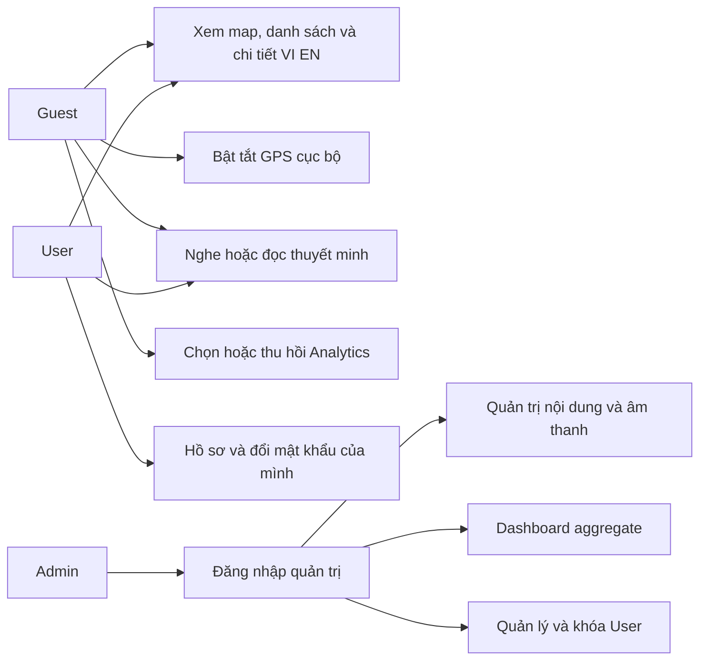
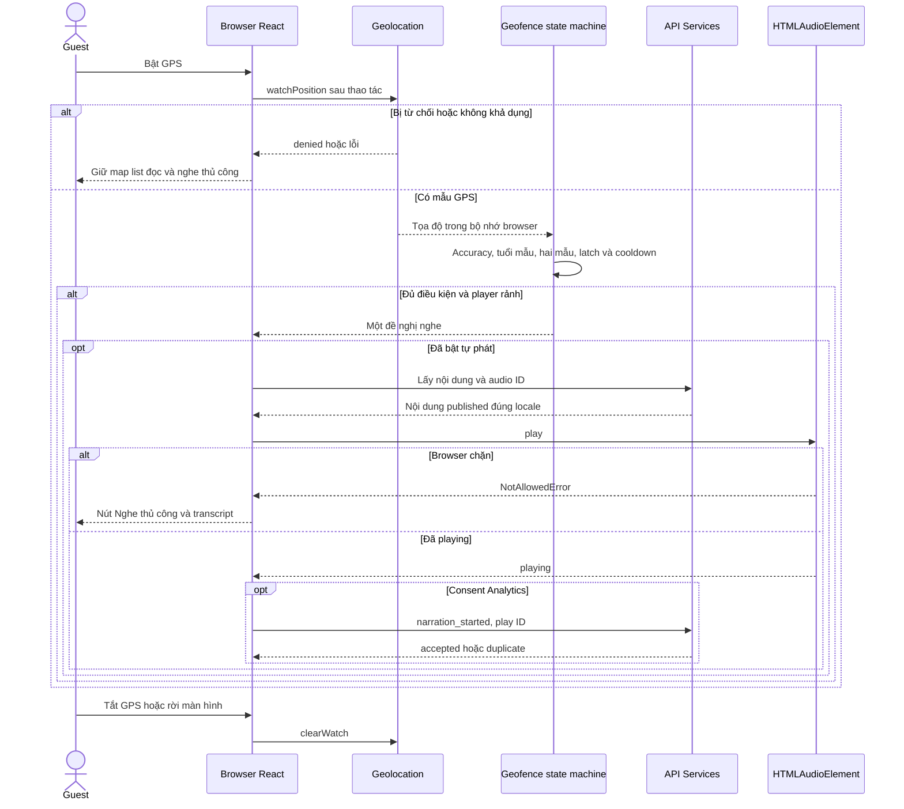
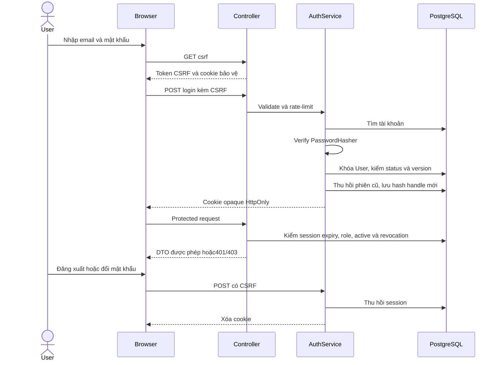
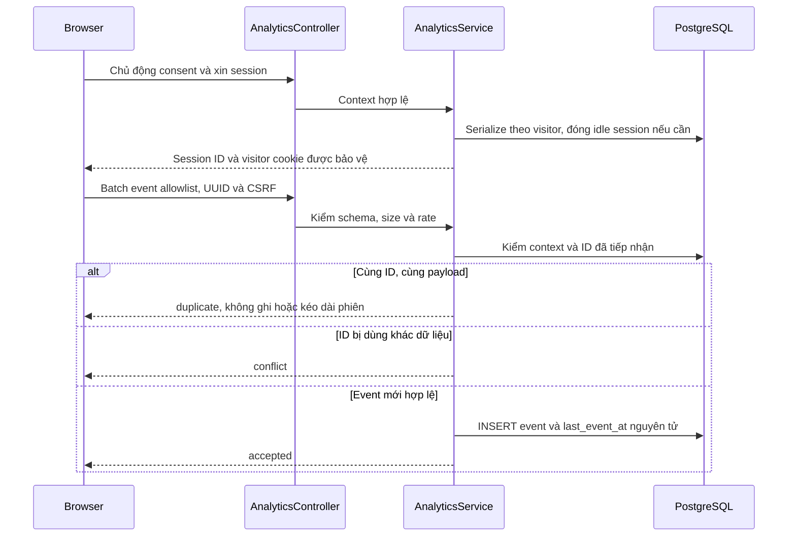
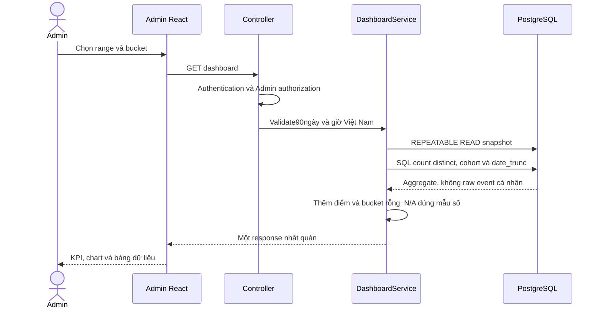

# Luồng nghiệp vụ và thiết kế tương tác

Cơ sở: PRD1.1, ERD, API Specification. Sơ đồ là thiết kế phản ánh implementation, không là bằng chứng deploy public hoặc GPS thực địa.

## 1. Use cases theo actor

User/Admin chỉ có quyền server đã xác minh; đường nối actor không thay backend authorization. Guest không có bản ghi tài khoản.

## 2. GPS và âm thanh

Không có tọa độ khách truyền đến API. Pause/resume giữ play ID; replay có ID mới. Completion chỉ gửi sau start được xác nhận và ended; server xác minh matching, elapsed và thời lượng. Đổi transcript phải cập nhật audio phù hợp trước khi công khai lại.

## 3. Xác thực và thu hồi

## 4. Ghi event và chống trùng

Dữ liệu client không được coi là bằng chứng danh tính, hiện diện hoặc nghe thật. Không có quyền sửa KPI trực tiếp. Từ chối/thu hồi dừng đo và không cản du lịch.

## 5. Dashboard

